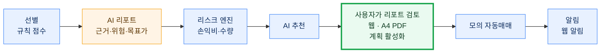
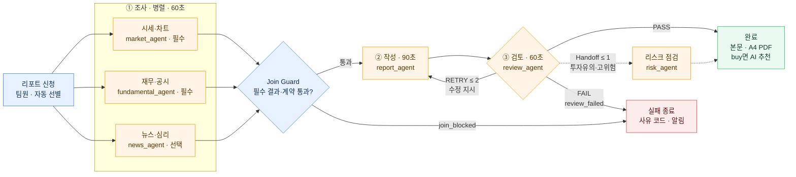
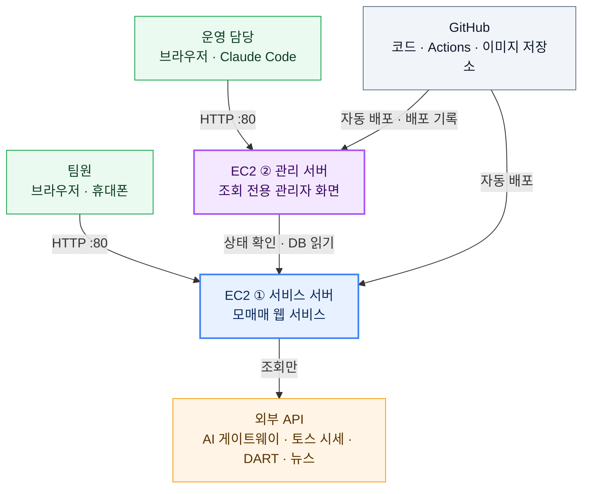
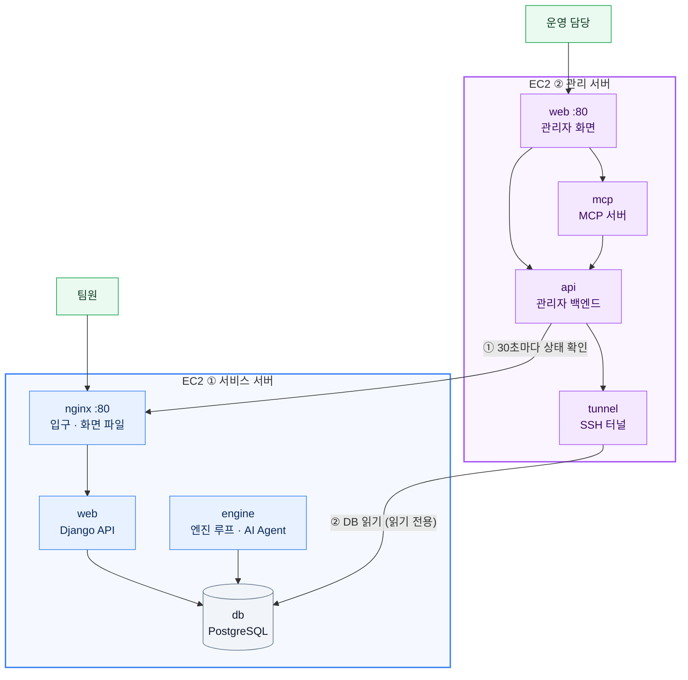
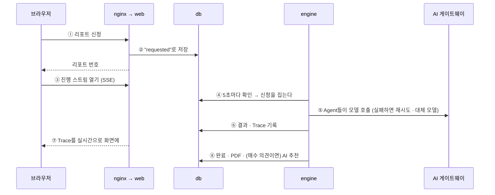

# 모매매 — 분석부터 모의매매까지, AI 투자 에이전트

주식이 처음인 사람도 AI 에이전트가 분석한 투자 리포트를 바탕으로 종목을 이해하고, 직접 투자 판단을 내린 뒤 모의 자동매매까지 경험할 수 있는 팀 기반 모의투자 서비스입니다.

AI는 시장·재무·뉴스 데이터를 분석해 투자 근거와 위험 요소를 제안하고, 최종 투자 결정과 매매 계획 활성화는 사용자가 직접 수행합니다.

## 팀원과 역할

다섯 명이 AI 리포트 워크플로우의 한 층씩을 맡아 설계·구현·테스트했습니다. 담당별 기여와 커밋·PR은 **[팀원별 업무 분장과 기여 내용](docs/evaluation/팀원별_업무분장_기여.md)**에 있습니다.

| 담당 | 팀원 | 맡은 일 |
|---|---|---|
| 1. 팀장·통합 | 심환석 | 저장소·CI/CD·EC2 배포, 담당 간 계약 문서, 추천 → 자동매매 연결과 자동 리포트, 관리 서버 |
| 2. Worker | 한다영 | Worker 출력 계약 6종과 공통 인터페이스, 조사·작성·검토 Worker, 하루 AI 비용 예산 |
| 3. Orchestrator | 신유빈 | YAML 실행 계획(Registry) 검증, Orchestrator 실행 흐름과 timeout 대체 정책 |
| 4. AutoHealing | 김인혜 | 재시도·대체 모델·Circuit Breaker, 장애 주입, 복구 지표 API |
| 5. 프론트 | 차성주 | 공통 오류 화면, 오류·복구 시연과 Agent Workflow 시연 화면, 발표 자료 |

## 서비스 흐름 · AI Agent 워크플로우 · ERD

### 서비스 흐름



- **AI는 제안만 한다.** 지표 계산·사실 검증·수량·한도·체결은 결정론적 코드(리스크 엔진, 모의 체결기)가 정한다. 모의 자동매매에 넣을 돈은 사용자가 정한다 (내 자금의 % 또는 금액).
- **최종 결정은 사람이 한다.** 사용자가 리포트를 읽고 직접 계획을 활성화해야 모의 자동매매가 시작된다.

### AI 리포트 Agent 워크플로우



- 정의는 YAML Registry(`backend/reports/orchestration/team_definitions.yaml`·`worker_definitions.yaml`), Worker 출력 계약은 `guardrails/contracts.py` (경로는 모두 `backend/reports/` 기준).
- 모든 AI 호출은 `autohealing/healing.py`를 거친다: 같은 모델 재시도 → 대체 모델 → Circuit Breaker (주 모델이 시간 초과면 다시 기다리지 않고 바로 대체 모델). 호출 한 번은 **최대 4회** 시도한다 (모델마다 2회까지). 진행은 `orchestration/state.py`가 Shared State·Trace로 남기고 SSE로 화면에 보낸다.
- 실행은 `orchestration/orchestrator.py`(병렬·Join Guard·부분 실패·검토 반복·Handoff Guard)와 `orchestration/runner.py`(엔진 루프에서 한 번에 하나), Worker는 `agents/report_team/`·`agents/selection_team/` (2026-10-07 구현).
  종목 선정까지 AI 팀으로 하는 하루 파이프라인(규칙 후보 30 → 선정 팀 → 선정 Guard → 자동 리포트 3개, `AUTO_REPORT=on`)은 [docs/design/AI_AGENT_WORKFLOW.md](docs/design/AI_AGENT_WORKFLOW.md).

### ERD


표 이름은 실제 `db_table`이고 열은 핵심만 적었다. 이 밖에 FK 없는 표: `notification_outbox`(Discord 보낼 글), `daily_move_notes`(오늘의 내 종목 뉴스), `analysis_run_files`(분석 파일 색인), `engine_status`(엔진 동작 기록 — 관리 서버가 읽는다).
워크플로우가 쓰는 표의 자세한 열은 [docs/design/AI_AGENT_WORKFLOW.md](docs/design/AI_AGENT_WORKFLOW.md) 0장, 엔진 CLI의 기록 저장소(`data/trading.db`)는 `docs/DECISIONS.md` 4장.

## 시스템 구조 — 큰 그림에서 한 단계씩 안으로

위의 Agent 워크플로우가 **어디서 도는지**를 큰 그림부터 확대해 본다. 자세한 설명은 [산출물 2의 0장](docs/deliverables/02_배포_및_장애복구_보고서.md#0-배포-구성--큰-그림에서-서버-안까지).

| 확대 | 그림 | 보이는 것 |
|---|---|---|
| 1단계 | [전체 그림](#1단계--전체-그림) | 서버 두 대(EC2 ①·②), GitHub, 외부 API |
| 2단계 | [두 서버 안과 사이](#2단계--두-서버-안과-서버-사이) | 서버마다 도는 컨테이너, 두 서버가 주고받는 것 |
| 3단계 | [리포트 한 건의 길](#3단계--리포트-한-건이-지나가는-길-서비스-서버-안) | 서비스 서버 안에서 요청이 컨테이너를 지나는 순서 |
| 4단계 | [Agent 워크플로우](#ai-리포트-agent-워크플로우) (위) | 엔진 컨테이너 안의 Orchestrator와 Agent |

### 1단계 — 전체 그림



- **EC2 ① 서비스 서버** — 팀원이 쓰는 모매매 전체(화면·API·엔진·DB).
- **EC2 ② 관리 서버** — 운영 담당이 장애·복구·배포·AI 비용을 보는 **조회 전용** 관리자 화면과 MCP 서버. 서비스와 서버를 나눠, 관리 서버가 멈춰도 서비스는 그대로 돈다.
- **GitHub** — `main`에 push하면 검사를 통과한 버전만 두 서버에 자동 배포한다 ([산출물 3](docs/deliverables/03_파이프라인_구현결과_보고서.md)).
- **외부 API는 조회만** 한다: AI 게이트웨이(DevPass), 토스증권 시세, DART 공시·재무, Google 뉴스. 증권사 주문 API는 부르지 않는다 (실주문 코드 0건 — CI가 검사).

### 2단계 — 두 서버 안과 서버 사이



| 서버 | 컨테이너 | 하는 일 |
|---|---|---|
| EC2 ① | `nginx` | 유일한 입구(80). React 빌드 파일을 내주고 `/api`를 web으로 넘긴다 |
| | `web` | Django API: 로그인, 계좌·주문, 리포트 신청, 진행 스트림(SSE) |
| | `engine` | 5초마다 도는 엔진 루프: 모의 체결·청산, **AI 리포트 실행(Orchestrator·Agent)**, 매일 08:00 자동 리포트, 추천·자동매매, 알림, A4 PDF |
| | `db` | PostgreSQL 16 — 위 ERD의 모든 표 |
| | `redis` · `migrate` | 엔진 CLI용 Redis, 띄울 때 한 번 도는 DB 마이그레이션 (그림에서 뺐다) |
| EC2 ② | `web` | 관리자 화면, `/api/admin`·`/mcp` 길 안내 |
| | `api` | 관리자 백엔드 — 서비스 상태·엔진 상태·배포 기록·리포트 장애·복구 지표·AI 비용을 계산 (읽기만) |
| | `mcp` | Claude Code에서 쓰는 조회 도구 9개 |
| | `tunnel` | 서비스 DB로 가는 SSH 터널 |

두 서버 사이에 오가는 것은 둘뿐이고, 모두 **관리 서버 → 서비스 서버** 방향이다 (서비스는 관리 서버를 모른다).

| # | 무엇 | 어떻게 |
|---|---|---|
| ① | 서비스가 살아 있나 | 30초마다 `GET /api/health`·`GET /`을 불러 가동률·응답 시간을 낸다 |
| ② | 리포트·Trace·엔진 상태·비용 같은 표 | SSH(22) 터널로 서비스 서버 안의 DB 포트(`127.0.0.1:15432`)에만 붙는다. 터널 전용 사용자(셸 없음)와 읽기 전용 DB 계정. DB 포트는 인터넷에 열지 않는다 |

이 밖에 GitHub Actions가 두 서버에 각각 배포하고, 서비스 배포 결과(`success`·`rolled_back`·`blocked` 등)를 관리 서버의 배포 기록에 한 줄 남긴다.

### 3단계 — 리포트 한 건이 지나가는 길 (서비스 서버 안)



- **웹은 AI를 부르지 않는다.** 오래 걸리는 일은 engine이 하고, web과 engine은 DB로만 이야기한다. 그래서 리포트가 도는 중에도 화면은 느려지지 않는다.
- ⑤의 안쪽이 위의 [AI 리포트 Agent 워크플로우](#ai-리포트-agent-워크플로우)다. Agent 하나의 호출이 실패하면 무엇을 하는지는 [산출물 1의 8장](docs/deliverables/01_멀티에이전트_아키텍처_설계서.md#8-정상재시도실패종료-흐름).
- 진행 스트림이 끊기면 화면은 3초 폴링으로 바꿔 계속 갱신한다.

## 평가 기준과 산출물

과제 주제는 **에러 자가 치유(AutoHealing) 워크플로우**다 — 여러 에이전트의 협업 구조를 설계하고, 장애를 감지·판단·복구하는 흐름을 구현해 배포한 뒤
장애 시험으로 복구 결과를 검증한다 ([평가 기준](docs/evaluation/프로젝트평가기준.md)). 산출물은 [`docs/deliverables/`](docs/deliverables/)에 번호를 붙여 둔다.

### 필수 산출물

| 산출물 | 문서 | 담은 것 |
|---|---|---|
| ① 멀티 에이전트 아키텍처 설계서 | [01_멀티에이전트_아키텍처_설계서.md](docs/deliverables/01_멀티에이전트_아키텍처_설계서.md) | 목적·시나리오, Supervisor(코드) 중앙 조정형과 선정 이유, Agent 11개의 역할·입출력, Handoff 전달 데이터, Shared State·Trace, 정상·재시도·실패·종료 흐름, 역할 중복·공백 점검 |
| ② 배포 및 장애 복구 보고서 | [02_배포_및_장애복구_보고서.md](docs/deliverables/02_배포_및_장애복구_보고서.md) | 서버 두 대·컨테이너·통신·시크릿·상태 확인, 장애 유형별 감지·복구, 장애 주입 시험 설정과 결과, 자동 복구율·평균 복구시간, 수동 개입과 알림, 실패 사례 |
| ③ 파이프라인 구현 결과 보고서 | [03_파이프라인_구현결과_보고서.md](docs/deliverables/03_파이프라인_구현결과_보고서.md) | 커밋 → 검사 → 이미지 → 배포 → 되돌리기, 단계별 성공 조건·실패 처리, 테스트 데이터와 통과 수, 배포 차단 실제 기록, 실행 결과(실행 번호·커밋·시각·링크) |

### 핵심 수행내용은 어디에

| 핵심 수행내용 (가이드) | 구현 | 문서 |
|---|---|---|
| 에이전트 협업 시나리오와 역할 구조 설계 | YAML 실행 계획(`backend/reports/orchestration/*_definitions.yaml`), Agent 11개(`backend/reports/agents/`) | 산출물 1의 1~6장 |
| 장애 유형별 복구 로직 및 자동화 파이프라인 구현 | `backend/reports/`의 재시도·대체 모델·Circuit Breaker(`autohealing/healing.py`), Join·Handoff Guard(`guardrails/guards.py`), 장애 주입(`autohealing/chaos.py`), 하루 파이프라인과 Fallback(`autoreport/auto.py`) | 산출물 1의 8장, 산출물 2의 1~4장 |
| 협업 기반 실행 흐름 통합 구현 | Orchestrator(`backend/reports/orchestration/orchestrator.py`) → 리포트·PDF(`reports/output/`) → 리스크 엔진 → AI 추천(`autotrade/recommend/`) → 계획 활성화 → 모의 자동매매(`autotrade/plans/`) → 알림 | 산출물 1의 2·4장 |
| 서비스 배포 및 결과 검증 | EC2 두 대 + Docker Compose, GitHub Actions(`ci.yml`·`deploy.yml`·`admin-*.yml`), 관리 서버 복구 지표 | 산출물 2·3 |

### 평가 항목별로 보여 줄 것

| 평가 항목 | 배점 | 보여 줄 것 | 근거 |
|---|---|---|---|
| 프로젝트 기획 및 목표 달성도 | 25 | 핵심 수행내용 네 가지를 모두 구현해 운영 서버에서 돈다. "AI는 제안, 코드는 검증, 사람이 결정" 원칙으로 초보자의 문제를 푼다 | 위 표, 산출물 1 |
| 서비스 완성도 및 활용 가능성 | 35 | 운영 주소에서 로그인 → AI 리포트(약 2분) → 계획 활성화 → 모의 자동매매 → 알림까지 실제로 돈다. 매일 08:00 자동 리포트, 주린이모드(쉬운 보기), 모바일 화면, 관리 서버 | [운영 E2E 점검](docs/records/운영E2E점검_UX리뷰_2026-10-08.md) |
| 프로젝트 수행 과정 및 개선 노력 | 20 | 결정 기록 27장, 브랜치 리뷰 문서, 실패 사례와 개선 이력 — 검사 실패가 실제로 배포를 막은 기록, 리뷰에서 찾아 고친 결함 | [DECISIONS](docs/DECISIONS.md), [docs/works/](docs/works/), 산출물 2의 6장, 산출물 3의 4·8장 |
| 발표 구성 및 전달력 | 20 | 큰 그림 → 서버 → Agent → 복구 순서로 설명, 시연(정상 → 장애 주입 → 복구 → 배포 차단) | 발표 자료, [docs/plans/TEAM_DEV_PLAN.md](docs/plans/TEAM_DEV_PLAN.md) 9장 시연 순서 |

### 실행 정보

| 항목 | 값 |
|---|---|
| 서비스 (EC2 ①) | http://52.78.101.101 — HTTP만. 상태 확인 `/api/health` |
| 관리 서버 (EC2 ②) | http://54.116.203.153 — 서비스의 staff 계정으로 로그인 |
| 저장소 | https://github.com/SHS5029/paper_trading (비공개) |
| 파이프라인 | https://github.com/SHS5029/paper_trading/actions — `Deploy`(main), `CI`(브랜치·PR), `Admin CI`·`Admin Deploy`(관리 서버) |
| 모니터링·로그 | 관리 서버의 서비스 상태·엔진 상태·배포 기록·리포트 장애·복구 지표·AI 비용 메뉴. 컨테이너 로그는 서버에서 `docker compose logs` |
| 실행 환경 | AWS EC2(Ubuntu 26.04) 두 대 + Docker Compose. 서비스: nginx · Django(gunicorn) · 엔진 루프 · PostgreSQL 16 · Redis 7. 관리 서버: nginx · FastAPI · MCP · SSH 터널 |
| 테스트 계정 | 회원 가입 화면은 없다. 팀원 계정 5개·관리자 1개를 관리 명령(`create_team_accounts`)으로 만들고, 아이디·비밀번호는 git에 넣지 않는 파일(`team_accounts.txt`·`admin_account.txt`)로 전한다 |
| AI·외부 API | DevPass LLM 게이트웨이(gemini-3.8-flash · gpt-5.6-luna · claude-opus-5-5 · deepseek-v4.1-flash), 토스증권 시세 조회, DART OpenAPI, Google 뉴스 RSS |
| 프로젝트 기간 | 2026-10-02 ~ 2026-10-13 (발표) |

## 기술 스택

| 영역 | 기술 | 어디에 쓰나 |
|---|---|---|
| 백엔드 | Python 3.12 · Django 5.2 · DRF · drf-spectacular · gunicorn | 웹 API(`backend/` 앱 7개, 세션 인증), OpenAPI `/api/schema/`, 엔진 루프 `run_engine` |
| 매매 엔진 | Python 표준 라이브러리만 | 선별·AI 교차검증·리스크 엔진·모의 체결(`engine/paper_engine`), 엔진 CLI |
| DB | SQLite · PostgreSQL 16 (psycopg) | 혼자 개발·테스트 / 공유 개발 DB·운영 — `.env`의 `POSTGRES_HOST`로 고른다 |
| 캐시·실시간 | Django LocMemCache · Redis 7 · SSE | 웹의 시세·조회 캐시 / 엔진 CLI 상주 루프·예약(`paper:` 키) / 리포트 진행 화면 |
| 프론트 | React 19 · TypeScript · Vite · Tailwind CSS 4 · TanStack Query · React Router · lightweight-charts · react-markdown | 화면 SPA(`frontend/`), 서버 상태 폴링, 차트, 리포트 본문 |
| AI | DevPass LLM Gateway (OpenAI 호환) | AI 교차검증 분석, 리포트 Worker 호출(`reports/autohealing/healing.py`), 장기투자 뉴스 문장 |
| 외부 데이터 | 토스증권 API(조회 전용) · DART OpenAPI · Google 뉴스 RSS | 시세·일봉·순위·종목 정보(조회만) · 공시·재무 · 뉴스 제목. 키움 REST 클라이언트도 남아 있어 `BROKER=kiwoom`으로 바꿀 수 있다 |
| PDF·알림 | Chrome headless · 웹 알림(DB) · Discord Webhook | 리포트 A4 PDF · 단계별 알림 (Discord는 2026-10-08부터 꺼 둠) |
| 관리 서버 | FastAPI · psycopg · MCP Python SDK · React | 조회 전용 관리자 API·화면·MCP 도구 (`admin/`). 서비스 코드에 기대지 않게 가볍게 따로 만들었다 |
| 배포 | Docker Compose · nginx · GitHub Actions · GHCR · AWS EC2 두 대 | 서비스(nginx·web·engine·db·redis)·관리 서버(web·api·mcp·tunnel), 검사 → 이미지 → 서버 배포 → 실패 시 되돌리기 |
| 검사 도구 | uv · ruff · pytest · ESLint · Vitest · Testing Library · MSW | 파이썬 의존성·린트·테스트, 프론트 린트·테스트·가짜 API(`VITE_MOCK=1`) |

버전·구성의 자세한 내용은 [docs/plans/TEAM_PAPER_TRADING_PLAN.md](docs/plans/TEAM_PAPER_TRADING_PLAN.md) 2장.

### 수업 기술 대신 React/TS·Django·uv를 쓴 이유

<details>
<summary>펼쳐 보기 — 세 가지 기준과 Streamlit·FastAPI·pip+venv 대비</summary>

정규 수업은 화면을 Streamlit, API를 FastAPI로 만들고 패키지는 pip, 가상환경은 venv로 관리한다.
이 프로젝트는 혼자 보는 분석 도구가 아니라 **팀원 다섯이 각자 로그인해 자기 모의 계좌를 쓰고, 백그라운드 엔진 루프가 체결·자동매매·리포트를 돌리는 웹 서비스**라서 아래 세 기준으로 다시 골랐다.

1. 여러 사용자가 동시에 쓰는 서비스 구조(로그인·계좌 분리·백그라운드 작업·운영 배포)를 무리 없이 만들 수 있는가
2. 여러 사람이 화면·API·엔진을 나눠 개발해도 계약과 자동 검사로 어긋남을 잡을 수 있는가
3. 팀원 PC(macOS·WSL2)·CI·운영 서버에서 같은 버전이 깔리고 같은 결과가 나오는가

| 수업 | 이 프로젝트 | 한 줄 이유 |
|---|---|---|
| Streamlit | React + TypeScript (Vite) | 로그인한 사용자별 모바일 앱 화면, 실시간 진행 화면, 프론트·백엔드 분업이 필요하다 |
| FastAPI | Django + DRF | 로그인·관리자 화면·ORM·마이그레이션·관리 명령이 기본으로 들어 있고, 엔진이 동기 코드라 async 이점이 작다 |
| pip + venv | uv | 잠금 파일(`uv.lock`)로 모든 환경의 버전을 맞추고, 엔진·백엔드를 작업 공간으로 나눈다 |

**화면: Streamlit → React + TypeScript**

- Streamlit은 데이터 앱용이다. 위젯을 누를 때마다 파이썬 스크립트 전체를 다시 실행하고, 상태는 서버 메모리의 브라우저 탭별 세션에 둔다.
  분석 대시보드를 빨리 만들기에는 좋지만, 이 서비스는 팀원마다 계좌·주문·알림이 따로 있고 하단 탭(홈·종목·리포트·모의투자·마이)과 상세 화면으로 이동하는 모바일 우선 앱이다.
- 필요한 화면 요소가 Streamlit 기본 부품 밖에 있다: 화면 전환 모션, 다크 모드 색 토큰, 일봉 차트(lightweight-charts), 리포트 Agent 진행 그래프의 실시간 갱신(SSE, `frontend/src/api/reports.ts`), 주린이모드 쉬운 보기.
  React는 이것을 컴포넌트로 만들어 여러 화면에서 다시 쓴다 (`components/ui.tsx`, `components/motion/`).
- 화면과 API를 나눠 개발할 수 있다. 프론트는 `docs/API.md` 계약만 보고 만들고, 백엔드 없이 가짜 API(`VITE_MOCK=1`, MSW)로 돌려 본다.
  Streamlit은 화면과 서버 로직이 한 파이썬 프로세스에 묶여 담당을 나누기 어렵다.
- TypeScript가 API 응답 형식을 타입으로 적어 두므로 필드 이름·형식이 어긋난 곳을 CI의 `tsc --noEmit`이 찾는다. 화면 동작은 Vitest·Testing Library로 검사한다.
- 빌드 결과가 정적 파일이라 운영에서는 nginx가 바로 내보낸다. Streamlit처럼 접속자마다 서버에 WebSocket 세션과 스크립트 실행을 붙잡지 않는다.

**백엔드: FastAPI → Django + DRF**

- 이 서비스에 필요한 것이 Django에 기본으로 있다: 세션 로그인 + CSRF, 관리자 화면(`/admin`, 앱 7개의 모델 등록), ORM과 마이그레이션, 관리 명령(`run_engine`·`create_team_accounts`·`demo_recommend`·`auto_report` 등).
  FastAPI는 가벼운 대신 ORM(SQLAlchemy)·마이그레이션(Alembic)·인증·관리자 화면을 따로 골라 붙여야 하고, 붙이는 방식이 사람마다 달라지기 쉽다.
- 같은 모델·마이그레이션으로 DB 둘을 쓴다. 혼자 개발할 때는 SQLite, 공유 개발 DB·운영은 PostgreSQL을 `.env`의 `POSTGRES_HOST` 하나로 고르고,
  CI가 `makemigrations --check`와 PostgreSQL 테스트로 두 쪽을 확인한다.
- 매매 엔진은 표준 라이브러리(`urllib`)만 쓰는 동기 코드다. FastAPI의 async 장점은 동기 호출에서는 거의 나지 않는다 (동기 함수는 어차피 스레드 풀에서 돈다).
  Django에서는 엔진을 그대로 불러 쓰고(`backend/config/engine.py`), 엔진 루프 `manage.py run_engine`도 웹과 같은 모델·설정을 써서 작업 서버를 따로 두지 않는다.
- FastAPI의 장점은 DRF로 챙겼다: 요청·응답 검증은 serializer, 자동 API 문서(OpenAPI)는 drf-spectacular(`/api/schema/`).

**패키지·가상환경: pip + venv → uv**

- `uv.lock`에 간접 의존성까지 정확한 버전을 적는다. 팀원 PC, CI(`uv sync --frozen`), 운영 이미지(`deploy/Dockerfile`의 `uv sync --frozen --no-dev`)가 같은 버전을 설치한다.
  pip의 `requirements.txt`는 버전을 직접 고정하지 않으면 설치하는 날마다 간접 의존성 버전이 달라질 수 있다.
- 작업 공간(workspace)으로 엔진(`engine/`, 의존성 0개)과 백엔드(`backend/`, Django 등)를 패키지 둘로 나눠 한 번에 설치한다.
  "엔진은 표준 라이브러리만" 규칙이 `engine/pyproject.toml`의 빈 `dependencies`로 드러난다.
- `uv sync` 한 번이 가상환경(`.venv`) 만들기·파이썬 3.12 받기(없을 때)·의존성 설치를 다 하고, `uv run ...`은 가상환경을 켜지 않고 그 환경에서 실행한다.
  운영체제마다 다른 `activate` 안내가 필요 없어 설치 안내([docs/guides/SETUP_PROMPT.md](docs/guides/SETUP_PROMPT.md))가 단순해진다. 설치도 pip보다 빠르고 CI는 `uv.lock` 기준으로 캐시한다.
- venv·pip과 호환된다. uv가 만드는 `.venv`는 표준 venv 구조이고, `uv pip install ...`처럼 pip 명령도 쓸 수 있다. `requirements.txt`가 필요하면 `uv export --format requirements-txt`로 뽑는다.

**대가와 대응**

| 대가 | 대응 |
|---|---|
| 수업 밖 도구라 익히는 시간이 든다 | 실행은 `scripts/dev.sh`, 설치는 `docs/guides/SETUP_PROMPT.md` 한 번으로 끝난다 |
| 언어·패키지 관리자가 둘씩(Python·TS, uv·npm)이다 | CI가 두 쪽을 함께 검사한다 |
| 리포트 SSE 연결이 스레드를 하나씩 잡는다 | gunicorn 스레드 16개, 끊기면 3초 폴링으로 바꾼다 |

</details>

## 지금 상태 (2026-10-09)

| 기능 | 상태 |
|---|---|
| AI 리포트 Agent 워크플로우 — Orchestrator·Agent 11개·Join/Handoff Guard·검토 반복, State·Trace·SSE, A4 PDF, 쉬운 보기, 끝 알림 | **운영에서 실제 모델로 동작** (2026-10-08 운영 점검: 리포트 1건 122초·$0.196, 검토가 한 번 고쳐 쓰게 한 뒤 통과) |
| 하루 파이프라인 — 규칙 후보 → AI 선정 팀 → 선정 Guard → 자동 리포트 3개 | 운영에서 켬 (`AUTO_REPORT=on`, 국내 거래일 08:00) |
| AutoHealing — 재시도·대체 모델·Circuit Breaker, 장애 주입, 복구 지표 API, 팀 하루 AI 예산 | 구현·테스트 완료 (시나리오 테스트 `test_dr_scenarios.py`). 운영 시험: DR-LLM-01 통과 (리포트 #61, 시간 초과 → 대체 모델 6.3초 복구), 같은 리포트에서 검토 RETRY → PASS (DR-CRT-01). 운영 7일 호출 장애 자동 복구율 100% (7/7, 평균 10.6초). 나머지는 산출물 2의 5장에 채우는 중 |
| 추천 → 계획 활성화 → 모의 자동매매 → 알림 | 운영 점검 통과 (리포트 → 계획 제안 → 실행 → 체결 → 멈추기(전량 매도) → 알림) |
| 모의 계좌·주문 — 팀원별 계좌, 시장가·지정가, 장 밖 예약, 목표·손절 청산, 보유 방식 스윙·장기 | 동작 (장중 지정가 체결·자동 청산 실측은 아직) |
| 종목·차트 — 시세는 실시간(토스 조회), 계좌 평가·랭킹은 장마감 기준 | 동작 |
| 장기투자 — "왜 샀나요?", 오늘의 내 종목 뉴스, 펀더멘털 점검 | 동작 (정해진 시각의 실제 실행 확인은 아직) |
| 주린이모드·화면 — 쉬운 보기, 하단 탭(홈·종목·리포트·모의투자·마이), 다크 모드 | 동작 |
| 알림 — 웹 알림, Discord Webhook | 웹 동작, Discord는 꺼 둠 (2026-10-08 결정) |
| 관리 서버 (EC2 ②) — 서비스·엔진 상태, 배포 기록, 리포트 장애, 복구 지표, AI 비용, MCP | 동작 (2026-10-08) |
| CI/CD — 검사 실패 시 배포 차단, 실패 시 되돌리기 | 동작 (운영 배포 24회 모두 성공, 검사 실패로 배포가 막힌 실제 기록 — 산출물 3) |
| AI 교차검증 분석 — 팀원별·팀 하루 한도 | 구현됨 (실제 AI 실행은 CLI 1건만 확인) |
| 엔진 CLI·백테스트 | 동작 (웹 계좌와 별개) |
| ~~단타 연습~~ | 2026-10-06 폐기 |

자세한 상태·근거는 [docs/plans/TEAM_PAPER_TRADING_PLAN.md](docs/plans/TEAM_PAPER_TRADING_PLAN.md), 남은 결정·확인은 [docs/결정필요사항.md](docs/결정필요사항.md).

## 설치

**팀원**: 호스트 PC 담당자에게 받은 `.env.team`을 AI 코딩 에이전트(Claude Code, Codex 등)에 주고 "이 `.env.team` 파일로 세팅해 줘"라고 하면
클론부터 서버 실행까지 진행한다. 이미 클론했으면 "`docs/guides/SETUP_PROMPT.md`를 읽고 그대로 진행해 줘" ([docs/guides/SETUP_PROMPT.md](docs/guides/SETUP_PROMPT.md)).
`.env`·`.env.team`에는 비밀 값이 들어가므로 커밋하지 않는다.

**Windows**: 먼저 [docs/guides/WSL2_SETUP.md](docs/guides/WSL2_SETUP.md)로 WSL2 Ubuntu와 VS Code 연결을 준비한다 (WSL이 아닌 Windows에서는 돌지 않는다).

직접 하려면 (macOS·Linux·WSL2):

```bash
cp .env.example .env              # 키를 채운다 (커밋하지 않는다)
uv sync                           # 엔진 + 백엔드 + 개발 도구
cd frontend && npm ci
```

## 웹 실행 (로컬 개발)

```bash
scripts/dev.sh            # (PostgreSQL 컨테이너 +) Django API + 엔진 루프 + 프론트엔드를 한 번에 (다시) 띄운다. 끝나면 주소와 DB 위치를 보여 준다
scripts/dev.sh stop       # 전부 내린다          · status · logs [backend|engine|frontend] · db (DB 셸) · db-stop · import-sqlite
```

- 프론트엔드는 `0.0.0.0`에 떠서 같은 네트워크의 휴대폰·다른 PC에서 `http://<이 PC의 IP>:5173`으로 볼 수 있다. Django는 이 PC에서만 접근한다.
- 8000·5173 포트가 사용 중이면 다음 빈 포트를 알아서 쓴다.
- DB는 `.env`의 `POSTGRES_HOST`로 고른다: 비어 있으면 SQLite(`backend/db.sqlite3`), `127.0.0.1`이면 이 PC에 PostgreSQL 컨테이너를 띄우고,
  호스트 PC의 IP면 팀이 같이 보는 개발 DB를 쓴다. 접속 방법은 [docs/plans/TEAM_DEV_PLAN.md](docs/plans/TEAM_DEV_PLAN.md) 12장.
- 로그인 아이디·비밀번호는 `team_accounts.txt`에 있다. 팀원마다 모의 계좌(초기 자금 `PAPER_CAPITAL_KRW`)가 하나씩 생긴다.

하나씩 직접 띄우려면:

```bash
cd backend && uv run python manage.py migrate                # DB 표
cd backend && uv run python manage.py create_team_accounts   # 팀원 계정 5개 → team_accounts.txt (git 제외, 다시 실행해도 안전)
cd backend && uv run python manage.py runserver              # Django API (기본 127.0.0.1:8000. .env에 DJANGO_DEBUG=on)
cd backend && uv run python manage.py run_engine             # 엔진 루프: 체결·청산·예약·일별 자산·AI 분석·추천 수집·리포트 알림·자동 추천·자동매매·장기투자·알림 발송
cd frontend && npm run dev                                   # 화면 (http://localhost:5173, /api·/admin을 127.0.0.1:8000으로 프록시)
```

- Django를 다른 포트에 띄웠으면 `VITE_API_TARGET=http://127.0.0.1:8001 npm run dev`.
- 백엔드 없이 화면만 볼 때는 `VITE_MOCK=1 npm run dev` (가짜 API).
- 시연용 추천(AI 아님): `cd backend && uv run python manage.py demo_recommend --symbol 005930` · 선별 상위로 `auto_recommend --force`.

## 검사

```bash
uv run ruff check . && uv run pytest     # 엔진·백엔드 (SQLite 메모리 DB, 외부 API는 전부 가짜 객체)
uv run pytest backtest                   # 백테스트
cd frontend && npx eslint . && npx tsc --noEmit && npx vitest run && npx vite build
```

push하면 GitHub Actions가 같은 검사를 돌린다. `main`은 검사를 통과해야 배포된다.

## 구조

```
engine/paper_engine/   매매 엔진 — 표준 라이브러리만: agents(AI 교차검증·모의 체결기) · data(조회·장 달력) · judge(리스크 엔진·손절) · records(기록) · longterm
backend/               Django 앱. 루트에는 Django 자리(models·views·urls …)만, 기능 코드는 기능 폴더 (docs/DECISIONS.md 29장)
  reports/             AI 리포트: agents/(report_team·selection_team — Worker 11개) · orchestration/(Orchestrator·YAML Registry·State·Trace)
                       · guardrails/(Guard·출력 계약) · autohealing/(재시도·대체 모델·Circuit Breaker·장애 주입·복구 지표)
                       · autoreport/(하루 파이프라인·선정 Guard) · output/(PDF·알림) · limits/(하루 한도·AI 예산)
  autotrade/           recommend/(리포트·분석 → 추천) · plans/(리스크 미리 보기·모의 자동매매 진행)
  accounts/ trading/   로그인·프로필·주린이모드 / 계좌·주문·시세·랭킹·run_engine
  analysis/ notifications/ longterm/   AI 교차검증 분석 / 웹 알림·Discord / 장기투자
frontend/src/          React + TypeScript + Vite + Tailwind CSS: pages/ · components/(공용 부품 + 기능 폴더) · api/ · hooks/ · lib/ · test/(화면 테스트)
admin/                 관리 서버 (EC2 ②): server(FastAPI·MCP) · web(관리자 화면) · deploy(compose·SSH 터널)
backtest/              백테스트 (AI 없음, DB 없이 단독 실행)
deploy/                Docker Compose (개발용 Redis·PostgreSQL, 운영 nginx·web·engine·db·redis), 배포 스크립트
docs/                  기준 문서(API·DECISIONS·DEPLOY·KIWOOM) · guides(설치) · plans(계획서) · design(설계) · records(시험 기록)
                       · evaluation(평가 기준·기여) · deliverables(산출물 3종) · tasks(담당별 작업) · works(리뷰) — 지도는 docs/README.md
```

엔진 자체 계좌(웹 계좌와 별개)는 CLI로 조작한다: `uv run python -m paper_engine --help` (명령은 [AGENTS.md](AGENTS.md) "실행").

## 문서

| 문서 | 내용 |
|---|---|
| [docs/deliverables/](docs/deliverables/) | **산출물 3종**: ① 멀티 에이전트 아키텍처 설계서 · ② 배포 및 장애 복구 보고서 · ③ 파이프라인 구현 결과 보고서 |
| [AGENTS.md](AGENTS.md) | 안전 규칙·명령·작업 방식 (AI 에이전트와 팀원 공통) |
| [docs/README.md](docs/README.md) | 문서 지도 — 무엇을 어디서 보나, 새 문서는 어느 폴더에 두나 |
| [docs/guides/SETUP_PROMPT.md](docs/guides/SETUP_PROMPT.md) · [docs/guides/WSL2_SETUP.md](docs/guides/WSL2_SETUP.md) | 클론 직후 설치·실행 (AI 에이전트용) · Windows의 WSL2·VS Code 준비 |
| [docs/plans/TEAM_PAPER_TRADING_PLAN.md](docs/plans/TEAM_PAPER_TRADING_PLAN.md) · [docs/결정필요사항.md](docs/결정필요사항.md) | 지금 상태·남은 작업 · 남은 결정과 다음 시작점 |
| [docs/plans/TEAM_DEV_PLAN.md](docs/plans/TEAM_DEV_PLAN.md) · [docs/tasks/](docs/tasks/) | 팀원이 이어서 할 일과 개발 환경 · 담당별 세부 작업과 담당 간 약속 |
| [docs/API.md](docs/API.md) · [docs/DECISIONS.md](docs/DECISIONS.md) | 웹 API 계약 · 공통 결정 |
| [docs/교육용문서.md](docs/교육용문서.md) · [docs/design/AI_AGENT_WORKFLOW.md](docs/design/AI_AGENT_WORKFLOW.md) | Agent 개념 · 종목 선정 Agent 워크플로우 설계 예시 (오류 복구 포함) |
| [docs/design/DESIGN.md](docs/design/DESIGN.md) · [docs/KIWOOM.md](docs/KIWOOM.md) | 엔진 설계 · 키움 API |
| [docs/design/화면배치.md](docs/design/화면배치.md) | 화면별 배치와 근거 |
| [docs/DEPLOY.md](docs/DEPLOY.md) · [admin/README.md](admin/README.md) | 배포와 CI/CD 설정 · 관리 서버 |
| [docs/evaluation/팀원별_업무분장_기여.md](docs/evaluation/팀원별_업무분장_기여.md) | 담당별 업무와 기여 (커밋·PR) |
| [docs/evaluation/프로젝트평가기준.md](docs/evaluation/프로젝트평가기준.md) | 과제 평가 기준 |

## 배포와 CI/CD (Docker)

push하면 GitHub Actions가 검사한다 (린트 → 실주문 코드 검사 → 테스트 → 프론트 빌드 → 이미지 빌드와 기동 확인). `main`은 검사를 통과하면 이미지를 올리고
서비스 서버(EC2 ①)에 배포하며, 새 버전이 뜨지 않으면 직전 버전으로 되돌린다. 관리 서버(EC2 ②)는 `admin/`이 바뀔 때 `admin-deploy.yml`로 따로 배포한다.
설정은 [docs/DEPLOY.md](docs/DEPLOY.md), 구조와 실제 실행 결과는 [산출물 3](docs/deliverables/03_파이프라인_구현결과_보고서.md).

```bash
cd deploy && cp .env.docker.example .env.docker      # 값을 채운다 (커밋하지 않는다)
docker compose --env-file .env.docker up -d --build   # nginx · web · engine · db · redis
./smoke_test.sh                                       # 띄운 스택 확인
```
