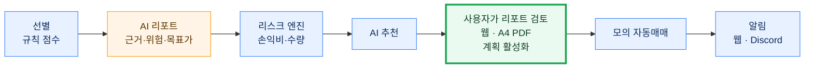

# 모매매 — 팀 모의투자 웹 서비스

주식이 처음인 사람도 **AI 리포트를 만들고 · 읽고 검토하고 · 모의 자동매매로 실행해 보는** 팀 모의투자 웹 서비스다.
시세는 증권사 조회 API로만 받고(운영은 키움 REST, 로컬 개발은 토스 조회), 매매는 팀원별 가상 현금 계좌에서만 체결한다. **실제 주문은 내지 않는다** (실주문 코드 0건).

## 서비스 흐름



- **AI는 제안만 한다.** 지표 계산·사실 검증·수량·한도·체결은 결정론적 코드(리스크 엔진, 모의 체결기)가 정한다.
- **최종 결정은 사람이 한다.** 사용자가 리포트를 읽고 직접 계획을 활성화해야 모의 자동매매가 시작된다.

## 지금 상태 (2026-10-07)

| 기능 | 상태 |
|---|---|
| 모의 계좌·주문 — 팀원별 계좌, 시장가·지정가, 장 밖 예약, 목표·손절 청산, 보유 방식 스윙·장기 | 동작 (장중 지정가 체결·자동 청산 실측은 아직) |
| 종목·차트 — 시세는 실시간, 계좌 평가·랭킹은 장마감 기준 | 동작 |
| AI 교차검증 분석 — 팀원별·팀 하루 한도 | 구현됨 (실제 AI 실행은 CLI 1건만 확인) |
| AI 리포트 — 신청·하루 한도, YAML Registry, State·Trace, SSE, A4 PDF, 쉬운 보기, 끝 알림 | **구조만**. Worker 출력 계약·인터페이스·Registry(`fallbacks`·`retry`)까지 들어왔고, Agent·Orchestrator·AutoHealing은 팀이 구현 중 (`backend/reports/registry.py`의 `AGENTS_IMPLEMENTED = False`) |
| 추천 → 활성화 → 모의 자동매매 → 알림 | 시연판 (규칙 추천 `demo_recommend`로 끝까지 돈다. AI 리포트가 붙으면 리포트 출처 추천이 생긴다) |
| 장기투자 — "왜 샀나요?", 오늘의 내 종목 뉴스, 펀더멘털 점검 | 동작 (정해진 시각의 실제 실행 확인은 아직) |
| 주린이모드·화면 — 쉬운 보기, 하단 탭(홈·종목·리포트·모의투자·마이), 다크 모드 | 동작 |
| 알림 — 웹 알림, Discord Webhook | 웹 동작, Discord는 꺼 둠 |
| 엔진 CLI·백테스트 | 동작 (웹 계좌와 별개) |
| ~~단타 연습~~ | 2026-10-06 폐기 |

자세한 상태·근거는 [docs/TEAM_PAPER_TRADING_PLAN.md](docs/TEAM_PAPER_TRADING_PLAN.md), 남은 결정·확인은 [docs/결정필요사항.md](docs/결정필요사항.md).

## 설치

**팀원**: 호스트 PC 담당자에게 받은 `.env.team`을 AI 코딩 에이전트(Claude Code, Codex 등)에 주고 "이 `.env.team` 파일로 세팅해 줘"라고 하면
클론부터 서버 실행까지 진행한다. 이미 클론했으면 "`SETUP_PROMPT.md`를 읽고 그대로 진행해 줘" ([SETUP_PROMPT.md](SETUP_PROMPT.md)).
`.env`·`.env.team`에는 비밀 값이 들어가므로 커밋하지 않는다.

직접 하려면 (macOS·Linux·WSL2):

```bash
cp .env.example .env              # 키를 채운다 (커밋하지 않는다)
uv sync                           # 엔진 + 백엔드 + 개발 도구
cd frontend && npm ci
```

## 웹 실행 (로컬 개발)

```bash
scripts/dev.sh            # (PostgreSQL 컨테이너 +) Django API + 엔진 루프 + 프론트엔드를 한 번에 (다시) 띄운다. 끝나면 주소와 DB 위치를 보여 준다
scripts/dev.sh stop       # 전부 내린다          · status · logs [backend|engine|frontend] · db (DB 셸) · db-stop · import-sqlite
```

- 프론트엔드는 `0.0.0.0`에 떠서 같은 네트워크의 휴대폰·다른 PC에서 `http://<이 PC의 IP>:5173`으로 볼 수 있다. Django는 이 PC에서만 접근한다.
- 8000·5173 포트가 사용 중이면 다음 빈 포트를 알아서 쓴다.
- DB는 `.env`의 `POSTGRES_HOST`로 고른다: 비어 있으면 SQLite(`backend/db.sqlite3`), `127.0.0.1`이면 이 PC에 PostgreSQL 컨테이너를 띄우고,
  호스트 PC의 IP면 팀이 같이 보는 개발 DB를 쓴다. 접속 방법은 [TEAM_DEV_PLAN.md](TEAM_DEV_PLAN.md) 12장.
- 로그인 아이디·비밀번호는 `team_accounts.txt`에 있다. 팀원마다 모의 계좌(초기 자금 `PAPER_CAPITAL_KRW`)가 하나씩 생긴다.

하나씩 직접 띄우려면:

```bash
cd backend && uv run python manage.py migrate                # DB 표
cd backend && uv run python manage.py create_team_accounts   # 팀원 계정 5개 → team_accounts.txt (git 제외, 다시 실행해도 안전)
cd backend && uv run python manage.py runserver              # Django API (기본 127.0.0.1:8000. .env에 DJANGO_DEBUG=on)
cd backend && uv run python manage.py run_engine             # 엔진 루프: 체결·청산·예약·일별 자산·AI 분석·추천 수집·리포트 알림·자동 추천·자동매매·장기투자·알림 발송
cd frontend && npm run dev                                   # 화면 (http://localhost:5173, /api·/admin을 127.0.0.1:8000으로 프록시)
```

- Django를 다른 포트에 띄웠으면 `VITE_API_TARGET=http://127.0.0.1:8001 npm run dev`.
- 백엔드 없이 화면만 볼 때는 `VITE_MOCK=1 npm run dev` (가짜 API).
- 시연용 추천(AI 아님): `cd backend && uv run python manage.py demo_recommend --symbol 005930` · 선별 상위로 `auto_recommend --force`.

## 검사

```bash
uv run ruff check . && uv run pytest     # 엔진·백엔드 (SQLite 메모리 DB, 외부 API는 전부 가짜 객체)
uv run pytest backtest                   # 백테스트
cd frontend && npx eslint . && npx tsc --noEmit && npx vitest run && npx vite build
```

push하면 GitHub Actions가 같은 검사를 돌린다. `main`은 검사를 통과해야 배포된다.

## 구조

```
engine/paper_engine/   매매 엔진 (선별, AI 교차검증, 리스크 엔진, 모의 체결, 기록, 리포트) — 표준 라이브러리만
backend/               Django: accounts(로그인·프로필·주린이모드) · trading(계좌·주문·시세·랭킹·run_engine) · analysis(AI 분석)
                       reports(AI 리포트: Registry·State·Trace·SSE·PDF·선별·출력 계약) · autotrade(추천·활성화·자동매매)
                       notifications(웹 알림·Discord) · longterm(장기투자)
frontend/              React + TypeScript + Vite + Tailwind CSS
backtest/              백테스트 (AI 없음, DB 없이 단독 실행)
deploy/                Docker Compose (개발용 Redis·PostgreSQL, 운영 nginx·web·engine·db·redis), 배포 스크립트
docs/                  설계·결정·API 계약·담당별 작업(tasks/)·작업 문서(works/)
```

엔진 자체 계좌(웹 계좌와 별개)는 CLI로 조작한다: `uv run python -m paper_engine --help` (명령은 [AGENTS.md](AGENTS.md) "실행").

## 문서

| 문서 | 내용 |
|---|---|
| [AGENTS.md](AGENTS.md) | 안전 규칙·명령·작업 방식 (AI 에이전트와 팀원 공통) |
| [docs/TEAM_PAPER_TRADING_PLAN.md](docs/TEAM_PAPER_TRADING_PLAN.md) · [docs/결정필요사항.md](docs/결정필요사항.md) | 지금 상태·남은 작업 · 남은 결정과 다음 시작점 |
| [TEAM_DEV_PLAN.md](TEAM_DEV_PLAN.md) · [docs/tasks/](docs/tasks/) | 팀원이 이어서 할 일과 개발 환경 · 담당별 세부 작업과 담당 간 약속 |
| [docs/API.md](docs/API.md) · [docs/DECISIONS.md](docs/DECISIONS.md) | 웹 API 계약 · 공통 결정 |
| [docs/교육용문서.md](docs/교육용문서.md) · [docs/AI_AGENT_WORKFLOW.md](docs/AI_AGENT_WORKFLOW.md) | Agent 개념 · 종목 선정 Agent 워크플로우 설계 예시 (오류 복구 포함) |
| [docs/DESIGN.md](docs/DESIGN.md) · [docs/KIWOOM.md](docs/KIWOOM.md) | 엔진 설계 · 키움 API |
| [docs/화면배치.md](docs/화면배치.md) | 화면별 배치와 근거 |
| [docs/DEPLOY.md](docs/DEPLOY.md) | 배포와 CI/CD |
| [docs/프로젝트평가기준.md](docs/프로젝트평가기준.md) | 과제 평가 기준 |

## 배포와 CI/CD (Docker)

push하면 GitHub Actions가 검사한다 (린트 → 실주문 코드 검사 → 테스트 → 프론트 빌드 → 이미지 빌드와 기동 확인). `main`은 검사를 통과하면 이미지를 올리고
서버에 배포하며, 새 버전이 뜨지 않으면 직전 버전으로 되돌린다. 설정과 동작은 [docs/DEPLOY.md](docs/DEPLOY.md).

```bash
cd deploy && cp .env.docker.example .env.docker      # 값을 채운다 (커밋하지 않는다)
docker compose --env-file .env.docker up -d --build   # nginx · web · engine · db · redis
./smoke_test.sh                                       # 띄운 스택 확인
```
