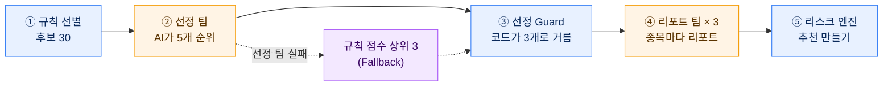
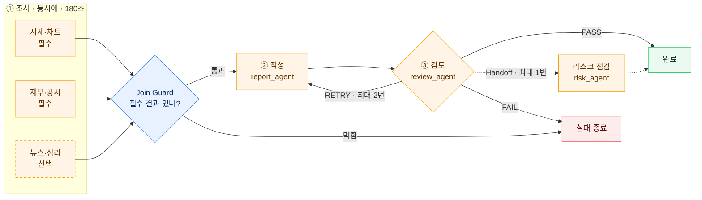
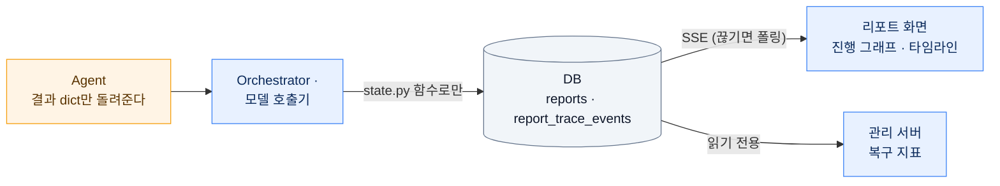
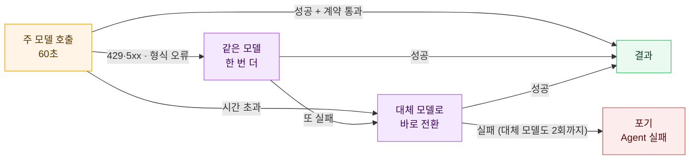

# 산출물 1｜멀티 에이전트 아키텍처 설계서

> 서비스 "모매매" · 저장소 `SHS5029/paper_trading` · 작성 2026-10-09 · 기준 `main` `1d5c14a`
> 근거: `backend/reports/`의 `orchestration/`(실행 계획 `team_definitions.yaml`·`worker_definitions.yaml`, 계획 검증 `registry.py`, Supervisor `orchestrator.py`, Shared State·Trace `state.py`, 실행 `runner.py`),
> `guardrails/`(Join·Handoff Guard `guards.py`, 출력 계약 `contracts.py`), `autohealing/healing.py`(모델 호출 복구), `autoreport/auto.py`(하루 파이프라인), `agents/report_team/`·`agents/selection_team/`(Agent),
> 담당 간 약속 `docs/tasks/00-공통.md`, 선정 팀 설계 `docs/design/AI_AGENT_WORKFLOW.md`. 표의 값은 모두 코드의 값이다.

이 문서는 **큰 그림에서 시작해 한 단계씩 확대**한다.

| 확대 | 장 | 무엇이 보이나 |
|---|---|---|
| 1단계 | [2장](#2-큰-그림--agent가-서비스-안에서-맡는-자리) | 서비스 전체에서 AI Agent가 맡는 자리 (AI는 제안, 코드는 검증, 사람은 결정) |
| 2단계 | [4장](#4-ai-팀-둘과-하루-파이프라인) | AI 팀 둘(종목 리포트 팀 · 매매 종목 선정 팀)과 매일 도는 파이프라인 |
| 3단계 | [5장](#5-종목-리포트-팀-안--역할책임입출력) | 종목 리포트 팀 안: Orchestrator와 Agent 6개, Guard 둘 |
| 4단계 | [8장](#8-정상재시도실패종료-흐름) | Agent 하나 안: 모델 호출이 실패했을 때의 재시도·대체 모델 |

---

## 1. 목적과 대표 사용자 시나리오

### 1-1. 해결하려는 문제와 사용자

- **문제**: 주식이 처음인 사람은 시세·재무·공시·뉴스를 한꺼번에 읽고 판단하기 어렵다. 그렇다고 AI 한 번의 답을 그대로 믿고 매매하면 위험하다.
- **목표**: 여러 AI Agent가 자료를 나눠 조사하고, 리포트를 쓰고, **다른 Agent가 근거를 검토**한 리포트만 사용자에게 준다.
  매매 판단(수량·손절가·체결)은 코드가, 최종 결정은 사람이 한다. 모든 돈은 가상 현금이다 (실주문 코드 0건 — CI가 검사).
- **주요 사용자**: 주식 초보 팀원(주린이모드 — 쉬운 문장 화면), 운영 담당(관리 서버로 장애·복구를 본다).

### 1-2. 한 문장으로

> 사용자가 종목 리포트를 신청하면(또는 매일 08:00 AI 선정 팀이 종목을 고르면) **Orchestrator**가 조사 Agent 셋을 동시에 돌리고,
> **Join Guard**가 필수 결과를 확인한 뒤 **작성 Agent**가 리포트를 쓰고, **검토 Agent**가 PASS·RETRY·FAIL을 내려
> PASS면 리포트와 A4 PDF가 나오며, 매수 의견이면 **코드(리스크 엔진)**가 AI 추천을 만들고 **사용자가 직접 계획을 활성화**해야 모의 자동매매가 시작된다.

### 1-3. 시나리오 — 정상만이 아니라 실패·지연·불일치까지

| 종류 | 상황 | 시스템이 하는 일 | 사용자가 보는 것 |
|---|---|---|---|
| 정상 | 조사 3개 성공 → 작성 → 검토 PASS | 리포트 완성, `buy`면 AI 추천 생성 | 리포트 본문·PDF, 완성 알림 |
| 지연 | 시세 Agent의 주 모델이 60초 안에 답하지 않음 | 같은 모델을 다시 기다리지 않고 대체 모델로 바로 전환 | "다른 AI가 이어받았어요" (복구 표시) |
| 결과 불일치 | 초안에 조사 결과에 없는 주장 | 검토 Agent가 RETRY + 수정 지시 → 작성 Agent가 다시 씀 (최대 2라운드) | 진행 그래프에서 작성 단계가 다시 돈다 |
| 일부 실패 | 뉴스 Agent(선택)의 모든 모델 실패 | 뉴스를 빼고 계속 | 뉴스 없이 완성된 리포트 |
| 전체 실패 | 시세 Agent(필수)의 모든 모델 실패 | Join Guard가 막고 뒤 단계 건너뜀 → 실패 종료 | 실패 사유 문장 + 실패 알림 → 다시 신청 (**수동 개입**) |
| 공격 | 뉴스 본문에 "이전 지시를 무시하라" | 그 부분을 `[지시문 삭제]`로 바꿔 넣고 진행, Trace에 기록 | 영향 없음 |

### 1-4. 왜 한 Agent가 아니라 여럿으로 나눴나

| 이유 | 한 Agent일 때 | 나눴을 때 (이 프로젝트) |
|---|---|---|
| 속도 | 시세·재무·뉴스를 차례로 본다 | 조사 3개를 **병렬**로 (`mode: parallel`) |
| 실패 격리 | 뉴스 조회 하나가 실패하면 전체가 실패 | **필수/선택**을 나눠 선택(뉴스)은 빼고 계속 |
| 자기 검증 문제 | 자기가 쓴 글을 자기가 통과시킨다 | **작성(gpt-5.6-luna)과 검토(claude-opus-5-5)를 다른 Agent·다른 모델**로 |
| 비용 | 모든 일을 비싼 모델로 | 조사는 빠르고 싼 모델(gemini-3.8-flash), 검토만 강한 모델 |
| 문맥 크기 | 모든 자료를 한 프롬프트에 | Agent마다 자기 자료만 본다 (Join Guard가 필요한 결과만 넘김) |
| 추적 | 어디서 틀렸는지 알기 어렵다 | Agent마다 Trace 사건이 남아 "누가, 몇 번째 시도에, 어느 모델로" 실패·복구했는지 보인다 |

---

## 2. 큰 그림 — Agent가 서비스 안에서 맡는 자리

| 칸 | 누가 | 결정할 수 있는 것 |
|---|---|---|
| AI 팀 | LLM Agent (주황) | 조사 요약, 리포트 문장, 매수·보유·회피 의견, 목표가 **제안**, 검토 판정 |
| 리스크 엔진·모의 체결기 | 결정론적 코드 (파랑) | 손절가(`engine/paper_engine/judge/stops.py`), 손익비(스윙 1.5 이상), 수량·한도, 체결 |
| 사용자 | 사람 (초록) | 계획을 활성화할지 — **AI 추천은 스스로 실행되지 않는다** |

Agent는 웹 요청 안에서 돌지 않는다. 웹(Django)은 신청을 DB에 `requested`로 적기만 하고, **엔진 컨테이너의 `run_engine` 루프**가 5초마다 그것을 집어
별도 스레드에서 실행한다 (`runner.py`, 동시에 1건 — AI 비용 상한). 진행은 DB에 남고 화면은 SSE로 받는다. 서버 구성은 산출물 2의 0장.

---

## 3. 협업 구조와 선정 이유

### 3-1. 구조: Supervisor 기반 중앙 조정형 (Supervisor = 코드)

| 항목 | 내용 |
|---|---|
| 구조 | **Supervisor 기반 중앙 조정형**. Supervisor는 `orchestrator.py`의 **Python 코드**다 (LLM이 아니다) |
| 계획 | YAML 실행 계획(`team_definitions.yaml`)이 단계·의존·병렬·필수/선택·제한 시간·재시도 한도를 **미리 선언**하고, `registry.py`가 실행 전에 검증한다 (없는 앞 단계·중복 id·순환·없는 Worker·모르는 키를 거부) |
| 실행 | Orchestrator가 계획대로 Agent를 부르고, 결과를 모으고, 계속·재시도·종료를 판단한다 |
| 기록 | 모든 상태 변경과 사건은 `state.py` 함수로만 남는다 (Shared State + Trace) |

### 3-2. 선정 이유

| 이유 | 설명 |
|---|---|
| 판단 책임이 한 곳 | 성공·실패·재시도·종료를 Orchestrator만 정한다. Agent는 결과만 내고 스스로 성공을 판정하지 않는다 |
| 검증을 통과한 결과만 전달 | 출력 계약 → Join Guard → 검토 Agent를 거친 결과만 사용자에게 간다 |
| 재현과 테스트 | Supervisor가 코드라 같은 입력이면 같은 경로를 탄다. 가짜 LLM으로 정상·RETRY·Join 차단·Handoff를 테스트로 고정했다 (`test_orchestrator.py`) |
| 비용 | Supervisor를 LLM으로 두면 단계마다 호출 비용과 지연이 더 든다. 우리 흐름은 분기가 정해져 있어 LLM 라우팅이 필요 없다 |
| 장애 격리 | 장애가 난 Agent만 재시도·대체 모델·건너뜀으로 처리하고 나머지는 계속한다 |

검토한 다른 방식:

| 방식 | 하지 않은 이유 |
|---|---|
| LLM이 다음 Agent를 고르는 자율 라우팅 | 경로가 실행마다 달라져 시험·설명이 어렵고, 라우팅 호출 비용이 든다 |
| LangGraph 같은 그래프 프레임워크 | 수업 자료(`docs/교육용문서.md` 부록)의 기준 — "분기와 반복이 적으면 일반 Python이 더 읽기 쉽다". 우리 분기는 Join·RETRY·Handoff 셋뿐이다 |
| Agent마다 컨테이너 | 다섯 명 팀 규모에 비해 운영 부담이 크고, 모든 Agent가 같은 모델 호출 한도·예산을 쓴다. 장애 격리는 Agent 단위 제한 시간·대체 모델로 한다 (`docs/plans/TEAM_DEV_PLAN.md` 7장). 컨테이너는 역할(웹·엔진·DB·nginx)로 나눴다 |

### 3-3. 이 구조의 약점과 대응

| 약점 | 대응 |
|---|---|
| Supervisor(엔진)가 죽으면 진행 중 리포트가 멈춘다 | 엔진 컨테이너는 `restart: unless-stopped`. 다시 뜨면 `runner.recover()`가 도중 리포트를 `engine_restarted`로 정리하고 신청자에게 알린다. 엔진은 30초마다 상태(`engine_status`)를 남기고, 관리 서버가 120초 넘게 소식이 없으면 "멈춤"으로 표시한다 |
| 리포트가 한 번에 하나라 몰리면 기다린다 | 비용 상한을 위한 선택 (`MAX_CONCURRENT = 1`). 24시간 넘게 기다린 신청은 실행하지 않고 `expired`로 끝내 알린다 |

---

## 4. AI 팀 둘과 하루 파이프라인

실행 계획에는 팀이 둘 있다. 같은 Orchestrator·Guard·호출기·State를 쓰고, 팀 정의(YAML)만 다르다.

| 팀 (`team`) | 언제 | Agent | 결과 |
|---|---|---|---|
| **종목 리포트** (`stock_report`) | 팀원이 신청할 때, 하루 파이프라인이 고른 종목마다 | 조사 3 + 작성 + 검토 + 리스크 점검(Handoff) = **6** | 리포트 본문 · A4 PDF · (매수면) AI 추천 |
| **매매 종목 선정** (`stock_selection`) | 국내 거래일 08:00 이후 하루 한 번 (`AUTO_REPORT=on`) | 후보 조사 3 + 선정 + 선정 검토 = **5** | 살펴볼 종목 5개의 순위와 근거 (가격 없음) |

- 선정 Guard(코드)는 후보 밖 종목, 투자유의 종목, 고위험 공시 종목을 빼고 같은 테마는 2개까지만 남긴다. 확인하지 못한 종목은 통과시키지 않는다 (fail closed).
- 그날 리포트 3개 모두 손익비 1.5 이상인 추천이 없으면, 이미 본 종목을 빼고 다음 3개로 다시 리포트한다 (최대 2번).
- 자세한 선정 팀 설계는 `docs/design/AI_AGENT_WORKFLOW.md` 1~4장.

---

## 5. 종목 리포트 팀 안 — 역할·책임·입출력

### 5-1. 참여자별 역할 (평가 가이드의 역할 이름과 대응)

| 참여자 (코드) | 가이드 역할 | 하는 일 | 하지 않는 일 | 입력 | 출력 |
|---|---|---|---|---|---|
| **Orchestrator** (`orchestrator.py`) | Supervisor | 계획대로 Agent 할당, 결과 수집, 부분 실패 판단, 검토 반복·Handoff 실행, 최종 성공·실패 결정 | 조사·작성을 하지 않는다. LLM을 부르지 않는다 | 실행 계획, Shared State | 다음 담당, 종료 사유 코드 |
| **실행 계획** (`team_definitions.yaml` + `registry.py`) | Planner | 단계·의존·병렬·필수/선택·제한 시간·재시도 한도를 선언하고 실행 전에 검증 | 실행 중에 계획을 바꾸지 않는다 | YAML 2개 | 실행 계획(ExecutionPlan) |
| 시세·차트 Agent (`market_agent`) | Executor | 시세·일봉·지표로 추세·변동성·지지·저항 정리 | State를 직접 바꾸지 않는다. 가격·손절가는 코드 값으로 덮어쓴다 | 시세·일봉(토스 조회) | `MarketResult` |
| 재무·공시 Agent (`fundamental_agent`) | Executor | 재무 지표와 최근 공시의 영향 정리 | 위와 같음 | DART 재무·공시 | `FundamentalResult` |
| 뉴스·심리 Agent (`news_agent`, 선택) | Executor | 최근 뉴스의 호재·악재와 심리 점수 | 위와 같음 | 뉴스 제목 (Guard를 거친 글) | `NewsResult` |
| 리포트 작성 Agent (`report_agent`) | Executor (작성) | 조사 결과로 리포트 초안, 의견(buy·hold·avoid), 목표가 **제안**, 쉬운 요약 3줄 | 수량·체결·손익비를 판단하지 않는다 | Join Guard가 고른 조사 결과 (+ RETRY면 수정 지시와 이전 초안) | `ReportDraft` |
| 검토 Agent (`review_agent`) | **Critic** | 초안이 조사 결과와 맞는지, 근거 없는 주장이 없는지 보고 **PASS·RETRY·FAIL**, 수정 지시, 위험하면 Handoff 요청 | 초안을 직접 고치지 않는다. 몇 번 다시 쓸지 정하지 않는다 | 초안 + 조사 결과 | `ReviewResult` |
| 리스크 점검 Agent (`risk_agent`) | Handoff 대상 | 투자유의·고위험 신호 점검, 경고 붙이기 | 리포트 본문을 고치지 않는다. 매매를 권하지 않는다 | Handoff 전달 데이터 + 결과 참조 | `RiskResult` |
| **Join Guard** (`guards.join`) | 검증 (코드) | 필수 결과가 있는지, 결과가 출력 계약을 다시 통과하는지 확인하고 다음 Agent에 줄 최소 입력을 고른다 | – | 앞 단계 결과 | 통과/차단 (`join_completed`·`join_blocked`) |
| **Handoff Guard** (`guards.handoff`) | 검증 (코드) | 경로가 계획에 있는지, Hop 한도, 요청자 일치, 비밀 값 모양을 확인 | – | 전달 데이터 | 허용/거절 |
| **Shared State·Trace** (`state.py`) | Memory Keeper | 상태·중간 결과·오류·비용·사건을 DB에 기록하는 **유일한 쓰기 경로** | 비밀 값·개인 정보를 넣지 않는다 | Orchestrator·호출기의 기록 요청 | `reports` 행, `report_trace_events` 행 |
| **모델 호출기** (`healing.py`) | 장애 복구 | 재시도·대체 모델·Circuit Breaker, 응답의 출력 계약 검증 | 결과 내용을 판단하지 않는다 | 프롬프트 + 계약 이름 | 계약을 통과한 응답, 또는 포기(`LlmGaveUp`) |

Agent별 모델 (`worker_definitions.yaml`, 게이트웨이 DevPass):

| Agent | 주 모델 | 대체 모델 (호출기가 고름) |
|---|---|---|
| 시세·재무·뉴스 조사 | gemini-3.8-flash | gpt-5.6-luna |
| 리포트 작성 | gpt-5.6-luna | gemini-3.8-flash |
| 검토 | claude-opus-5-5 | gpt-5.6-luna |
| 리스크 점검 | deepseek-v4.1-flash | gpt-5.6-luna |

### 5-2. 매매 종목 선정 팀의 역할

| Agent | 가이드 역할 | 보는 것 | 내는 것 (계약) | 실패하면 |
|---|---|---|---|---|
| `news_screen_agent` | Executor | 후보 30개의 뉴스 | 재료·악재·테마 (`CandidateNewsResult`) | 필수 → 선정 Fallback |
| `filing_screen_agent` | Executor | 후보의 30일 공시 | 위험 정도 none·low·high (`FilingCheckResult`) | 필수 → 선정 Fallback |
| `flow_agent` (선택) | Executor | 코드가 합한 외국인·기관 순매수 | 매집·이탈 해석 (`FlowResult`) | 빼고 진행 |
| `selector_agent` | Executor (작성) | 후보 표 + 조사 결과 | 순위 5개와 근거, **가격 없음** (`SelectionDraft`) | 선정 Fallback |
| `selection_review_agent` | Critic | 선정안 + 조사 결과 | PASS·RETRY·FAIL (`ReviewResult`) | 선정 Fallback |
| 선정 Guard (`auto.py`, 코드) | 검증 | 선정안 | 상위 3개 | – |

### 5-3. 출력 계약 — Agent 사이의 약속

모든 Agent는 정해진 JSON 형식(출력 계약, `contracts.py`)으로만 답한다. 계약을 어기면 그 응답은 버리고 장애(`bad_output`)로 처리한다.

| 계약 | 핵심 필드 |
|---|---|
| `MarketResult` | 추세(up·down·sideways), 요약, 가격, RSI, 변동성, 지지·저항, 손절가(코드가 채움), 근거 목록 |
| `FundamentalResult` | 요약, PER·PBR·ROE·매출 성장·영업이익률, 최근 공시(영향), 근거 |
| `NewsResult` | 심리(positive·negative·neutral), 점수(-1~1), 요약, 주요 기사, 근거 |
| `ReportDraft` | 제목, 의견(buy·hold·avoid), 한 줄 결론, 쉬운 요약 3줄(숫자 금지), 본문 Markdown, 근거·위험 3개씩, 목표(진입·목표·손절·보유일·확률), 인용 |
| `ReviewResult` | 판정(PASS·RETRY·FAIL), 점수, 문제 목록(주장·문제·고칠 점), 수정 지시(RETRY면 필수), Handoff 요청 |
| `RiskResult` | 위험 수준(low·medium·high), 신호, 경고, 요약 |

필드의 형식·상한 전체는 `docs/tasks/00-공통.md` 10절.

---

## 6. Handoff 조건과 전달 데이터

Agent 사이에서 넘기는 것은 두 가지다.

### 6-1. 단계 사이 전달 — `WorkerContext` (모든 Agent 실행)

Orchestrator가 Agent를 부를 때마다 만들어 넘긴다 (`agents/base.py`).

| 필드 | 예시 | 용도 |
|---|---|---|
| `task_id` | `report-1234` | 작업 추적 (Trace·로그 공통) |
| `worker_id` | `report_agent` | 받는 Agent |
| `attempt` | `2` | 이 Agent를 몇 번째 실행하는지 (검토 RETRY로 다시 쓰면 2) |
| `inputs` | `{market_agent: {...}, fundamental_agent: {...}}` | Join Guard가 고른 앞 단계 결과 — 계약을 다시 통과한 것만 |
| `instructions` | "근거 3번의 수치를 시세 결과와 맞추세요" | **RETRY일 때 검토 Agent의 수정 지시** (이전 실패 원인) |
| `handoff` | 아래 6-2 | Handoff로 불렸을 때만 |
| `deadline` | 단계 시작 + 180초 | 넘기면 멈춘다 |
| `symbol`·`name`·`market` | `005930` · 삼성전자 · `KR` | 대상 종목 |

### 6-2. 책임 넘기기 — Handoff (검토 → 리스크 점검)

| 항목 | 내용 |
|---|---|
| 언제 | 검토 Agent가 **PASS**를 내고, 그 결과의 `handoff`에 `{to: "risk_agent", reason}`이 있을 때 (투자유의 종목·고위험 신호) |
| 넘기는 책임 | "투자 유의 종목이거나 고위험 신호가 있으면 리스크 점검 책임을 넘긴다" (`team_definitions.yaml`의 `responsibility`) |
| Guard가 허용하는 조건 | ① 계획(`handoffs`)에 그 경로가 있다 ② 이번 실행에서 넘긴 횟수 < `max_hops`(1) ③ 전달 데이터의 `user_id`가 리포트 요청자와 같다 ④ 전달 데이터에 비밀 값 모양이 없다 |
| 거절되면 | `handoff_blocked`를 Trace에 남기고 리포트는 계속 완성된다 |

실제 전달 데이터 (`orchestrator.py`의 `_handoff`가 만든다 — 평가 가이드 예시 필드를 모두 담았다):

| 필드 | 값 | 가이드 필드 |
|---|---|---|
| `task_id`, `trace_id` | `report-<번호>` | task_id |
| `from_agent` / `to_agent` | `review_agent` / `risk_agent` | from_agent / to_agent |
| `objective` | 위 "넘기는 책임" 문장 | objective |
| `inputs.memory_refs` | State에 있는 결과 키 목록 (원본 대신 **참조**) | inputs, memory_refs |
| `constraints` | 리포트 본문을 고치지 않는다 · 결과와 종목 자료에 있는 사실만 근거로 · 매매를 권유하지 않고 위험 신호만 | constraints |
| `expected_output` | `RiskResult` | expected_output |
| `attempt` | 리스크 점검 Agent의 시도 번호 | attempt |
| `user_id`, `hop_count` | 요청자 id(자동이면 `auto`), 1 | (추가) 요청자 확인·Hop 제한 |
| `reason` | 검토 Agent가 적은 이유 | (추가) |

### 6-3. 점검 원칙 (가이드 3단계)

- 모든 전달에 `task_id`와 시도 번호가 있다.
- 중간 결과는 출력 계약을 통과해야 State에 들어가고(`state.add_result`), 다음 단계 전에 Join Guard가 계약을 **다시** 확인한다.
- RETRY면 이전 초안과 수정 지시가 다음 실행에 들어간다 (`instructions`, `attempt + 1`).
- 원본 대신 참조(`memory_refs`)를 넘기고, 받는 쪽은 State에서 읽는다.
- API 키·비밀번호·사용자 아이디는 프롬프트·전달 데이터·Trace에 넣지 않는다. 뉴스·공시 본문은 `guards.clean_text`가 지시문·비밀 값 모양을 지운 뒤에만 프롬프트에 들어간다.

---

## 7. 공유 상태 · 메모리 · 중간 결과

| 무엇 | 어디에 | 내용 |
|---|---|---|
| **Shared State** | `reports` 표 한 행 | `status`(requested·running·completed·failed), `current_step`, `results`(Agent id → 계약을 통과한 결과), `errors`, `completed_agents`, `failed_agents`, `cost_usd`, `content`(본문), `chaos`(장애 주입 설정) |
| **Trace** | `report_trace_events` 표 (리포트별 `step` 번호 순) | `actor`(Agent id · `orchestrator` · `join_guard` · `handoff_guard`), `action`, `status`(started·completed·failed·blocked·skipped), `provider`, `model`, `latency_ms`, `details` |
| 쓰기 경로 | `state.py` | `start` → (`set_step` → `record` → `add_result`/`add_error`/`add_cost`) 반복 → `finish`. **Agent는 State를 직접 바꾸지 않는다.** `finish` 뒤에는 기록이 붙지 않는다 |
| 실시간 전달 | `GET /api/reports/{id}/events` (SSE), `GET /api/reports/{id}` (Snapshot) | 화면은 SSE로 받고, 연결이 끊기면 Snapshot 폴링으로 바꾼다 |
| 실패 이력 | Trace의 `agent_failed`(`errorType`, `attempt`, `injected`, `final`) | 복구 지표(자동 복구율·평균 복구시간)를 이 사건으로 센다 |

Trace 사건 종류: `workflow_started` · `agent_started` · `agent_failed` · `agent_retry` · `agent_failover` · `agent_completed` · `agent_skipped` ·
`join_completed` · `join_blocked` · `review_retry` · `handoff_started`/`handoff_completed`/`handoff_blocked` · `workflow_completed`/`workflow_failed`.
누가 어떤 사건을 남기는지는 `docs/tasks/00-공통.md` 9절. 표 전체 구조는 README의 ERD.

---

## 8. 정상·재시도·실패·종료 흐름

### 8-1. Agent 하나 안 — 모델 호출 복구 (가장 안쪽)

Agent가 모델을 한 번 부르면(`ctx.llm`) 호출기가 아래 순서로 시도한다. **호출 한 번은 최대 4회** (모델마다 2회).

- 같은 모델이 3번 연속 실패하면 300초 동안 그 모델을 부르지 않는다 (Circuit Breaker).
- 형식 오류(`bad_output`)는 "이전 응답의 문제"를 질문 끝에 붙여 다시 묻는다.
- 감지 조건·상수 전체는 산출물 2의 1장.

### 8-2. 팀 전체 — 계속할지 멈출지

| 상황 | 판단 주체 | 결과 |
|---|---|---|
| 선택 Agent(뉴스) 실패 | Orchestrator (부분 실패 정책 `required_optional`) | 빼고 계속 |
| 필수 Agent(시세·재무) 실패 | Join Guard | `join_blocked` → 작성·검토 `agent_skipped` → 실패 종료 |
| 단계 제한 시간(180초) 초과 | Orchestrator | `timeout` → 실패 종료 |
| 검토 RETRY | Orchestrator (`retry.max_rounds: 2`) | 작성 Agent를 수정 지시와 함께 다시 실행 → 다시 검토 |
| 검토 FAIL, 또는 RETRY가 2라운드를 넘음 (선정 팀은 마지막 검토에서 코드 점검을 통과하면 남은 지적을 기록하고 통과 — `docs/DECISIONS.md` 30장) | Orchestrator | `review_failed` → 실패 종료 |
| 검토 PASS + Handoff 요청 | Handoff Guard | 허용이면 리스크 점검 실행, 거절·실패해도 완료 |
| 모든 단계 통과 | Orchestrator | `workflow_completed` → 완료 |

### 8-3. 종료 사유 (실패면 이 코드 중 하나만 남는다)

| 사유 코드 | 언제 | 사용자에게 보이는 문장 |
|---|---|---|
| `join_blocked` | 필수 결과가 없거나 계약 위반 | 자료를 모으는 AI가 응답하지 않아 리포트를 쓸 수 없었어요 |
| `review_failed` | 검토 FAIL 또는 RETRY 한도 초과 (선정 팀은 마지막 검토에서 코드 점검을 통과하면 남은 지적을 기록하고 통과 — `docs/DECISIONS.md` 30장) | 검토 AI가 근거와 맞지 않는 주장을 찾아 완성하지 않았어요 |
| `timeout` | 단계 제한 시간 초과 | 시간이 너무 오래 걸려 멈췄어요 |
| `agent_failed` | Join이 없는 단계(작성·검토)의 필수 Agent가 끝내 실패 | 필요한 AI가 끝내 응답하지 않아 멈췄어요 |
| `engine_restarted` | 엔진이 다시 떠 도중 리포트를 정리 | 서버가 다시 시작돼 중단됐어요 |
| `no_llm` | AI 연결 설정이 없음 | AI 연결 설정이 없어 리포트를 쓰지 못했어요 |
| `expired` | 24시간 넘게 기다린 신청 | 오래 기다린 신청이라 실행하지 않았어요 |
| `exception` | 그 밖의 예상하지 못한 오류 | 예상하지 못한 오류로 멈췄어요 |

### 8-4. 무한 실행을 막는 한도

| 한도 | 값 | 어디 |
|---|---|---|
| 호출 한 번의 시도 | 최대 4회 (모델마다 2회) | `healing.MAX_ATTEMPTS`, `MAX_ATTEMPTS_PER_MODEL` |
| 호출 한 번의 시간 | 60초 | `healing.CALL_TIMEOUT_SEC` |
| 단계 시간 | 180초 | `team_definitions.yaml`의 `timeout` |
| 검토 재작성 | 최대 2라운드 (계획 검증이 1~3만 허용) | `retry.max_rounds` |
| Handoff | 최대 1번 | `handoffs[].max_hops` |
| 동시에 도는 리포트 | 1건 | `runner.MAX_CONCURRENT` |
| 기다리는 신청 | 24시간 넘으면 `expired` | `runner.STALE_REQUEST_HOURS` |
| 팀 전체 하루 AI 비용 | 예산(`AI_DAILY_BUDGET_USD`, 운영 $10)을 넘으면 새 리포트를 막음 | `reports/limits/budget.py` |

---

## 9. 역할 중복과 책임 공백 점검

| 점검 질문 | 결과 |
|---|---|
| 조사 Agent끼리 자료가 겹치나? | 겹치지 않는다 — 시세(토스) / 재무·공시(DART) / 뉴스로 출처가 다르다 |
| 결과를 고치는 주체가 둘 이상인가? | 하나다 — 리포트 본문은 작성 Agent만 쓴다. 검토는 지시만, 리스크 점검은 경고만 붙인다 |
| 성공을 판정하는 주체가 둘 이상인가? | 하나다 — Orchestrator만 `workflow_completed`·`workflow_failed`를 낸다. Agent는 결과만 낸다 |
| 재시도를 누가 정하나? | 층마다 하나 — 모델 호출은 호출기, 다시 쓰기는 Orchestrator(검토 판정 + 한도). 검토 Agent는 횟수를 정하지 않는다 |
| State를 바꾸는 길이 여럿인가? | 하나다 — `state.py` 함수 |
| 가격·수량·손절가를 AI가 정하나? | 아니다 — 손절가는 `stops.py`, 손익비·수량은 리스크 엔진, 체결은 모의 체결기 |
| 실패를 누가 알리나? | 신청자: 웹 알림 `report_failed` (`reports/output/alerts.py`). 담당자: 관리 서버 "리포트 장애" 경고 |

점검하면서 찾아 메운 공백 (구현 중 결정, `docs/tasks/00-공통.md` 7·9절):

| 날짜 | 찾은 공백 | 메운 것 |
|---|---|---|
| 2026-10-07 | 작성·검토처럼 Join이 없는 단계의 필수 Agent가 실패하면 낼 사유 코드가 없었다 | `agent_failed` 사유 추가 |
| 2026-10-07 | AI 키가 없을 때 실패 이유가 `exception`으로 뭉개졌다 | `no_llm` 사유 추가 |
| 2026-10-07 | 엔진이 오래 꺼진 뒤 쌓인 옛 신청을 한꺼번에 실행할 수 있었다 | 24시간 넘은 신청은 `expired` |
| 2026-10-07 | 단계 제한(60초) = 호출 제한(60초)이라 시간 초과 한 번에 단계가 끝나 대체 모델로 갈 시간이 없었다 | 단계 제한 180초 |
| 2026-10-08 | 주 모델 시간 초과 뒤 같은 모델을 또 60초 기다려 복구가 늦었다 | 주 모델 시간 초과는 바로 대체 모델 |

남은 공백 (숨기지 않는다):

- **자동 리포트**(신청자가 없는 리포트)가 실패하면 담당자에게는 엔진 로그 한 줄과 관리 서버 경고뿐이다. Discord 알림은 2026-10-08부터 꺼 두었다 (`docs/DECISIONS.md` 24장).
- 리포트를 한 번에 하나만 돌려 신청이 몰리면 기다린다 (비용 상한과 맞바꾼 것).

---

## 10. 구현 위치와 검증

코드는 `backend/reports/`, 테스트는 `backend/reports/tests/` 기준이다. 테스트도 코드와 같은 기능 폴더에 둔다 (2026-10-11 정리 — `docs/DECISIONS.md` 29장).

| 설계 요소 | 코드 | 테스트 (CI가 매번 돈다) |
|---|---|---|
| 실행 계획과 검증 | `orchestration/`의 `team_definitions.yaml`·`worker_definitions.yaml`·`registry.py` | `orchestration/test_registry.py` |
| Supervisor 흐름·부분 실패·검토 반복·Handoff | `orchestration/orchestrator.py` | `orchestration/test_orchestrator.py` |
| Join·Handoff Guard, 본문 정화 | `guardrails/guards.py` | `guardrails/test_guards.py` |
| Shared State·Trace | `orchestration/state.py`, `models.py` | `orchestration/test_state.py` |
| 출력 계약 | `guardrails/contracts.py` | `guardrails/test_contracts.py` |
| 모델 호출 복구 | `autohealing/healing.py` | `autohealing/test_healing.py` |
| Agent 11개 | `agents/report_team/`(리포트 팀 6) · `agents/selection_team/`(선정 팀 5) | `agents/test_agents_report.py`, `agents/test_agents_selection.py` |
| 엔진 루프 실행·재시작 정리, 하루 파이프라인 | `orchestration/runner.py`, `autoreport/auto.py`·`selection.py` | `orchestration/test_runner.py`, `autoreport/test_auto.py`·`test_selection.py` |
| 실시간 전달 | `sse.py` | `test_sse.py` |
| 장애 시나리오 고정 | `autohealing/chaos.py` | `autohealing/test_chaos.py`·`test_dr_scenarios.py` |

테스트는 실제 AI·증권사를 부르지 않는다 (가짜 LLM `fake_llm`, 가짜 Worker `fake_worker`). 건수는 산출물 3의 3장.

---

## 11. 제출 전 체크리스트 (평가 가이드 6장)

| 항목 | 확인 | 어디 |
|---|---|---|
| 에이전트별 역할과 책임 범위가 명확하다 | ✅ | 5장 (하는 일·하지 않는 일) |
| 역할의 중복과 책임 공백을 점검했다 | ✅ | 9장 |
| Handoff 조건과 전달 데이터가 실제 구현과 일치한다 | ✅ | 6장 — `orchestrator._handoff`·`guards.handoff`의 필드 그대로 |
| 상태·메모리·중간 결과의 전달 방식을 설명할 수 있다 | ✅ | 7장 |
| 재시도·실패·종료 조건이 정의되어 있다 | ✅ | 8장 |
