# 산출물 2｜배포 및 장애 복구 보고서 — 초안

작성 2026-10-09. 0장(배포 구성)은 담당 1(팀장·통합), 1~6장(장애 복구)은 담당 4(AutoHealing).
상태: **초안** — 0~4장은 코드·운영 서버 기준으로 채웠다. 5장은 2026-10-09 운영 서버에서 DR-LLM-01·DR-CRT-01을 채웠고, 나머지는 시험하면서 채운다.
화면 캡처는 [`img/`](img/)에 둔다 (파일 이름 앞의 `02-`는 산출물 번호).
근거: `deploy/docker-compose.yml`, `admin/deploy/compose.yml`, `docs/DEPLOY.md`, `admin/README.md`, `docs/tasks/04-autohealing.md`(T4-9·T4-10),
`docs/plans/TEAM_DEV_PLAN.md` 5장·8장, `docs/tasks/00-공통.md` 5·7·9절, `docs/evaluation/프로젝트평가기준.md` 7단계.
CI/CD(커밋 → 검사 → 배포)는 산출물 3 [`03_파이프라인_구현결과_보고서.md`](03_파이프라인_구현결과_보고서.md).

| 장 | 내용 |
|---|---|
| [0](#0-배포-구성--큰-그림에서-서버-안까지) | 배포 구성 — 전체 그림 → 서버 ①·② 안 → 두 서버 사이 통신 → 시크릿 → 상태 확인과 자동 복구 |
| [1](#1-장애-유형별-감지와-복구) · [2](#2-수동-개입-조건과-알림) · [3](#3-지표) | AI 호출 장애의 감지·복구, 수동 개입과 알림, 지표 정의 |
| [4](#4-llm-장애-주입-시험-설정-t4-10) · [5](#5-시험-결과-시험하면서-채운다) · [6](#6-실패-사례와-개선-이력) | 장애 주입 시험 설정, 시험 결과, 실패 사례와 개선 이력 |

---

## 0. 배포 구성 — 큰 그림에서 서버 안까지

### 0-1. 전체 그림: 서버 두 대와 GitHub

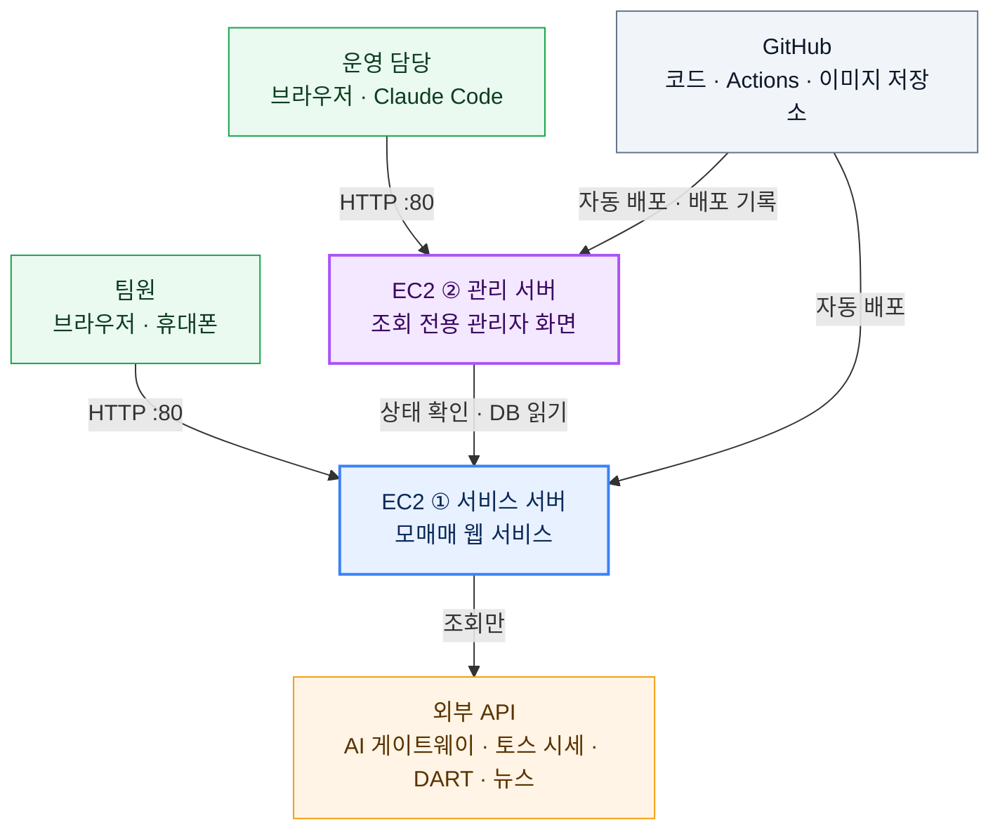

| 서버 | 하는 일 | 사양 | 밖에 연 포트 |
|---|---|---|---|
| **EC2 ① 서비스 서버** | 사용자가 쓰는 모매매 전체: 화면, API, 엔진 루프(모의 체결·AI Agent 실행), DB | Ubuntu 26.04, 2 vCPU · 3.7GB (t3.medium급), 서울 리전 | 80(HTTP), 22(SSH) |
| **EC2 ② 관리 서버** | 운영 담당이 보는 관리자 화면·관리자 API·MCP. 서비스 상태·배포 기록·리포트 장애·복구 지표·AI 비용을 **읽기만** 한다 | t3.micro, 고정 IP(Elastic IP) | 80(HTTP), 22(SSH) |
| GitHub | 코드 저장소, Actions(검사·배포), GHCR(컨테이너 이미지 저장소) | – | – |

두 서버를 나눈 이유: 관리 서버가 멈추거나 바뀌어도 서비스에 영향이 없고(서비스는 관리 서버를 모른다), 관리 서버는 서비스 DB를 **읽기 전용 계정**으로만 본다.
배포도 따로 한다 — 서비스는 `deploy.yml`, 관리 서버는 `admin-deploy.yml` (`admin/**`이 바뀔 때만).

### 0-2. EC2 ① 서비스 서버 안

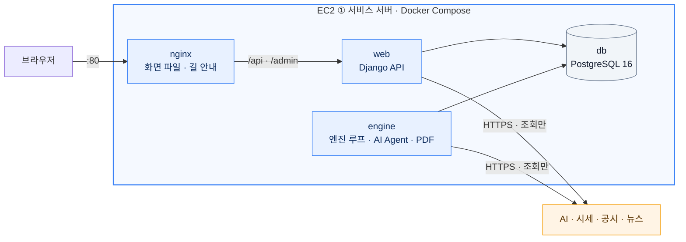

| 컨테이너 | 하는 일 | 밖에서 접근 | 상태 확인 |
|---|---|---|---|
| `nginx` | React 빌드 파일을 내주고 `/api`·`/admin`을 web으로 넘긴다. 리포트 진행 스트림(SSE)은 버퍼링을 끈다. 압축·보안 헤더 | **80번만** (유일한 입구) | web이 정상이어야 뜬다 |
| `web` | Django + gunicorn(스레드 16): 로그인, 웹 API, 리포트 신청, SSE, 화면에 보일 시세 조회(짧게 캐시) | 없음 | `/api/health` 10초마다 |
| `engine` | `run_engine` 5초 루프: 모의 체결·청산·예약, 일별 자산, **AI 리포트 실행(Orchestrator·Agent)**, 하루 파이프라인, 추천·자동매매, 장기투자, 알림. 리포트 A4 PDF(Chromium) | 없음 | 30초마다 `engine_status` 표에 동작 기록 |
| `migrate` | 띄울 때 한 번 DB 마이그레이션을 하고 끝난다. 성공해야 web·engine이 뜬다 | – | – |
| `db` | PostgreSQL 16 — 계정·주문·리포트·Trace 등 모든 표 | 서버 안 `127.0.0.1:15432`만 (관리 서버 터널용, 보안 그룹에 열지 않음) | `pg_isready` 5초마다 |
| `redis` | Redis 7 — 엔진 CLI(`python -m paper_engine`)의 예약·전략용. 웹 서비스는 쓰지 않는다 | 없음 | `ping` 5초마다 |

- 이미지는 3개: `paper-trading-web`(web·migrate), `paper-trading-engine`, `paper-trading-nginx`. 태그는 **커밋 해시**다.
- 공통 보호: root가 아닌 사용자, 읽기 전용 파일 시스템(쓰는 곳은 볼륨과 `/tmp`뿐), 권한 상승 금지, 꺼지면 자동 재시작(`restart: unless-stopped`).
- web과 engine은 같은 Django 모델·설정을 쓰고 DB로만 이야기한다. 웹 요청 안에서 AI를 부르지 않는다 — 신청은 DB에 적고 engine이 집어 실행한다 (산출물 1의 2장).

### 0-3. EC2 ② 관리 서버 안

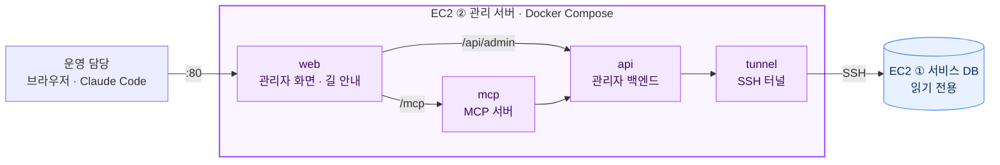

| 컨테이너 | 하는 일 |
|---|---|
| `web` | 관리자 화면(React)을 내주고 `/api/admin`은 api로, `/mcp`는 mcp로 넘긴다. 유일한 입구(80) |
| `api` | 관리자 백엔드(FastAPI). 서비스 staff 계정으로 로그인, 숫자·상태(정상·주의·멈춤)는 **여기서만** 만든다. 30초마다 서비스 상태를 확인한다 |
| `mcp` | Claude Code 같은 MCP 클라이언트용 조회 도구 9개. DB에 붙지 않고 api를 사람별 토큰으로 부른다 |
| `tunnel` | 서비스 서버로 SSH 터널을 열어 서비스 DB 포트를 api에 이어 준다 |

관리 화면 메뉴: 개요 · 서비스 상태 · 엔진 상태 · 배포 기록 · 리포트 장애 · 복구 지표 · AI 비용 · 알림·작업 실패 · MCP 도구 (`admin/README.md` 1장).

### 0-4. 두 서버 사이의 통신

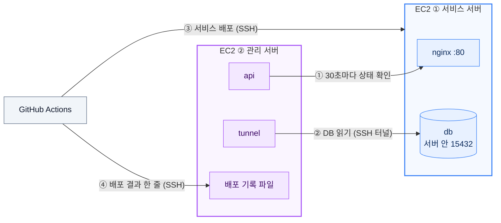

| # | 방향 | 무엇을 | 어떻게 | 지키는 장치 |
|---|---|---|---|---|
| ① | 관리 → 서비스 | 서비스가 살아 있나 | 30초마다 `GET /api/health`(API)와 `GET /`(화면)를 공개 주소로 부른다 | 읽기만 한다. 결과로 24시간 가동률·응답 시간을 낸다 |
| ② | 관리 → 서비스 | 리포트·Trace·엔진 상태·비용 같은 표 | `tunnel` 컨테이너가 SSH(22)로 서비스 서버에 붙어 서버 안 `127.0.0.1:15432`(DB)로만 터널을 연다 → api가 그 터널로 PostgreSQL에 접속 | 터널 전용 사용자 `admin-tunnel`(셸 없음, 그 포트로만 열림). DB 계정 `paper_admin_ro`(읽기 전용 트랜잭션, 허용한 표·열만 SELECT, 쿼리 10초 제한). DB 포트는 인터넷에 열지 않는다 |
| ③ | GitHub → 서비스 | 새 버전 | `main`에 push → 검사 통과 → SSH로 `remote_deploy.sh` 실행 → GHCR에서 이미지 받아 띄움 | 배포 전용 키, 서버 호스트 키 고정. 실패하면 직전 버전으로 되돌림 |
| ④ | GitHub → 관리 | 배포 결과 | 배포가 끝나면 결과(`success`·`rolled_back`·`blocked` 등) 한 줄을 SSH로 보낸다 | 키에 강제 명령(`deploy_record.py`)이 걸려 있어 기록 한 줄 더하기 말고는 할 수 없다 |

서비스 서버에서 관리 서버로 가는 연결은 없다. 그래서 관리 서버가 꺼져도 서비스는 그대로 돈다 (관리 화면만 못 본다).

### 0-5. 시크릿 관리

| 어디 | 무엇 | 지키는 방법 |
|---|---|---|
| 서비스 서버 `/home/ubuntu/paper_trading/.env.docker` | Django 비밀키, DB 비밀번호, AI 게이트웨이·DART·토스 키 | 파일 권한 0600, 서버에서만 고친다. 파이프라인은 이 파일을 만들거나 바꾸지 않는다 |
| 관리 서버 `~/paper_admin/.env`, `secrets/` | 관리 서버 비밀키, 읽기 전용 DB 비밀번호, 터널 키 | 0600, 서버에만 |
| GitHub 비밀 값 | 배포 SSH 키(서비스용·관리 서버용·배포 기록용) | Actions에서만 읽힌다. 실행이 끝나면 실행기의 키 파일을 지운다 |
| 저장소 | `.env.example`·`.env.docker.example`(빈 틀)만 | `.env`·계정 파일은 git·Docker 빌드에서 뺀다. CI는 비밀 값 없이 돈다 |

이미지 레지스트리 인증은 Actions의 임시 토큰(`GITHUB_TOKEN`)만 쓴다. 토큰·비밀 값은 로그·Trace·Agent 전달 데이터에 넣지 않는다.

### 0-6. 상태 확인과 자동 복구 (인프라)

| 대상 | 감지 | 자동 대응 | 사람이 보는 곳 |
|---|---|---|---|
| 컨테이너가 죽음 | Docker | `restart: unless-stopped`로 다시 띄운다 | 관리 서버 서비스·엔진 상태 |
| 배포한 새 버전이 뜨지 않음 | nginx를 거쳐 `/api/health`·`/`를 2초 간격 최대 2분 | **직전 버전으로 되돌린다** | 관리 서버 배포 기록 (`rolled_back`) |
| 엔진 루프의 한 단계 오류 (조회 실패 등) | 단계마다 예외를 잡는다 | 그 단계만 건너뛰고 루프는 계속, 오류를 `engine_status`에 남긴다 | 관리 서버 엔진 상태 (30분 안 오류 → 주의) |
| DB 연결 끊김 | 엔진 루프가 매 바퀴 확인 | 끊긴 연결을 버리고 다시 붙는다 (`close_old_connections`) | – |
| 엔진 재시작 | 다시 뜰 때 `running`으로 남은 작업 | 도중 리포트는 `engine_restarted`로 정리하고 신청자에게 알림, 분석 작업도 정리 | 리포트 화면, 웹 알림 |
| 엔진 멈춤 | `engine_status`가 120초 넘게 갱신되지 않음 | – (사람이 확인) | 관리 서버 엔진 상태 "멈춤" |
| 서비스 전체 응답 없음 | 관리 서버가 30초마다 확인 | – (사람이 확인) | 관리 서버 서비스 상태 "멈춤" |
| 리포트 진행 스트림(SSE) 끊김 | 브라우저 | Snapshot 폴링으로 바꿔 화면을 계속 갱신 | 화면 |

AI 호출 장애(시간 초과·서버 오류·형식 오류)의 복구는 아래 1장이다.

### 0-7. 실제 운영 상태 (2026-10-09 확인)

두 서버에 SSH로 들어가 `docker ps`로 확인한 출력이다 (조회만). 이미지 태그는 커밋 해시다 — 서비스는 그날 `main`인 `1d5c14a`, 관리 서버는 `admin/`이 바뀔 때만 배포되므로 `5b4699a`다.
`migrate`는 띄울 때 한 번 돌고 끝나서 목록에 없다.

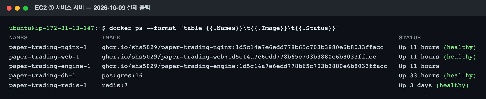

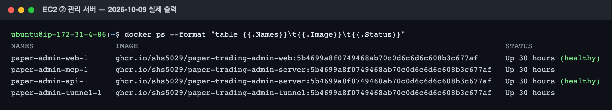

---

## 1. 장애 유형별 감지와 복구

LLM 호출 복구는 `backend/reports/autohealing/healing.py` 한 곳에서 한다. Worker가 `ctx.llm(...)`을 한 번 부르면 그 안에서 아래 순서로 시도한다.
상수는 코드 값이다 (`backend/reports/autohealing/healing.py` 머리).

| 상수 | 값 | 뜻 |
|---|---|---|
| `CALL_TIMEOUT_SEC` | 60 | 호출 한 번의 제한 시간 (Worker 마감이 더 가까우면 그때까지) |
| `MAX_ATTEMPTS` | 4 | 한 번의 `ctx.llm(...)`에서 전체 시도 수 (첫 시도 + 재시도 3번) |
| `MAX_ATTEMPTS_PER_MODEL` | 2 | 모델마다 시도 수 |
| `RETRY_BACKOFF_SEC` | 2 | 서버 오류 뒤 같은 모델로 다시 부르기 전에 쉬는 시간 |
| `BREAKER_FAILURES` · `BREAKER_OPEN_SEC` | 3 · 300 | 모델별 연속 실패 3번이면 300초 동안 그 모델을 건너뜀 |
| `FALLBACK_POOL` | gpt-5.6-luna → gemini-3.8-flash → deepseek-v4.1-flash | 대체 모델 후보. 주 모델이 아니고 차단되지 않은 첫 모델 **하나**를 쓴다 |
| 단계 제한 (`team_definitions.yaml` `timeout`) | 180초 | Worker 마감. timeout → 대체 모델 → 재시도까지 들어가게 |

| 유형 | 감지 조건 (코드) | 복구 | 그래도 안 되면 (최종 실패 조건) |
|---|---|---|---|
| LLM 응답 없음 | `LlmTimeout` (`CALL_TIMEOUT_SEC` 안에 응답 없음) → `timeout` | **주 모델**이면 다시 기다리지 않고 바로 대체 모델 (2026-10-08 결정). **대체 모델**이면 같은 모델 1번 더 | 4번 또는 마감을 넘기면 `LlmGaveUp` → Worker 실패 |
| LLM 서버 오류 | `HTTP 429`·`HTTP 5xx`·연결 실패(`요청 실패`) → `server_error` | 2초 쉬고 같은 모델 1번 더 → 대체 모델 | 위와 같음 |
| LLM 출력 형식 불일치 | JSON 아님·빈 응답·출력 계약 위반(`contracts.validate`의 `ContractError`) → `bad_output` | 문제를 질문 끝에 붙여("이전 응답의 문제: … JSON 객체만 출력하세요") 같은 모델 1번 더 → 대체 모델 | 위와 같음 |
| 그 밖의 호출 오류 | HTTP 400·401 등 → `unknown` | 재시도 없이 바로 대체 모델 | 위와 같음 |
| 같은 모델의 연속 실패 | 모델별 연속 실패 3번 (Circuit Breaker) | 300초 동안 그 모델을 부르지 않고 대체 모델부터 (Trace `agent_failover` `reason: "circuit_open"`). 성공하면 0부터, 차단이 풀린 뒤 다시 실패하면 바로 재차단 | 대체 모델도 막혀 있으면 0번 시도로 `LlmGaveUp` |
| Worker 실패 (위 복구가 다 실패) | `LlmGaveUp`·`WorkerError` (Orchestrator) | **선택 Worker**(뉴스)면 빼고 계속 (Handoff로 부른 위험 점검이 실패해도 리포트는 완성) | **필수 Worker**(시세·재무)면 Join Guard가 막음 → 뒤 단계 건너뜀 → 리포트 실패(`join_blocked`) |
| 근거 없는 응답 | 검토 Agent의 `RETRY` | 수정 지시를 넣어 작성 Worker를 다시 실행 (최대 2라운드, `team_definitions.yaml` `retry.max_rounds`) | 라운드를 넘기거나 `FAIL` → 리포트 실패(`review_failed`) (선정 팀은 마지막 검토에서 코드 점검을 통과하면 남은 지적을 기록하고 통과 — `docs/DECISIONS.md` 30장) |
| 프롬프트 공격 | 뉴스·공시 본문의 지시문·비밀 값 모양 (`guards.clean_text`) | 그 부분을 `[지시문 삭제]`·`[비밀 값 삭제]`로 바꾸고 진행, Trace `agent_completed.details.guarded`에 사유 기록 | – |
| 엔진 중단 | 엔진이 다시 뜰 때 `running`으로 남은 리포트 (`runner.recover()`) | 실패로 정리(`engine_restarted`)하고 신청자에게 알림 | 다시 신청 (수동) |

장애 주입(`backend/reports/autohealing/chaos.py`)은 실제 호출 직전 한 곳에서만 실패를 만들고, 그 뒤는 위 표의 진짜 복구 경로를 그대로 탄다.
주입한 실패는 모델을 부르지 않아 비용이 0이고, timeout도 기다리지 않는다. 장애 주입 리포트는 **그 리포트 전용 Circuit Breaker**를 써서
다른 사람 리포트의 모델을 막지 않는다 (PR #5 리뷰, `docs/works/done/feat-4-chaos_리뷰_장애주입_2026-10-08.md`).

## 2. 수동 개입 조건과 알림

| 경우 | 사용자에게 | 담당자에게 | 수동 개입 |
|---|---|---|---|
| 필수 Worker 실패(`join_blocked`), 검토 실패(`review_failed`), 단계 시간 초과(`timeout`), 예외(`exception`) | 웹 알림 `report_failed` 한 번 (사유의 쉬운 문장, `reports/output/alerts.py`) + 리포트 화면의 실패 사유 | 관리 서버 "리포트 장애" 패널이 **최근 24시간 안에 장애 주입 없이 실패한 리포트**가 있으면 `warn` (`admin/API.md` 2장) | 있음 — 신청자가 다시 신청하고, 담당자가 Trace로 원인을 본다 |
| 엔진 재시작으로 중단(`engine_restarted`) | 위와 같음 | 위와 같음 | 있음 — 다시 신청 |
| 24시간 넘게 기다린 신청(`expired`) | 위와 같음 ("다시 만들 수 있어요") | – | 다시 신청 |
| 자동 리포트 실패 | – (신청자 없음) | 엔진 콘솔 한 줄 (`auto.after_finish`) | 다음 거래일에 다시 돈다 |

Discord 알림은 2026-10-08부터 꺼져 있다 (`docs/DECISIONS.md` 24장). 그래서 `docs/plans/TEAM_DEV_PLAN.md` 8장 DR-LLM-04의 "Discord 알림"은
**웹 알림 `report_failed`와 관리 서버 경고**로 판정한다. 확인 테스트: `backend/reports/tests/autohealing/test_failure_alerts.py`.

## 3. 지표

두 자동 복구율은 이름을 나눠 적는다 (2026-10-04 합의).

| 지표 | 정의 | 어디서 |
|---|---|---|
| **시나리오 자동 복구율** | 수동 개입 없이 정상화된 장애 시나리오 수 ÷ 전체 장애 시나리오 수 × 100 (평가 가이드 정의) | 5장 결과표 |
| **호출 장애 자동 복구율** | 복구된 호출 장애 건 ÷ 호출 장애 건 × 100. 장애 1건 = Worker 실행 한 번 안의 첫 `agent_failed(final: false)`, 복구 = 그 실행이 `agent_completed`로 끝남 (`docs/tasks/00-공통.md` 9절) | `GET /api/reports/recovery-stats`(`backend/reports/autohealing/stats.py`), 관리 서버 F7 — 같은 셈법, 기준 사례 `admin/recovery_cases.json` |
| 평균 복구시간 | 복구된 건의 (그 Worker의 `agent_completed` 시각 − 첫 `agent_failed` 시각) 평균 | 위와 같음 |

셈할 때 알아 둘 것:

- **주입한 실패는 기다리지 않는다.** 주입 건의 복구시간은 거의 대체 모델이 답하는 시간이다. 진짜 timeout(60초)보다 훨씬 짧으므로 평균을 낼 때 주입 건과 진짜 건을 나눠 적는다 (`recent[].injected`).
- 끝나지 않은 실행의 장애는 장애 건수에만 들고 복구·복구 못 함에는 들지 않는다.
- 쉬운 요약(`plainSummary`)에 숫자가 들어 계약 위반으로 재요청한 것도 `bad_output` 장애 1건으로 세어진다 (B1).
- 호출 장애 없이 실패한 Worker(`WorkerError` — 시세 조회 실패 등)는 호출 장애로 세지 않는다.

**운영 측정값** — 관리 서버 "복구 지표" 화면, 2026-10-09 21:58 기준 최근 7일 (리포트 60건 중 장애가 있었던 7건):

| 호출 장애 | 복구 | 복구 못 함 | 호출 장애 자동 복구율 | 평균 복구시간 | 그중 장애 주입 |
|---|---|---|---|---|---|
| 7 | 7 | 0 | **100%** | **10.6초** | 2 (#61, #34 — 둘 다 `timeout`) |

종류별로는 `bad_output` 5건(5건 복구, 모두 주입 없이 실제로 생긴 형식 오류)과 `timeout` 2건(2건 복구, 모두 주입)이다. Worker별로는 작성 3 · 뉴스 2 · 재무 1 · 시세 1.
주입하지 않은 실제 장애 5건의 복구시간은 7.8~16.0초, 주입한 2건은 5.8초·6.3초다 (주입은 60초를 기다리지 않는다 — 위 첫 항목).

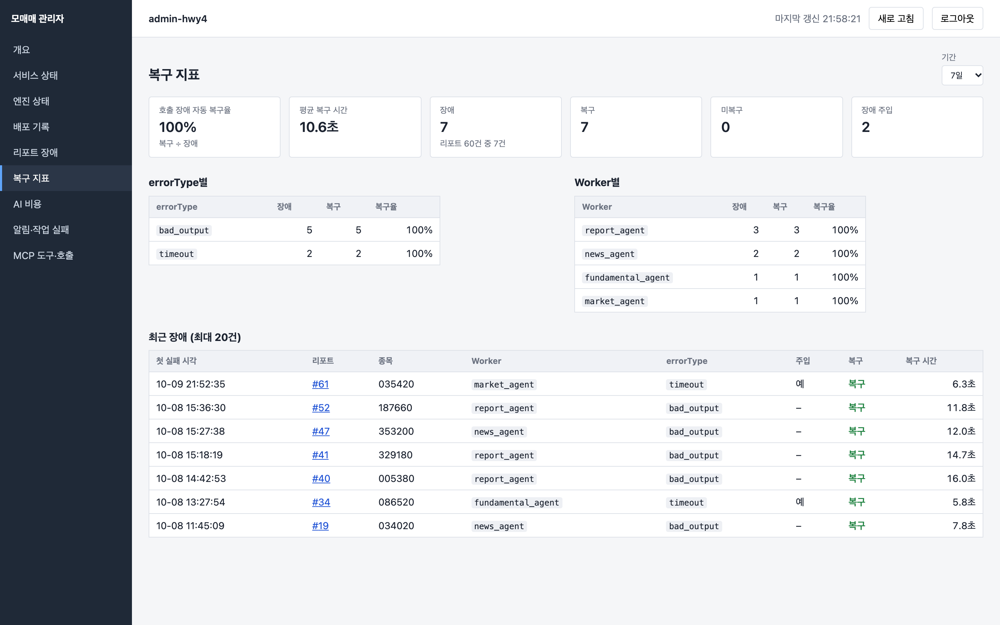

## 4. LLM 장애 주입 시험 설정 (T4-10)

리포트 신청 화면의 장애 주입 → **직접 설정**에 아래 값을 넣는다 (프리셋은 쓰지 않는다 — 확률·대상이 달라 결과가 정해지지 않는다).
아래 기대 Trace는 같은 설정을 실제 Orchestrator·호출기에 넣은 테스트로 고정했다: `backend/reports/tests/autohealing/test_dr_scenarios.py`의 `SCENARIOS`.
대상 Worker의 주 모델은 gemini-3.8-flash, 코드가 고르는 대체 모델은 gpt-5.6-luna다.

| ID | 장애 주입 설정 (`chaos`) | 기대 동작 | 기대 Trace (대상 Worker) | 기대 복구 지표 (장애·복구·복구 못 함·주입) |
|---|---|---|---|---|
| DR-LLM-01 | 대상 `market_agent` · 종류 `timeout` · 범위 주 모델만 · 확률 100% · seed 1 | 주 모델 시간 초과 → 다시 기다리지 않고 대체 모델로 완료 | 실패(timeout, 주입) → 전환(gemini → gpt, timeout) → 완료(gpt, 시도 2) | 1 · 1 · 0 · 1 |
| DR-LLM-02a | 대상 `market_agent` · 종류 `bad_output` · 주 모델만 · 확률 50% · **seed 3** | 형식 오류 → 오류를 알려 같은 모델에 재요청 → 성공 | 실패(bad_output, 주입) → 재시도 → 완료(gemini, 시도 2) | 1 · 1 · 0 · 1 |
| DR-LLM-02b | 대상 `market_agent` · 종류 `bad_output` · 주 모델만 · 확률 100% · seed 1 | 재요청도 실패 → 대체 모델로 완료 | 실패 → 재시도 → 실패 → 전환(gemini → gpt, bad_output) → 완료(gpt, 시도 3) | 1 · 1 · 0 · 1 |
| DR-LLM-03 | 대상 `news_agent` · 종류 `server_error` · 범위 **대체 모델까지** · 확률 100% · seed 1 | 선택 Worker(뉴스)의 모든 모델 실패 → 뉴스를 빼고 리포트 완료 | 실패 → 재시도 → 실패 → 전환 → 실패 → 재시도 → 실패 → 포기(final) | 1 · 0 · 1 · 1 |
| DR-LLM-04 | 대상 `market_agent` · 종류 `server_error` · 대체 모델까지 · 확률 100% · seed 1 | 필수 Worker의 모든 모델 실패 → Join 차단 → 뒤 단계 건너뜀 → 실패 종료 → 신청자 `report_failed` (**수동 개입**) | DR-LLM-03과 같고, 뒤에 `join_blocked` → 작성·검토 `agent_skipped` → `workflow_failed(join_blocked)` | 1 · 0 · 1 · 1 |

시험할 때:

- 시나리오마다 **새 리포트**로 한다 (같은 종목이 진행 중이면 그 리포트가 돌아온다 — 다른 종목을 쓰거나 끝난 뒤 신청).
- `server_error` 시나리오는 재시도 전에 2초씩 쉬어 대상 Worker가 4초쯤 더 걸린다. 주입한 시도는 모델을 부르지 않아 대상 Worker의 비용은 0이다 (다른 Worker는 실제 모델을 부른다 — 리포트 1건 약 $0.3~0.5).
- 확률 50%(DR-LLM-02a)의 결과는 seed·Worker·모델·시도 번호로 정해진다. seed를 바꾸면 결과가 바뀐다.
- Circuit Breaker 차단(연속 3번)은 위 시나리오에서 열리지 않는다 (한 모델 연속 실패가 최대 2번). 차단까지 보이려면 대상을 비우고(전부) 종류 `timeout`·주 모델만·확률 100%로 하면
  주 모델이 같은 조사 Worker 셋이 차례로 실패해 리포트 안에서 gemini가 막힌다 — 다만 병렬 Worker 순서에 따라 어느 Worker가 `circuit_open`을 받는지는 실행마다 다르다 (리뷰 3번).

### 장애 주입으로 만들 수 없는 시나리오

장애 주입 종류는 timeout·server_error·bad_output 셋뿐이라(쟁점 Q6) 아래 셋은 배포 환경에서 마음대로 일으킬 수 없다. **자동 테스트를 증빙으로** 쓰고, 실제 리포트에서 생기면 그 Trace를 더한다.

| ID | 기대 동작 | 증빙 (자동 테스트) |
|---|---|---|
| DR-CRT-01 | 검토 RETRY → 수정 지시로 다시 작성 → PASS | `backend/reports/tests/orchestration/test_orchestrator.py::test_review_retry_then_pass` |
| DR-CRT-02 | 검토가 계속 RETRY → 최대 2라운드에서 멈추고 실패 종료 (선정 팀: 마지막 검토에서 코드 점검을 통과하면 남은 지적을 기록하고 통과, 코드 점검 문제가 남으면 실패 종료 — `docs/DECISIONS.md` 30장) | `test_orchestrator.py::test_review_retry_beyond_max_rounds_fails` · 선정 팀 `test_orchestrator.py::test_selection_converges_when_reviewer_keeps_retrying`·`test_selection_last_round_code_issue_still_review_failed` |
| DR-SEC-01 | 뉴스 본문의 "지시를 무시하라" → 지우고 진행, 차단 기록 | `backend/reports/tests/guardrails/test_guards.py::test_clean_text_removes_instructions_and_secrets` |

### 인프라 시험 설정 (담당 1)

배포 환경(EC2 ①)에서 컨테이너를 직접 내리거나 연결을 끊어 일으킨다. 서버 명령은 `cd /home/ubuntu/paper_trading` 뒤 `docker compose --env-file .env.docker ...`.
기대 동작은 0-6장의 구현에서 나온 것이다.

| ID | 주입 방법 | 기대 동작 | 수동 개입 (기대) | 확인할 곳 |
|---|---|---|---|---|
| DR-DB-01 | `stop db` → 30초 뒤 `start db` | 그동안 엔진 루프의 단계가 실패로 기록되지만 루프는 멈추지 않는다. DB가 돌아오면 web·engine을 다시 띄우지 않아도 끊긴 연결을 버리고 다시 붙어 정상으로 돌아온다 | 없음 | 엔진 로그(`logs engine`), 관리 서버 엔진 상태(오류 → 정상), 화면 로그인·조회 |
| DR-PROC-01 | 리포트 진행 중 `restart engine` | 엔진이 다시 뜨면 도중 리포트를 `engine_restarted`로 실패 정리하고 신청자에게 웹 알림 | **있음** — 다시 신청 | 리포트 화면 실패 사유, 알림, Trace |
| DR-NET-01 | 리포트 진행 화면에서 브라우저 개발자 도구로 `events` 요청을 막거나 네트워크를 잠깐 끊음 | SSE가 끊기면 Snapshot 폴링으로 바꿔 진행 그래프가 계속 갱신된다 | 없음 | 화면 (네트워크 탭) |
| DR-CI-01 | 실패하는 테스트를 넣어 `main`에 push | 검사 실패 → 이미지 올리기·서버 배포 skipped, 서버 버전 그대로, 관리 서버 기록 `blocked` | 없음 (서비스 영향 없음) | 산출물 3의 4-4장 |

DR-API(증권사·DART 조회 장애)와 DR-NOTI(Discord 전송 실패)는 이번에는 시험하지 않는다 — 조회 장애를 운영에서 일으킬 수단을 두지 않았고, Discord 알림은 2026-10-08부터 꺼져 있다.

## 5. 시험 결과 (시험하면서 채운다)

평가 가이드 7단계 형식. "실제 동작"과 "복구시간"은 리포트 Trace(화면 또는 `GET /api/reports/{id}`)에서, 증빙은 리포트 id와 화면 캡처.
기대와 다르면 **그대로 FAIL로 적고**, 원인과 고친 내용을 6장에 남긴다.

| ID | 리포트 id | 주입 장애 | 기대 동작 | 실제 동작 | 복구시간 | 수동 개입 | 판정 | 증빙 |
|---|---|---|---|---|---|---|---|---|
| DR-LLM-01 | **#61** (NAVER 035420, 10-09 21:52 신청) | `market_agent` · `timeout` · 주 모델만 · 100% · seed 1 | 4장 | 21:52:35 gemini-3.8-flash 시간 초과(주입, 시도 1) → 같은 초에 gpt-5.6-luna로 전환 → 21:52:41 완료(시도 2, `recovered`). 리포트 완성 (104초, $0.136). 복구 지표 1·1·0·1 — 4장 기대와 같음 | **6.3초** (6,315ms) | 없음 | **PASS** | [설정](img/02-dr-llm-01-settings.png) · [진행 화면](img/02-dr-llm-01-live.png) · [Trace](img/02-dr-llm-01-trace.png) · [관리 서버 실행 기록](img/02-r61-admin-trace.png) |
| DR-LLM-02a | | | 4장 | | | 없음 (기대) | | |
| DR-LLM-02b | | | 4장 | | | 없음 (기대) | | |
| DR-LLM-03 | | | 4장 | | | 없음 (기대) | | |
| DR-LLM-04 | | | 4장 | | – | **있음** (기대) | | |
| DR-CRT-01 | **#61** (같은 리포트 — 주입 없이 실제로 생김) | – | 4장 | 21:53:38 검토 RETRY 85점(목표 가격 근거 줄 없음 · 본문 출처가 `citations`에 없음) → `review_retry`(1/2라운드) → 작성 Agent 다시 실행(시도 2) → 21:54:09 검토 PASS 92점 → 완성 | 31초 (RETRY 판정 → PASS 판정) | 없음 | **PASS** | [Trace](img/02-dr-crt-01-trace.png) · 자동 테스트 `test_review_retry_then_pass` |
| DR-CRT-02, DR-SEC-01 | – | – | 4장 | 자동 테스트 통과 | – | – | **PASS** (자동 테스트) | `Deploy` [#37869844658](https://github.com/SHS5029/paper_trading/actions/runs/37869844658) (`1d5c14a`, 10-09) |
| DR-DB-01 | – | DB 컨테이너 중지 30초 | 4장 인프라 | | | 없음 (기대) | | |
| DR-PROC-01 | | 진행 중 엔진 재시작 | 4장 인프라 | | – | **있음** (기대) | | |
| DR-NET-01 | | SSE 끊김 | 4장 인프라 | | | 없음 (기대) | | |
| DR-CI-01 | – | 실패 테스트 push | 4장 인프라 | | – | 없음 (기대) | | Actions 실행 번호 |

시나리오 자동 복구율(3장)은 위 표에서 시험을 마친 줄만 세어 이 아래에 적는다: 수동 개입 없이 정상화된 시나리오 수 ÷ 시험한 시나리오 수 × 100.

### 5-1. 중간 집계 (2026-10-09, 운영에서 시험한 시나리오 2개)

| 지표 | 값 | 기준 |
|---|---|---|
| 시나리오 자동 복구율 | 2 / 2 = **100%** | DR-LLM-01, DR-CRT-01 — 둘 다 수동 개입 없이 정상화. 자동 테스트로만 확인한 DR-CRT-02·DR-SEC-01은 세지 않았다. 남은 시나리오를 시험하면 다시 센다 |
| 평균 복구시간 (호출 장애) | 6.3초 (1건) | DR-LLM-01. 주입한 실패라 60초 timeout을 기다리지 않은 값이다 (3장) |
| 검토 재작성 시간 | 31초 (1건) | DR-CRT-01. 호출 장애 셈법(첫 `agent_failed` → `agent_completed`)과 달라 따로 적는다 |

### 5-2. DR-LLM-01 기록 — 리포트 #61

시험: 2026-10-09 21:52, 운영 서버(EC2 ①), 담당 1이 관리자 계정으로 신청. 리포트 신청 화면의 **전문가 보기 → 장애 주입 → 직접 설정**에 4장의 값을 넣었고, 서버로 간 요청은 아래와 같다.

```json
{"symbol": "035420", "chaos": {"enabled": true, "scope": "primary", "probability": 1, "errorTypes": ["timeout"], "workers": ["market_agent"], "seed": 1}}
```

대상 Worker(`market_agent`)의 Trace (`GET /api/reports/61`):

| step | 시각 | 사건 | 모델 | details |
|---|---|---|---|---|
| 2 | 21:52:34 | `agent_started` | – | 시도 1 |
| 5 | 21:52:35 | `agent_failed` | gemini-3.8-flash | `errorType: timeout`, `injected: true`, `final: false`, 시도 1, latency 0ms |
| 6 | 21:52:35 | `agent_failover` | gemini-3.8-flash → gpt-5.6-luna | `reason: timeout` |
| 7 | 21:52:41 | `agent_completed` | gpt-5.6-luna | 시도 2, `recovered: true`, `recoveryMs: 6315`, latency 6,712ms |

다른 Worker는 주입 없이 주 모델로 끝났다 (재무 21:52:52, 뉴스 21:52:55 → Join 통과 21:52:55). 사용자 화면(쉬운 보기)에는 "시세를 보는 AI가 늦어 다른 AI가 이어받았어요"가 나왔다.

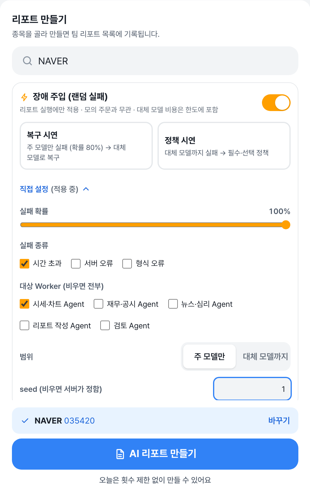 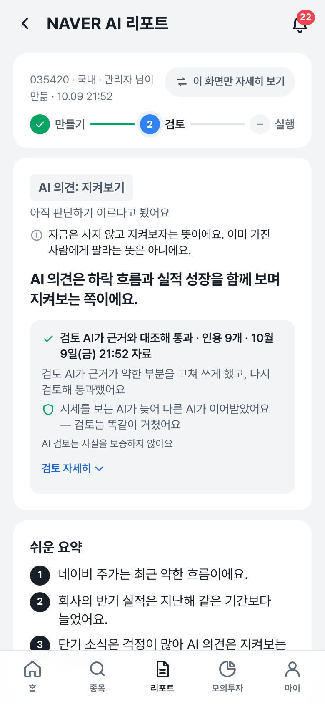

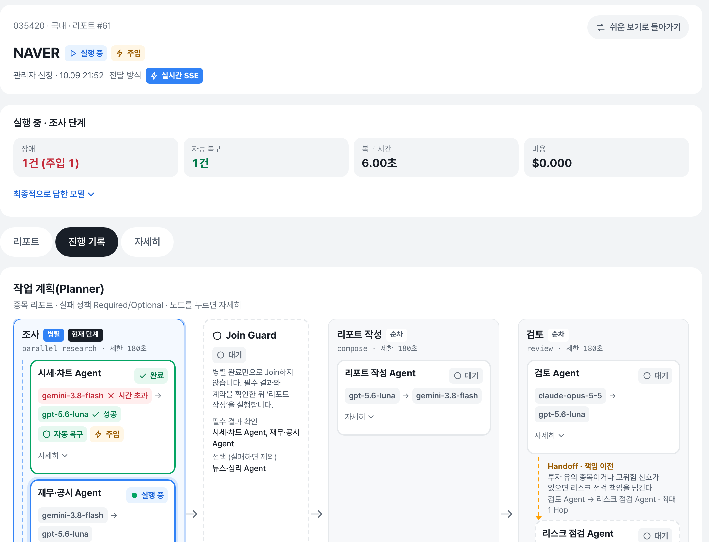

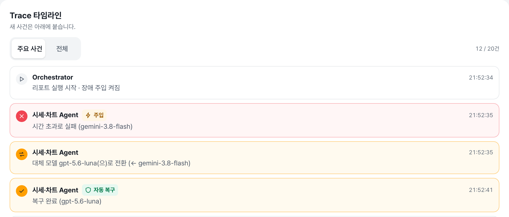

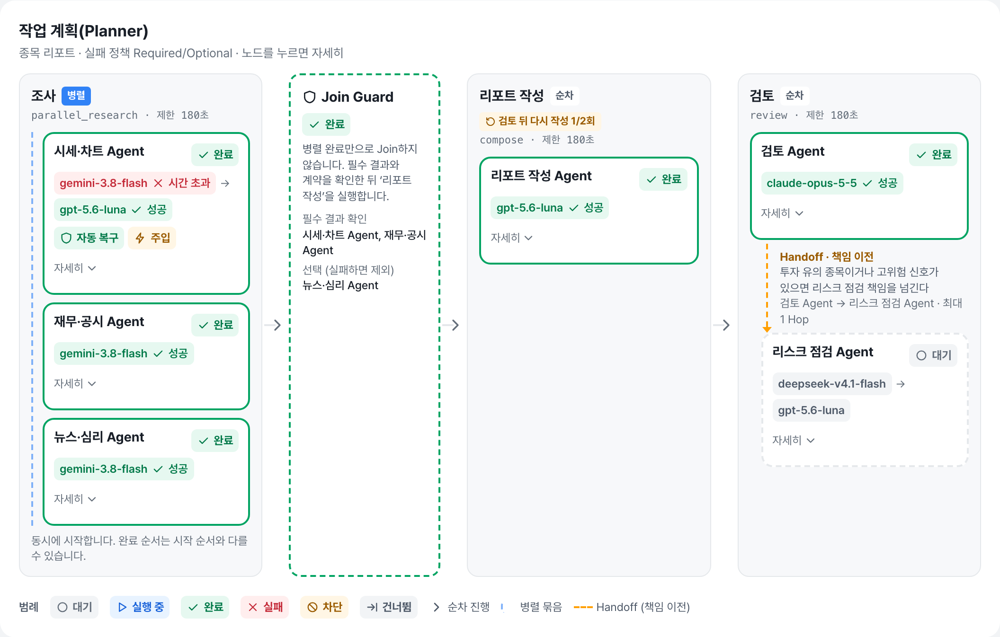

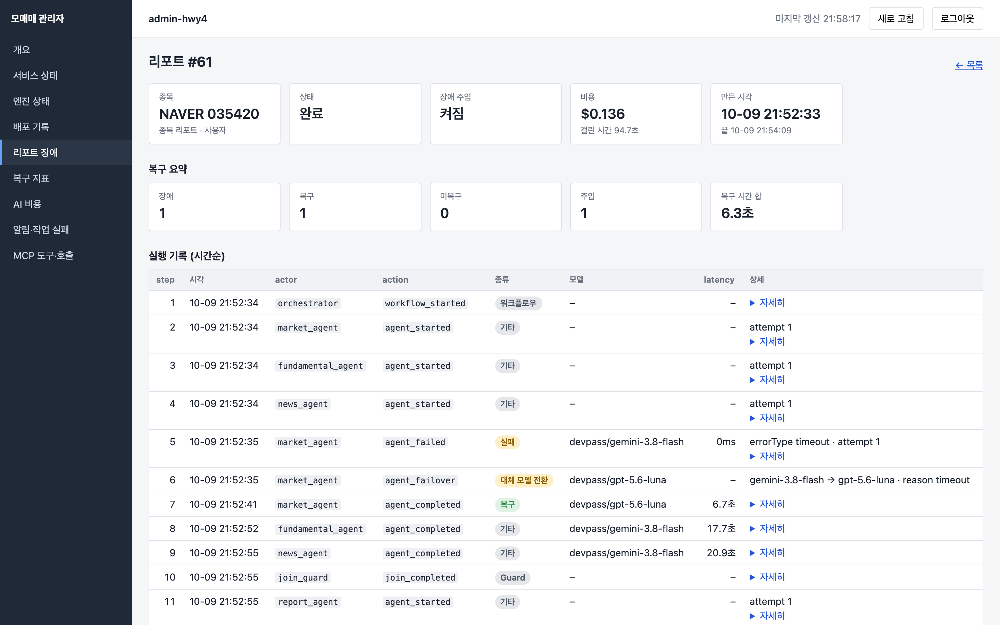

### 5-3. DR-CRT-01 기록 — 같은 리포트 #61

장애 주입과 상관없이 검토 Agent가 첫 초안에 RETRY를 냈다. 수정 지시 요지: "목표 가격 …의 근거" 줄이 초안에 없다(보유 의견이라도 목표 가격을 내지 않는 이유를 밝혀야 한다),
본문에 쓴 푸조 입점 소식·증권사 목표주가 3건·10-07 공시의 출처가 `citations`에 없다. Orchestrator가 이 지시를 붙여 작성 Agent를 한 번 더 실행했고(최대 2라운드 중 1), 두 번째 검토가 PASS 92점을 냈다.
검토 Agent는 초안을 직접 고치지 않았다.

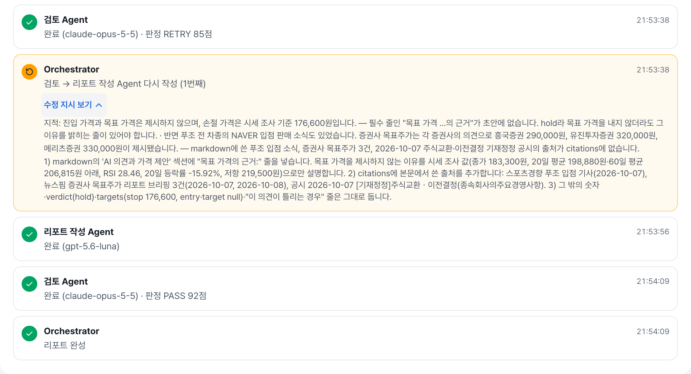

## 6. 실패 사례와 개선 이력

시험 전 리뷰·테스트에서 찾아 고친 것 (시험 결과의 FAIL은 아래에 이어 적는다):

| 날짜 | 찾은 문제 | 고친 것 | 근거 |
|---|---|---|---|
| 2026-10-07 | 호출 제한 60초 = 단계 제한 60초라 timeout 한 번에 마감이 끝나 재시도·전환을 못 함 | 단계 제한 180초 | `00-공통.md` 7절, `test_healing.py::test_stops_at_deadline` |
| 2026-10-08 | 장애 주입 실패가 전역 Circuit Breaker에 쌓여, 주입 리포트 1~2건으로 다른 사용자 리포트까지 5분 동안 실패 | 장애 주입 리포트 전용 Breaker (`ReportBreaker`) | PR #5 리뷰 1번 |
| 2026-10-08 | 큰 seed가 브라우저에서 반올림돼 "같은 설정으로 다시 신청"이 재현되지 않음 | seed 상한 2^53 | PR #5 리뷰 2번 |
| 2026-10-08 | 주 모델 timeout 뒤 같은 모델을 또 60초 기다려 복구가 늦음 | 주 모델 timeout은 바로 대체 모델 (절충안) | `8a4488c`, U21 |
