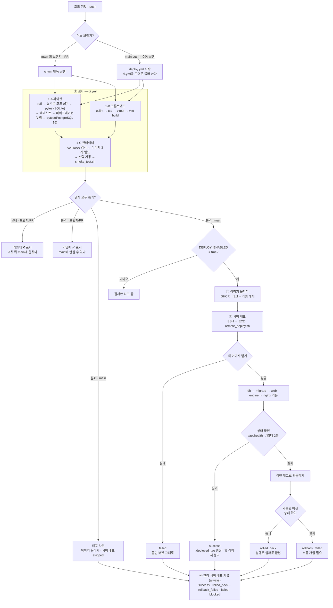
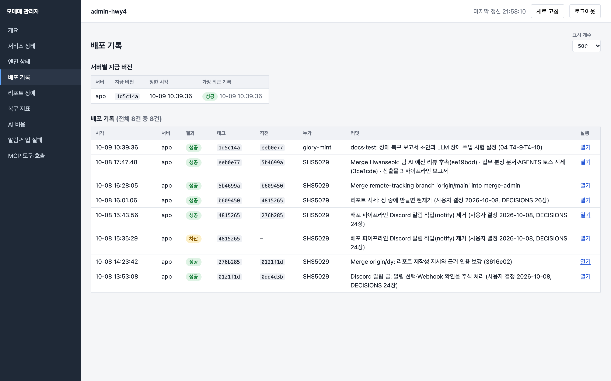

# 산출물 3｜파이프라인 구현 결과 보고서



> 서비스 "모매매" · 저장소 `SHS5029/paper_trading` · 작성 2026-10-08 · 담당 1(팀장·통합, `docs/tasks/01-인프라.md` T1-16)
> 기준: `main` `276b285`. 근거는 `.github/workflows/ci.yml`, `.github/workflows/deploy.yml`, `deploy/remote_deploy.sh`, `deploy/smoke_test.sh`,
> GitHub Actions 실행 기록(`gh run list`, 2026-10-02 ~ 10-08), 운영 서버의 `deploy_history.log`다. 시각은 모두 KST다.
> 설정 방법과 서버 준비는 `docs/DEPLOY.md`에 있고, 이 문서는 구조 설명과 실행 결과를 다룬다.

---

## 1. 한눈에 보기

서비스의 GitHub Actions 워크플로는 두 개다 (관리 서버는 `admin-ci.yml`·`admin-deploy.yml`로 따로 — `admin/`이 바뀔 때만 돈다). 검사를 한 파일(`ci.yml`)에 두고, 배포 워크플로(`deploy.yml`)가 그것을 `workflow_call`로 불러 쓴다.
그래서 **브랜치에서 통과한 검사와 `main`에서 배포 전에 도는 검사가 같다.**

| 워크플로 | 언제 도나 | 하는 일 | 결과 |
|---|---|---|---|
| `ci.yml` (이름 `CI`) | `main`이 아닌 브랜치에 push, PR, `deploy.yml`이 부를 때 | 린트·테스트·빌드·컨테이너 기동 확인 | 커밋 옆 ✅/❌. 배포는 하지 않는다 |
| `deploy.yml` (이름 `Deploy`) | `main`에 push, Actions 화면에서 수동 실행(`workflow_dispatch`) | 검사 → 이미지 올리기 → 서버 배포 → 배포 기록 | 검사를 통과한 커밋만 EC2에 배포 |

작업(job) 구성은 아래와 같다. 앞 작업이 실패하면 `needs`로 이어진 뒤 작업은 돌지 않는다(skipped). 이것이 배포 차단의 핵심이다.

| 작업 | 워크플로 | 앞 작업(`needs`) | 도는 조건 | 시간 제한 |
|---|---|---|---|---|
| 1-A 파이썬 (린트·테스트) | ci | – | 항상 | 15분 |
| 1-B 프론트엔드 (린트·타입·테스트·빌드) | ci | – | 항상 (1-A와 동시에) | 10분 |
| 1-C 컨테이너 (빌드·기동 확인) | ci | 1-A, 1-B | 둘 다 통과 | 30분 |
| ② 이미지 올리기 (GHCR) | deploy | ① 검사 전체 | `DEPLOY_ENABLED == true`이고 `main` | 30분 |
| ③ 서버 배포 | deploy | ② | ②가 통과 | 20분 |
| ④ 관리 서버에 배포 기록 | deploy | ①②③ | 항상(`always()`), 관리 서버 변수가 있을 때 | 5분 |

설계 원칙 네 가지:

- **검사는 비밀 값 없이 돈다.** 증권사·AI를 부르지 않고(테스트는 가짜 객체), DB도 작업 안에서 띄웠다 버린다. 그래서 팀원 브랜치와 PR에서도 똑같이 돈다.
- **이미지 태그 = 커밋 해시.** 서버에서 돌고 있는 버전이 어느 커밋인지 바로 알 수 있고, 되돌릴 때 태그만 바꾸면 된다.
- **새 커밋이 오면 이전 검사는 취소한다** (`ci.yml`의 `concurrency: ci-<이벤트>-<브랜치>`, `cancel-in-progress: true`). 새 커밋이 이전 변경을 포함하므로 잃는 것이 없다.
- **서버 배포는 한 번에 하나, 도는 중인 배포는 끊지 않는다** (`deploy-production` 그룹, `cancel-in-progress: false`). 서버가 중간 상태로 남지 않게 한다.

---

## 2. 단계별 설명

순서도의 번호를 그대로 따른다.

### 2-0. 코드 커밋 (트리거)

| 이벤트 | 실행되는 워크플로 | 비고 |
|---|---|---|
| 팀원 브랜치(`Hwanseok`, `dy`, `yubeen`, `inhye`, `ju`, `feat/*`)에 push | `CI` | 합치기 전에 깨진 곳을 본다 |
| PR 생성·갱신 | `CI` | PR #5(장애 주입)처럼 PR로 합칠 때 |
| `main`에 push | `Deploy` (안에서 `CI`를 부름) | 팀 규칙상 구현이 끝나면 테스트 후 `main`에 push한다 (AGENTS.md) |
| Actions 화면에서 `Deploy` 실행 | `Deploy` | 같은 커밋을 다시 배포할 때. 첫 배포(10-06)가 이 방법이었다 |

비공개 저장소의 무료 요금제라 GitHub 브랜치 보호(필수 검사)를 쓸 수 없다(API 응답 403). 그래서 `main`을 지키는 장치는 `deploy.yml` 안의 `needs` 연결이다.
`main`에 깨진 커밋이 들어와도 서버에는 나가지 않는다.

### 2-1. ① 검사 — 1-A 파이썬 작업

`ubuntu-24.04`에서 Python 3.12(운영 이미지와 같은 버전)로 돈다. 작업 안에 PostgreSQL 16 서비스 컨테이너를 띄운다(운영과 같은 버전, `pg_isready`로 준비 확인).

| 순서 | 단계 | 명령 | 확인하는 것 | 실패하면 |
|---|---|---|---|---|
| 1 | 의존성 설치 | `uv sync --frozen` | `uv.lock`과 정확히 같은 의존성 | 잠금 파일이 어긋나면 실패 |
| 2 | 린트 | `uv run ruff check .` | 코드 규칙 | 작업 실패 |
| 3 | 실주문 코드 0건 | `git ls-files … \| grep -E 'create_order\|LIVE_TRADING\|--live\|--bypass\|tossinvest'`, `orders.py` 파일 검사 | 모의매매 전용 서비스의 안전 규칙(토스 조회 클라이언트 `data/toss.py` 한 곳만 예외) | `::error::`로 위치를 찍고 실패 |
| 4 | 테스트 (엔진 + 백엔드, SQLite) | `uv run pytest -q` | 엔진 단위 테스트 + 백엔드 통합 테스트 (메모리 SQLite) | 한 건이라도 실패하면 작업 실패 |
| 5 | 백테스트 테스트 | `uv run pytest backtest -q` | 백테스트 모듈 | 작업 실패 |
| 6 | 빠진 마이그레이션 확인 | `manage.py makemigrations --check --dry-run` | 모델을 고치고 마이그레이션을 빠뜨리지 않았는지 | 작업 실패 (배포 때 DB 표가 어긋나는 것을 막는다) |
| 7 | 백엔드 테스트 (PostgreSQL) | `TEST_WITH_POSTGRES=1 uv run pytest backend -q` | 같은 백엔드 테스트를 운영과 같은 DB에서 다시 | 작업 실패 (SQLite에서만 통과하는 코드를 막는다) |

- 입력: 커밋된 소스, `uv.lock`. 출력: 통과/실패, 각 단계 로그.
- 성공 조건: 7단계 모두 통과(테스트 실패 0건).

### 2-2. ① 검사 — 1-B 프론트엔드 작업

Node 22(운영 nginx 이미지의 빌드 단계와 같은 버전), `frontend/`에서 돈다. 1-A와 동시에 시작한다.

| 순서 | 단계 | 명령 | 확인하는 것 |
|---|---|---|---|
| 1 | 의존성 설치 | `npm ci` | `package-lock.json`과 같은 의존성 |
| 2 | 린트 | `npx eslint .` | 코드 규칙 |
| 3 | 타입 검사 | `npx tsc --noEmit` | TypeScript 타입 (API 응답 형식과 화면이 어긋나지 않는지) |
| 4 | 테스트 | `npx vitest run` | 화면·부품·API 호출 단위 테스트, 색 토큰 규칙(`colors.test.ts`) 등 |
| 5 | 빌드 | `npx vite build` | 운영 번들이 만들어지는지 |

- 성공 조건: 5단계 모두 통과. 실패하면 작업 실패 → 1-C가 돌지 않는다.

### 2-3. ① 검사 — 1-C 컨테이너 작업 (빌드 + 기동 확인)

1-A와 1-B가 **둘 다 통과해야** 시작한다(`needs: [python, frontend]`). 이 작업이 파이프라인의 **빌드** 단계이자 **시스템 통합 시험**이다.

| 순서 | 단계 | 내용 |
|---|---|---|
| 1 | 환경 파일 만들기 | `deploy/.env.docker.example`을 복사하고 `DJANGO_SECRET_KEY`·`POSTGRES_PASSWORD`를 `openssl rand`로 만든 임의 값으로 채운다 (저장소 비밀 값을 쓰지 않는다) |
| 2 | compose 파일 검사 | 운영(`docker-compose.yml`)과 개발(`compose.dev.yml`) 구성이 문법상 맞는지 `docker compose config --quiet` |
| 3 | 이미지 3개 빌드 | `deploy/Dockerfile`의 `web`(Django + gunicorn)·`engine`(엔진 루프 + PDF용 Chromium·한글 글꼴), `deploy/nginx/Dockerfile`(React 빌드 + nginx). Buildx GHA 캐시를 쓰고, 같은 캐시를 ② 이미지 올리기가 받아 쓴다 |
| 4 | 스택 띄우기 | 운영과 같은 `docker-compose.yml`로 nginx·web·engine·migrate·db·redis를 띄운다 |
| 5 | 기동 확인 | `deploy/smoke_test.sh` — nginx를 거쳐 29개 항목 확인 (아래) |
| 6 | 실패 시 로그 | `if: failure()` — `compose ps -a`, 마지막 로그 80줄 |
| 7 | 정리 | `if: always()` — `compose down -v` (볼륨까지 지움) |

`smoke_test.sh`가 확인하는 29개 항목:

| 묶음 | 항목 수 | 내용 |
|---|---|---|
| 상태 확인 | 2 | nginx `/healthz` 200, API `/api/health` 200 |
| 화면·정적 파일 | 4 | `/`, SPA 경로 `/stocks/005930`, 빌드된 JS 파일, 관리자 화면 정적 파일 |
| 압축·보안 헤더 | 10 | 빌드 파일 gzip, `X-Frame-Options`·`X-Content-Type-Options`·`Referrer-Policy`·`Permissions-Policy`를 화면과 빌드 파일에서 각각(8), API 응답의 `X-Frame-Options`가 한 번만 붙는지 |
| 인증 | 8 | 로그인 없이 401(3), CSRF 쿠키 받기, CSRF 토큰 없는 로그인 403, 로그인 200, 로그인 후 내 정보 200, 로그아웃 204 — 시험용 계정은 만들었다가 끝나면 지운다 |
| 로그인 후 API | 4 | 리포트 실행 계획(DB + 리포트 구성 YAML), AI 추천 표, 매매 계획 표, 알림 표 |
| 엔진 | 1 | 엔진 컨테이너(읽기 전용·root 아닌 사용자)에서 Chromium이 한글 PDF를 만드는지 |

- 입력: 소스, Dockerfile 2개, compose 파일. 출력: 이미지 3개(이 작업 안에서만 쓰고 레지스트리에 올리지 않는다), GHA 빌드 캐시.
- 성공 조건: 빌드 성공 + 29개 항목 통과. 실패하면 로그를 남기고 작업 실패 → `Deploy`에서는 ②③이 돌지 않는다.

### 2-4. 배포 게이트

`deploy.yml`의 ② 이미지 올리기 작업에 걸린 조건이다.

```yaml
publish:
  needs: ci                                                        # ① 검사 전체(1-A·1-B·1-C)가 통과해야 한다
  if: vars.DEPLOY_ENABLED == 'true' && github.ref == 'refs/heads/main'
deploy:
  needs: publish                                                   # 이미지가 올라가야 서버 배포가 돈다
```

- 검사가 하나라도 실패하면 `publish`·`deploy`는 **skipped**로 끝난다 → 서버는 아무것도 받지 않는다.
- `DEPLOY_ENABLED`는 서버를 준비하기 전(10-02 ~ 10-05)에는 꺼 두었다. 그때 `main` push는 검사만 돌았다. 10-06 EC2 연결 후 `true`.

### 2-5. ② 이미지 올리기 (GHCR)

| 항목 | 내용 |
|---|---|
| 입력 | 검사를 통과한 커밋, 1-C가 만든 GHA 빌드 캐시 |
| 처리 | `ghcr.io/shs5029/paper-trading-{web,engine,nginx}:<커밋 해시 40자>`로 빌드·push. 1-C의 캐시를 받으므로 같은 커밋이면 다시 만드는 층이 없다 (평균 1.5분) |
| 인증 | 워크플로의 `GITHUB_TOKEN` (`packages: write`만, 작업이 끝나면 만료). 따로 만든 토큰이 없다 |
| 출력 | `image_prefix`, `image_tag` (③으로 넘긴다) |
| 실패 처리 | 작업 실패 → ③ skipped. 관리 서버 기록은 `failed` |

### 2-6. ③ 서버 배포 (SSH → EC2)

GitHub 실행기에서 EC2(Ubuntu, `/home/ubuntu/paper_trading`)에 SSH로 들어가 서버 스크립트를 돌린다.

| 순서 | 단계 | 내용 |
|---|---|---|
| 1 | SSH 준비 | 필수 변수(`DEPLOY_HOST`·`DEPLOY_USER`·`DEPLOY_DIR`·`DEPLOY_HOST_KEY`·`DEPLOY_SSH_KEY`)가 비었는지, `DEPLOY_DIR`에 허용 문자만 있는지 검사. **서버 호스트 키는 저장소 변수에 적어 둔 것만 믿는다**(`StrictHostKeyChecking yes`, 접속하면서 받아 오지 않음). `BatchMode`, `ConnectTimeout 20`, `ServerAliveInterval 30` |
| 2 | 배포 파일 올리기 | `docker-compose.yml`, `remote_deploy.sh`를 `scp` |
| 3 | 서버에서 이미지 받아 띄우기 | 레지스트리 토큰을 표준 입력으로 넘겨 `docker login ghcr.io` → `remote_deploy.sh` 실행 → 출력의 마지막 `DEPLOY_RESULT=… PREVIOUS=…` 줄을 읽어 작업 출력(`result`, `previous`)으로 남긴다 |
| 4 | 레지스트리 로그아웃 | `if: always()` — 서버에서 `docker logout ghcr.io` |
| 5 | SSH 키 지우기 | `if: always()` — 실행기의 키 파일 삭제 |

서버 스크립트 `remote_deploy.sh`의 동작:

1. `.env.docker`가 있는지 확인한다 (파이프라인은 이 파일을 만들거나 바꾸지 않는다. 비밀 값은 서버에만 있다).
2. 직전에 성공한 태그를 `.deployed_tag`에서 읽는다.
3. 새 태그의 이미지 3개를 받는다. **받지 못하면 아무것도 바꾸지 않고 끝난다** (돌던 버전 그대로).
4. `docker compose up -d`: db·redis 준비 → `migrate` 성공 → web·engine 기동 → web 상태 확인 통과 → nginx 기동. 마이그레이션이 실패하면 web이 뜨지 않는다.
5. nginx를 거쳐 `/api/health`와 `/`를 2초 간격 60번(최대 2분) 확인한다.
6. 통과하면 태그를 `.deployed_tag`에 적고, 지금 버전과 직전 버전 이미지만 남기고 지운다(디스크 관리). `deploy_history.log`에 "성공" 한 줄.
7. 실패하면 `compose ps`·최근 로그 40줄을 남기고 **직전 태그로 다시 띄워 상태를 확인한다.** 결과와 상관없이 실행은 실패(exit 1)로 끝난다.

| 결과 코드 | 뜻 | 서버 상태 |
|---|---|---|
| `success` | 새 버전이 상태 확인을 통과 | 새 버전 |
| `rolled_back` | 새 버전 실패 → 직전 버전으로 되돌림 성공 | 직전 버전 (서비스 유지) |
| `rollback_failed` | 새 버전 실패 → 되돌리기도 실패 | 확인 필요 (**수동 개입**) |
| `failed` | 이미지 받기 실패, 또는 되돌릴 직전 버전이 없음 | 받기 실패면 그대로, 첫 배포 실패면 없음 |

- DB 마이그레이션은 되돌리지 않는다. 되돌릴 수 없는 모델 변경(열 삭제 등)은 "코드가 안 쓰게 하는 배포"와 "지우는 배포" 두 번으로 나눈다 (`docs/DEPLOY.md` 6장).

### 2-7. ④ 관리 서버에 배포 기록

배포 결과를 별도 관리 서버(EC2 ②, 코드는 이 저장소의 `admin/`, 조회 전용 관리자 화면 — 서버 구성은 산출물 2의 0장)에 한 줄씩 남긴다. 2026-10-08 13:42 배포(`0121f1d`)부터 켜져 있다.

| 항목 | 내용 |
|---|---|
| 조건 | `always()` + 관리 서버 변수(`ADMIN_RECORD_HOST`)가 있고 `DEPLOY_ENABLED`이고 `main`. 취소된 실행은 남기지 않는다 |
| 결과 판정 | 검사 실패 → `blocked` · 배포 성공 → `success` · 배포 skipped(이미지 올리기 실패) → `failed` · 그 밖 → 서버 스크립트의 결과 코드 |
| 보내는 것 | `{at, server, tag, previous, result, actor, commit(첫 줄 120자), runUrl}` JSON 한 줄 |
| 보안 | 관리 서버의 `authorized_keys`가 이 키에 강제 명령(`deploy_record.py`)을 걸어 두었다 — 이 키로는 기록 한 줄을 더하는 것 말고 아무것도 할 수 없다. 호스트 키도 변수로 고정 |
| 실패 처리 | `continue-on-error: true` — 관리 서버가 응답하지 않아도 배포 실행 결과는 바뀌지 않는다 |

### 2-8. 단계별 정의 요약

| 단계 | 입력 | 출력 | 성공 조건 | 실패 처리 |
|---|---|---|---|---|
| 1-A 파이썬 | 소스, `uv.lock` | 린트·테스트 결과 | 린트 통과, 실주문 코드 0건, 테스트 실패 0건, 빠진 마이그레이션 없음 | 작업 실패 → 1-C·②·③ skipped |
| 1-B 프론트엔드 | `frontend/`, `package-lock.json` | 검사 결과, 빌드 번들 | 린트·타입·테스트·빌드 통과 | 작업 실패 → 1-C·②·③ skipped |
| 1-C 컨테이너 (빌드·통합) | 소스, Dockerfile, compose | 이미지 3개(로컬), 빌드 캐시 | 빌드 성공, 스모크 29개 통과 | 컨테이너 상태·로그 출력, 스택 정리, ②·③ skipped |
| ② 이미지 올리기 | 검사 통과 커밋, 빌드 캐시 | GHCR 이미지 3개(태그 = 커밋 해시) | push 성공 | ③ skipped, 기록 `failed` |
| ③ 서버 배포 | 이미지 태그, compose, 서버 `.env.docker` | 새 버전 기동, `.deployed_tag`, `deploy_history.log` | 이미지 받기 + 기동 + 상태 확인(최대 2분) 통과 | 받기 실패: 그대로 둠 / 기동·상태 확인 실패: 직전 버전으로 되돌림 |
| ④ 관리 서버 기록 | ①②③ 결과 | 배포 기록 한 줄 | 기록 전송 | 무시(`continue-on-error`) — 배포 결과에 영향 없음 |

---

## 3. 테스트 데이터와 커버리지 기준

### 3-1. 테스트 층과 개수

대표 실행([`Deploy` #37731143666](https://github.com/SHS5029/paper_trading/actions/runs/37731143666), 커밋 `276b285`) 로그에서 뽑은 수다.

| 층 | 대상 | 어디서 | 실행 수 (통과/전체) |
|---|---|---|---|
| 단위 | 엔진(`engine/tests`) — 선별·리스크 엔진·모의 체결·손절가 계산·지표·리포트 렌더 | 1-A 4단계 | 817 / 817 |
| 단위 | 백테스트(`backtest/`) | 1-A 5단계 | 12 / 12 |
| 단위·부품 | 프론트(`vitest`, 38개 파일) — 화면 부품, API 호출, 쉬운 보기 문구, 색 토큰 | 1-B 4단계 | 686 / 686 |
| 통합 | 백엔드(`backend/*/tests`) — Django 테스트 클라이언트로 API → DB → 엔진 접점 → Agent 워크플로까지, 메모리 SQLite | 1-A 4단계 | 1,287 / 1,287 |
| 통합 | 같은 백엔드 테스트를 PostgreSQL 16에서 다시 | 1-A 7단계 | 1,287 / 1,287 |
| 시스템 | 운영 구성 컨테이너 전체를 nginx를 거쳐 확인 (`smoke_test.sh`) | 1-C 5단계 | 29 / 29 |

1-A 4단계의 `pytest`는 엔진과 백엔드를 한 번에 돌린다 (로그상 `2104 passed` = 엔진 817 + 백엔드 1,287).

Agent 워크플로와 장애 복구(AutoHealing)의 통합 테스트는 `backend/reports/tests/`에 있고, 넣으면 CI가 그대로 돌린다 (워크플로를 고칠 필요가 없다).
테스트는 코드와 같은 기능 폴더(`autohealing/`·`guardrails/`·`orchestration/` …)에 둔다 (2026-10-11 정리 — `docs/DECISIONS.md` 29장). 주요 파일(개수는 `3ce1cde` 수집 기준):

| 파일 | 개수 | 확인하는 흐름 |
|---|---|---|
| `autohealing/test_healing.py` | 53 | 재시도, 대체 모델 전환, Circuit Breaker, 오류 유형 분류 |
| `autohealing/test_chaos.py` | 45 | 장애 주입(시드 고정) → 실제 복구 경로를 거쳐 리포트가 끝까지 나오는지, 다른 리포트를 막지 않는지 |
| `guardrails/test_contracts.py` | 42 | Worker 출력 계약(형식이 깨진 응답을 거르는지) |
| `orchestration/test_orchestrator.py` | 30 | 실행 계획, Join, Handoff, 필수 Worker 실패 시 뒤 단계 건너뜀 |
| `orchestration/test_state.py` / `guardrails/test_guards.py` | 16 / 12 | Shared State·Trace 기록, Guard 사건 |
| `test_sse.py` | 10 | 실시간 진행 스트림 |
| `orchestration/test_runner.py` | 9 | 엔진 루프에서 리포트가 신청 → 완료까지 가는지 |
| `autohealing/test_recovery_cases.py` | 7 | 자동 복구율·평균 복구시간 계산 기준 사례 (관리 서버 백엔드와 같은 파일 `admin/recovery_cases.json`) |

### 3-2. 테스트 데이터

| 원칙 | 방법 |
|---|---|
| 실제 증권사·AI·외부 알림을 부르지 않는다 | 루트 `conftest.py`가 모든 테스트에서 증권사 키(`BROKER`, `CLIENT_*`, `KIWOOM_*`)와 알림 설정을 비우고, 자동 작업(`AUTO_REPORT`·`AUTO_RECOMMEND`·`LONGTERM_JOBS`)을 끈다. 시세·LLM은 가짜 클라이언트를 `config.engine`에 끼운다 |
| Agent 응답은 고정 표본 | `backend/reports/tests/conftest.py`의 `SAMPLES`, `FakeWorker`, `fake_team` — 정상 응답, 형식 깨짐, 시간 초과 등을 정해진 대로 낸다 |
| 장애 주입은 재현 가능 | 장애 주입 설정에 시드(`seed`)를 고정해 같은 입력이면 같은 Worker가 실패한다 |
| DB는 매번 새로 | 단위·통합: 메모리 SQLite(`config.settings_test`). PostgreSQL 단계: 작업 안의 서비스 컨테이너(비밀번호 `ci-only`, 작업이 끝나면 사라짐) |
| 컨테이너 시험 데이터 | `.env.docker`를 예시 파일 + 임의 비밀 값으로 만들고, 스모크 시험 계정은 실행마다 새로 만들었다 지운다. 끝나면 `down -v`로 볼륨까지 지운다 |
| 고정 기준 사례 | 복구 지표 계산 기준 `admin/recovery_cases.json` — 서비스 테스트와 관리 서버 백엔드가 같은 파일을 읽어 두 셈법이 어긋나지 않게 한다 |

### 3-3. 커버리지 기준

| 기준 | 현재 | 강제 여부 |
|---|---|---|
| **테스트 통과율 100%** (실패 0건) | 대표 실행 4,118건 전부 통과 (817 + 12 + 686 + 1,287 + 1,287 + 29) | **강제** — 한 건이라도 실패하면 작업 실패 → 배포 차단 |
| 같은 백엔드 테스트를 두 DB에서 | SQLite·PostgreSQL 모두 1,287건 | **강제** |
| 빠진 마이그레이션 0건 | `No changes detected` | **강제** |
| 장애 유형별 복구 경로 테스트 | 위 3-1 표 (재시도·대체 모델·Circuit Breaker·Join 차단·장애 주입) | 리뷰로 확인 |
| 라인 커버리지 | **CI에서 측정하지 않는다.** 참고로 2026-10-08에 로컬에서 한 번 측정했다(아래) | 강제하지 않음 (8장 개선 과제) |

참고 측정 — `uv run --with pytest-cov pytest --cov=engine/paper_engine --cov=backend` (작업 트리 `3ce1cde`, 2,106건 통과, 테스트·마이그레이션 파일 제외):

| 범위 | 문장 수 | 커버리지 |
|---|---|---|
| 파이썬 전체 | 15,308 | **93.2%** |
| 엔진 `engine/paper_engine` | 6,296 | 90.0% |
| 백엔드 전체 | 9,012 | 95.4% |
| └ `reports` (Agent 워크플로·AutoHealing) | 4,165 | 96.6% |
| └ `trading` / `accounts` / `notifications` | 1,248 / 516 / 381 | 96.6% / 96.5% / 99.0% |
| └ `autotrade` / `analysis` / `longterm` | 1,277 / 555 / 727 | 93.3% / 92.8% / 92.6% |

프론트엔드 커버리지는 측정하지 않았다.

---

## 4. 테스트 실패 시 배포 차단 정책

### 4-1. 차단 장치

1. **작업 의존(`needs`)**: 1-C는 1-A·1-B를, ②는 ① 전체를, ③은 ②를 기다린다. 앞이 실패하면 뒤는 skipped — 이미지가 레지스트리에 올라가지 않으므로 서버가 받을 것이 없다.
2. **서버 상태 확인과 되돌리기**: 검사를 통과해도 서버에서 새 버전이 뜨지 않으면(마이그레이션 실패, web 상태 확인 실패, nginx 응답 없음) 직전 버전으로 되돌린다.
3. **브랜치 검사**: `main`에 합치기 전 브랜치 push·PR에서 같은 검사가 돈다. 깨진 커밋은 커밋 옆 ❌로 먼저 드러난다.

### 4-2. 어디서 실패하면 어떻게 되나

| 실패 지점 | 이미지 | 서버 | 관리 서버 기록 | Actions 실행 결과 |
|---|---|---|---|---|
| 1-A 또는 1-B (린트·테스트·빌드) | 올리지 않음 | 그대로 | `blocked` | ❌ 실패 (이미지·배포 skipped) |
| 1-C (이미지 빌드·스모크) | 올리지 않음 | 그대로 | `blocked` | ❌ 실패 (이미지·배포 skipped) |
| ② 이미지 올리기 | 일부만 올라갔을 수 있음 | 그대로 | `failed` | ❌ 실패 (배포 skipped) |
| ③ 이미지 받기 | 올라감 | 그대로 | `failed` | ❌ 실패 |
| ③ 기동·상태 확인 | 올라감 | 직전 버전으로 되돌림 | `rolled_back` / `rollback_failed` | ❌ 실패 |
| 시간 제한 초과 (어느 작업이든) | 그 작업 실패와 같음 | 같음 | 같음 | 같음 |

### 4-3. 실제 증빙

| 증빙 | 실행 | 내용 |
|---|---|---|
| `main`의 검사 실패 → 이미지·배포 skipped | [`Deploy` #36984838873](https://github.com/SHS5029/paper_trading/actions/runs/36984838873) (10-02 17:34, `612b228`) | 1-A가 시작 단계에서 실패(`Unable to resolve action astral-sh/setup-uv@v10` — 액션이 major 태그를 내지 않음) → 1-C·②·③ **skipped**. 2분 뒤 `f3c9eb1`(정확한 버전 `v10.2.0`으로 고침)이 통과. 단, 이때는 `DEPLOY_ENABLED`를 켜기 전이었다 |
| **배포가 켜진 `main`에서 테스트 실패 → 배포 차단** | [`Deploy` #37738223848](https://github.com/SHS5029/paper_trading/actions/runs/37738223848) 1차 시도 (10-08 15:33, `4815265`) | `DEPLOY_ENABLED=true` 상태. 1-A 4단계 `1 failed, 2103 passed` (`test_run_engine_once_runs_report_to_completion`, `database table is locked`) → 1-C·②·③ **skipped**, 서버는 `276b285` 그대로. 관리 서버 기록 `{"tag":"4815265…","result":"blocked",…}`. 의도한 시험이 아니라 불안정 테스트(8장 6번) 때문에 생긴 실패다. 실패한 작업만 다시 돌린 2차 시도는 전부 통과해 배포됐다 |
| 브랜치 테스트 실패 | [`CI` #37731395828](https://github.com/SHS5029/paper_trading/actions/runs/37731395828) (10-08 14:14, `Hwanseok` `ee19bdd`) | 1-A 4단계 `1 failed, 2104 passed` (`test_run_engine_once_runs_report_to_completion`, 로그에 `database table is locked`) → 1-C skipped. 이 커밋은 지금까지(10-08) `main`에 들어가지 않았다 |
| 브랜치 프론트 테스트 실패 | [`CI` #37731005614](https://github.com/SHS5029/paper_trading/actions/runs/37731005614) (10-08 14:10, `yubeen` `93eaf66`), [`CI` #37715638963](https://github.com/SHS5029/paper_trading/actions/runs/37715638963) (10-08 10:59, `ju` `5dad679`) | 1-B 테스트 단계 실패 → 1-C skipped |
| 실패한 커밋이 서버에 나간 적 없음 | 운영 서버 `deploy_history.log` | 위 네 커밋(`612b228`, `ee19bdd`, `93eaf66`, `5dad679`)은 배포 기록에 없다. 기록된 24개 태그는 모두 `Deploy` 검사를 통과한 커밋이다 |
| 서버 되돌리기 | 2026-10-02 로컬 검증 (`docs/DEPLOY.md` 8장) | 로컬 레지스트리에 정상 이미지와 web이 죽는 이미지를 올려 `remote_deploy.sh` 실행: 정상 → 성공, 고장 → 실패로 끝나고 정상 버전으로 복귀. **운영에서는 24번 모두 성공해 되돌리기가 일어난 적이 없다** |

관리 서버의 배포 기록 화면 (2026-10-09 캡처) — 10-08 15:35 `4815265` 줄이 **차단**, 같은 커밋의 2차 시도가 15:43 **성공**이다.



### 4-4. 의도적 배포 차단 시험 (DR-CI-01) — 미실시

`main`에서 테스트 실패로 배포가 멈추는 것을 직접 보이는 시험이다. 2026-10-09 진행 예정(`docs/tasks/01-인프라.md` T1-14). 결과는 이 표에 채운다.

절차: 실패하는 테스트(`assert False`)를 넣은 커밋을 `main`에 push → `Deploy`에서 `검사` 실패, `이미지 올리기`·`서버 배포` skipped 확인 → 서버의 `.deployed_tag`와 화면이 그대로인지 확인 → 관리 서버 배포 기록에 `blocked` 확인 → 되돌리는 커밋 push → 정상 배포 확인.

| 항목 | 기록 |
|---|---|
| Scenario ID | DR-CI-01 |
| 주입 | 실패하는 테스트 1건을 넣고 `main`에 push |
| 기대 동작 | 검사 실패, 이미지 올리기·서버 배포 skipped, 서버 버전 그대로, 관리 서버 기록 `blocked` |
| 실행 ID · 커밋 · 시각 | (시험 후 기입) |
| 실제 동작 | (시험 후 기입) |
| 서버 `.deployed_tag` 전후 | (시험 후 기입) |
| 판정 · 증빙 | (시험 후 기입 — Actions 화면 캡처, 관리 서버 배포 기록 캡처) |

---

## 5. 알림과 에스컬레이션

### 5-1. 결과가 전달되는 곳

| 채널 | 내용 | 현재 상태 |
|---|---|---|
| 관리 서버 배포 기록 (`record` 작업) | 결과 코드·커밋·직전 태그·실행 링크 | **동작 중** — 10-08 13:42(`0121f1d`)부터. 관리자 화면에서 배포 이력으로 본다 |
| GitHub 커밋·PR 표시 | 커밋 옆 ✅/❌, PR 검사 결과 | 동작 중 |
| GitHub Actions 기본 알림 | 실행한 사람에게 실패 알림(메일·웹, 각자 계정 알림 설정에 따름) | GitHub 기본 기능 |
| 서버 `deploy_history.log` | 배포마다 시각·태그·결과 한 줄 | 동작 중 (24줄) |

### 5-2. 지연 처리

"지연"은 시간 제한으로 다룬다. 제한을 넘기면 그 작업은 실패로 끝나고, 실패와 같은 경로(차단·기록·알림)를 탄다.

| 대상 | 제한 | 평소 소요 (실배포 24회 평균) |
|---|---|---|
| 1-A 파이썬 | 15분 | 1.3분 |
| 1-B 프론트엔드 | 10분 | 3.0분 |
| 1-C 컨테이너 | 30분 | 3.7분 |
| ② 이미지 올리기 | 30분 | 1.5분 |
| ③ 서버 배포 | 20분 | 1.5분 |
| ③ 안의 상태 확인 | 2분 (2초 × 60번) | – |
| ③ SSH 연결 | 접속 20초, 30초마다 연결 확인 | – |
| ④ 관리 서버 기록 | 5분 | 수 초 |
| 전체 `Deploy` | – | 10.0분 (최소 9.1, 최대 12.2) |

"오래 걸리는 중"을 알리는 별도 알림은 없다 (8장).

### 5-3. 에스컬레이션

| 결과 | 누가 먼저 보나 | 다음 조치 |
|---|---|---|
| `blocked` (검사 실패) | 커밋한 팀원 | Actions 로그에서 실패 단계 확인 → 고쳐 다시 push. 서버는 그대로라 서비스 영향 없음 |
| `failed` (이미지 올리기·받기 실패) | 커밋한 팀원 → 담당 1(인프라) | 레지스트리·서버 디스크·네트워크 확인 → Actions에서 `Deploy` 다시 실행. 서버는 그대로 |
| `rolled_back` | 담당 1 + 커밋한 팀원 | 서비스는 직전 버전으로 돌고 있다. ③ 작업 출력의 `compose ps`·로그로 원인 확인(대개 마이그레이션·설정) → 고친 커밋 push |
| `rollback_failed` | **담당 1 즉시** | 서비스가 멈췄을 수 있다. 서버에 접속해 `docker compose ps`·로그 확인 → 이미지가 남은 태그로 손으로 되돌리기: `IMAGE_PREFIX=ghcr.io/shs5029/paper-trading IMAGE_TAG=<태그> bash remote_deploy.sh` (`docs/DEPLOY.md` 6장). 더 예전 버전은 `git revert` 후 push |

"먼저 보는" 경로는 GitHub 기본 실패 알림(실행한 사람)과 관리 서버의 배포 기록 화면이다.

---

## 6. 실제 실행 결과

### 6-1. 대표 실행

가이드의 기입 양식 그대로다.

| 항목 | 내용 |
|---|---|
| Pipeline ID | `Deploy` #37731143666 |
| Commit | `276b285` — Merge origin/dy: 리포트 재작성 지시와 근거 인용 보강 (3616e02) |
| 시작·종료 시각 | 2026-10-08 14:11:38 ~ 14:23:47 |
| 단위 테스트 | 엔진 817/817, 백테스트 12/12, 프론트 686/686 (38개 파일) — 모두 통과 |
| 통합 테스트 | 백엔드 SQLite 1,287/1,287, 백엔드 PostgreSQL 1,287/1,287, 빠진 마이그레이션 없음, 컨테이너 스모크 29/29 |
| 린트·안전 검사 | ruff `All checks passed!`, 실주문 코드 0건, eslint·tsc 통과, vite build 성공 |
| 배포 결과 | 성공 — `DEPLOY_RESULT=success PREVIOUS=0121f1d…`, 서버 `deploy_history.log` 14:23:33 "성공" |
| 총 실행시간 | 12분 09초 (검사 작업은 14:12:58에 시작 — 직전 실행(`1262cc9`)의 검사가 14:12:55에 취소된 직후) |
| 알림 전송 | 관리 서버 배포 기록: 성공 (아래 JSON) |
| 로그 URL | https://github.com/SHS5029/paper_trading/actions/runs/37731143666 |

작업별 시각:

| 작업 | 시작 | 끝 | 소요 | 결과 |
|---|---|---|---|---|
| 1-B 프론트엔드 | 14:12:58 | 14:16:34 | 3분 36초 | 통과 |
| 1-A 파이썬 | 14:13:00 | 14:14:36 | 1분 36초 | 통과 |
| 1-C 컨테이너 | 14:16:36 | 14:20:35 | 3분 59초 | 통과 |
| ② 이미지 올리기 | 14:20:38 | 14:22:09 | 1분 31초 | 통과 |
| ③ 서버 배포 | 14:22:12 | 14:23:38 | 1분 26초 | 통과 |
| ④ 관리 서버 기록 | 14:23:40 | 14:23:46 | 6초 | 통과 |

관리 서버로 보낸 기록:

```json
{"at":"2026-10-08T05:23:42+00:00","server":"app","tag":"276b285cffcec482d5707bf346492df98b05922b",
 "previous":"0121f1d7138755fff64025365c6bbf3a64e032c3","result":"success","actor":"SHS5029",
 "commit":"Merge origin/dy: 리포트 재작성 지시와 근거 인용 보강 (3616e02)",
 "runUrl":"https://github.com/SHS5029/paper_trading/actions/runs/37731143666"}
```

### 6-2. 누적 결과 (2026-10-02 ~ 10-08)

`Deploy` 37회:

| 결과 | 횟수 | 설명 |
|---|---|---|
| 배포 성공 | 24 | 10-06 첫 배포(수동 실행 #37420279822, `d3325f2`)부터 전부. 서버 `deploy_history.log` 24줄과 태그가 하나하나 맞는다 |
| 검사만 (배포 꺼짐) | 6 | 10-02 ~ 10-05, `DEPLOY_ENABLED`를 켜기 전 |
| 취소 | 6 | 검사 중에 `main`에 새 커밋이 와서 이전 실행의 검사가 취소됨. 이전 변경을 포함한 새 커밋의 실행이 이어서 돌았다 |
| 차단 (검사 실패) | 1 | #36984838873 (4-3) |

- **배포 시도 대비 성공 24 / 24 (100%), 되돌림 0회.**
- 실배포 24회의 단계별 평균: 파이썬 1.3분 · 프론트 3.0분 (둘은 동시) → 컨테이너 3.7분 → 이미지 1.5분 → 서버 배포 1.5분, 전체 평균 10.0분.

`CI`(브랜치·PR) 61회: 통과 51, 실패 3(4-3의 세 건), 취소 7(같은 브랜치에 새 push). 통과한 실행의 평균 6.4분.
이 밖에 `Admin CI` 1회는 관리 서버 코드가 이 저장소에 잠깐 있던 10-08 12:23의 실행이다 (같은 날 별도 저장소로 옮겼다가 다시 `admin/`으로 합쳤다. 지금은 이 저장소의 `admin-ci.yml`·`admin-deploy.yml`이 `admin/`이 바뀔 때만 돌고, `deploy.yml`은 `admin/`만 바뀐 push에는 돌지 않는다).

### 6-3. 전체 `Deploy` 실행 목록

<details>
<summary>37회 펼치기 (✅ 통과 · ❌ 실패 · ⏭ skipped · ⏹ 취소)</summary>

| # | 실행 ID | 커밋 | 시작 | 방식 | 총 시간 | 검사 | 이미지 | 서버 배포 | 결과 |
|---|---|---|---|---|---|---|---|---|---|
| 1 | [36984838873](https://github.com/SHS5029/paper_trading/actions/runs/36984838873) | `612b228` | 10-02 17:34 | push | 0분 58초 | ❌ | ⏭ | ⏭ | 차단 (blocked) |
| 2 | [36985046788](https://github.com/SHS5029/paper_trading/actions/runs/36985046788) | `f3c9eb1` | 10-02 17:36 | push | 4분 46초 | ✅ | ⏭ | ⏭ | 검사만 (배포 꺼짐) |
| 3 | [36985707401](https://github.com/SHS5029/paper_trading/actions/runs/36985707401) | `c4955a5` | 10-02 17:43 | push | 2분 54초 | ✅ | ⏭ | ⏭ | 검사만 (배포 꺼짐) |
| 4 | [37195525599](https://github.com/SHS5029/paper_trading/actions/runs/37195525599) | `e7364b0` | 10-04 19:29 | push | 5분 18초 | ✅ | ⏭ | ⏭ | 검사만 (배포 꺼짐) |
| 5 | [37198292845](https://github.com/SHS5029/paper_trading/actions/runs/37198292845) | `c51bfdb` | 10-04 20:18 | push | 4분 06초 | ✅ | ⏭ | ⏭ | 검사만 (배포 꺼짐) |
| 6 | [37235230363](https://github.com/SHS5029/paper_trading/actions/runs/37235230363) | `d5376b8` | 10-05 06:13 | push | 5분 52초 | ⏹ | ⏭ | ⏭ | 취소 (새 커밋이 대신함) |
| 7 | [37235593742](https://github.com/SHS5029/paper_trading/actions/runs/37235593742) | `e064cbc` | 10-05 06:18 | push | 5분 17초 | ✅ | ⏭ | ⏭ | 검사만 (배포 꺼짐) |
| 8 | [37316655698](https://github.com/SHS5029/paper_trading/actions/runs/37316655698) | `d3325f2` | 10-05 22:25 | push | 7분 39초 | ✅ | ⏭ | ⏭ | 검사만 (배포 꺼짐) |
| 9 | [37420279822](https://github.com/SHS5029/paper_trading/actions/runs/37420279822) | `d3325f2` | 10-06 14:47 | 수동 | 10분 45초 | ✅ | ✅ | ✅ | 배포 성공 |
| 10 | [37424885265](https://github.com/SHS5029/paper_trading/actions/runs/37424885265) | `fae25fe` | 10-06 15:38 | push | 9분 17초 | ✅ | ✅ | ✅ | 배포 성공 |
| 11 | [37561079720](https://github.com/SHS5029/paper_trading/actions/runs/37561079720) | `17b3ef7` | 10-07 11:15 | push | 9분 11초 | ✅ | ✅ | ✅ | 배포 성공 |
| 12 | [37565636960](https://github.com/SHS5029/paper_trading/actions/runs/37565636960) | `867ae72` | 10-07 12:12 | push | 10분 49초 | ✅ | ✅ | ✅ | 배포 성공 |
| 13 | [37573864373](https://github.com/SHS5029/paper_trading/actions/runs/37573864373) | `393f4cf` | 10-07 13:56 | push | 10분 10초 | ✅ | ✅ | ✅ | 배포 성공 |
| 14 | [37577768496](https://github.com/SHS5029/paper_trading/actions/runs/37577768496) | `e517a45` | 10-07 14:43 | push | 10분 03초 | ✅ | ✅ | ✅ | 배포 성공 |
| 15 | [37580284761](https://github.com/SHS5029/paper_trading/actions/runs/37580284761) | `01d843e` | 10-07 15:12 | push | 10분 37초 | ✅ | ✅ | ✅ | 배포 성공 |
| 16 | [37585754588](https://github.com/SHS5029/paper_trading/actions/runs/37585754588) | `b4a5ce2` | 10-07 16:10 | push | 9분 14초 | ✅ | ✅ | ✅ | 배포 성공 |
| 17 | [37586589222](https://github.com/SHS5029/paper_trading/actions/runs/37586589222) | `bdea021` | 10-07 16:19 | push | 9분 27초 | ✅ | ✅ | ✅ | 배포 성공 |
| 18 | [37596039707](https://github.com/SHS5029/paper_trading/actions/runs/37596039707) | `fa04ea2` | 10-07 17:46 | push | 10분 28초 | ✅ | ✅ | ✅ | 배포 성공 |
| 19 | [37605770226](https://github.com/SHS5029/paper_trading/actions/runs/37605770226) | `81cda59` | 10-07 19:11 | push | 1분 41초 | ⏹ | ⏭ | ⏭ | 취소 (새 커밋이 대신함) |
| 20 | [37605905930](https://github.com/SHS5029/paper_trading/actions/runs/37605905930) | `b569394` | 10-07 19:12 | push | 9분 33초 | ✅ | ✅ | ✅ | 배포 성공 |
| 21 | [37609919031](https://github.com/SHS5029/paper_trading/actions/runs/37609919031) | `edafc7b` | 10-07 19:49 | push | 9분 49초 | ✅ | ✅ | ✅ | 배포 성공 |
| 22 | [37706193730](https://github.com/SHS5029/paper_trading/actions/runs/37706193730) | `29c8f5a` | 10-08 09:08 | push | 9분 22초 | ✅ | ✅ | ✅ | 배포 성공 |
| 23 | [37707351198](https://github.com/SHS5029/paper_trading/actions/runs/37707351198) | `5fba9f3` | 10-08 09:21 | push | 9분 27초 | ✅ | ✅ | ✅ | 배포 성공 |
| 24 | [37710792532](https://github.com/SHS5029/paper_trading/actions/runs/37710792532) | `c98cc56` | 10-08 10:01 | push | 9분 04초 | ✅ | ✅ | ✅ | 배포 성공 |
| 25 | [37711915658](https://github.com/SHS5029/paper_trading/actions/runs/37711915658) | `9b5f2fb` | 10-08 10:14 | push | 9분 22초 | ✅ | ✅ | ✅ | 배포 성공 |
| 26 | [37717365623](https://github.com/SHS5029/paper_trading/actions/runs/37717365623) | `500d087` | 10-08 11:20 | push | 1분 42초 | ⏹ | ⏭ | ⏭ | 취소 (새 커밋이 대신함) |
| 27 | [37717411277](https://github.com/SHS5029/paper_trading/actions/runs/37717411277) | `45cff1a` | 10-08 11:20 | push | 10분 55초 | ✅ | ✅ | ✅ | 배포 성공 |
| 28 | [37718121490](https://github.com/SHS5029/paper_trading/actions/runs/37718121490) | `9b99bbd` | 10-08 11:29 | push | 7분 01초 | ⏹ | ⏭ | ⏭ | 취소 (새 커밋이 대신함) |
| 29 | [37718684713](https://github.com/SHS5029/paper_trading/actions/runs/37718684713) | `7e93bdf` | 10-08 11:36 | push | 10분 26초 | ✅ | ✅ | ✅ | 배포 성공 |
| 30 | [37720342405](https://github.com/SHS5029/paper_trading/actions/runs/37720342405) | `4bea7d9` | 10-08 11:56 | push | 9분 30초 | ✅ | ✅ | ✅ | 배포 성공 |
| 31 | [37720926818](https://github.com/SHS5029/paper_trading/actions/runs/37720926818) | `2cc4b5d` | 10-08 12:03 | push | 9분 35초 | ✅ | ✅ | ✅ | 배포 성공 |
| 32 | [37722523430](https://github.com/SHS5029/paper_trading/actions/runs/37722523430) | `ea086b9` | 10-08 12:23 | push | 10분 12초 | ✅ | ✅ | ✅ | 배포 성공 |
| 33 | [37723419661](https://github.com/SHS5029/paper_trading/actions/runs/37723419661) | `6d77f84` | 10-08 12:35 | push | 6분 19초 | ⏹ | ⏭ | ⏭ | 취소 (새 커밋이 대신함) |
| 34 | [37723834796](https://github.com/SHS5029/paper_trading/actions/runs/37723834796) | `0dd4d3b` | 10-08 12:40 | push | 11분 01초 | ✅ | ✅ | ✅ | 배포 성공 |
| 35 | [37728801786](https://github.com/SHS5029/paper_trading/actions/runs/37728801786) | `0121f1d` | 10-08 13:42 | push | 10분 20초 | ✅ | ✅ | ✅ | 배포 성공 |
| 36 | [37731016338](https://github.com/SHS5029/paper_trading/actions/runs/37731016338) | `1262cc9` | 10-08 14:10 | push | 2분 55초 | ⏹ | ⏭ | ⏭ | 취소 (새 커밋이 대신함) |
| 37 | [37731143666](https://github.com/SHS5029/paper_trading/actions/runs/37731143666) | `276b285` | 10-08 14:11 | push | 12분 09초 | ✅ | ✅ | ✅ | 배포 성공 |
</details>

---

## 7. 비밀 값 처리

| 단계 | 쓰는 비밀 값 | 처리 |
|---|---|---|
| ① 검사 | 없음 | 저장소 비밀 값을 읽지 않는다(`permissions: contents: read`). PostgreSQL 비밀번호는 `ci-only`, 컨테이너 `.env.docker`는 실행마다 만든 임의 값 |
| ② 이미지 올리기 | `GITHUB_TOKEN` | 작업이 끝나면 만료. `packages: write`만 준다 |
| ③ 서버 배포 | `DEPLOY_SSH_KEY`(비밀 값), `GITHUB_TOKEN` | 배포 전용 키(관리자 키와 따로). 서버 호스트 키는 변수로 고정. 레지스트리 토큰은 표준 입력으로만 넘기고 끝나면 `docker logout`. 실행기의 키 파일은 `always()`로 지운다 |
| ④ 관리 서버 기록 | `ADMIN_RECORD_SSH_KEY` | 강제 명령 키 — 기록 한 줄 쓰기 말고는 할 수 없다. 키 파일은 `trap`으로 지운다 |
| 서버 | `.env.docker` (0600) | 서버에만 있다. 파이프라인은 만들거나 바꾸지 않는다 |
| 이미지 | – | 루트 `.dockerignore`가 `.env`·계정 파일·실행 데이터를 빌드에서 뺀다. 컨테이너는 root가 아닌 사용자, 읽기 전용 파일 시스템 |

로그에는 비밀 값이 찍히지 않는다 (GitHub가 등록된 비밀 값을 가리고, 스크립트도 값을 출력하지 않는다).

---

## 8. 한계와 개선 과제

| # | 내용 | 영향 | 개선 |
|---|---|---|---|
| 1 | 의도적 배포 차단 시험(DR-CI-01) 미실시 | 테스트 실패로 배포가 멈춘 실행(#37738223848)은 있지만 불안정 테스트 때문이었다. 절차대로 일부러 깨고 되돌리는 시연은 아직 | 10-09 00:00 진행, 4-4 표 기입 |
| 2 | 커버리지를 CI에서 재지 않는다 | 테스트 없이 들어오는 코드를 수치로 막지 못한다 | `pytest-cov` + `--cov-fail-under=90`(참고 측정 93.2%), 프론트 `vitest --coverage` |
| 3 | "지연 중" 알림이 없다 | 시간 제한(최대 30분)까지 기다려야 실패를 안다 | 평소 소요(10분)의 2배를 넘기면 알리는 단계 |
| 4 | 운영에서 되돌리기가 일어난 적이 없다 | 되돌리기는 로컬에서만 확인 | 장애 복구 시험에서 고장 이미지 배포 → `rolled_back` 확인 |
| 5 | DB 마이그레이션은 되돌리지 않는다 | 되돌린 옛 코드가 새 DB 구조와 어긋날 수 있다 | 되돌릴 수 없는 변경은 두 번에 나눠 배포 (규칙으로 운영 중) |
| 6 | 불안정 테스트 1건 | `test_run_engine_once_runs_report_to_completion`이 `database table is locked`로 가끔 실패한다: `ee19bdd`(브랜치), `4815265`(`main` — 배포 차단). 같은 커밋(`4815265`)의 실패한 작업만 다시 돌리자 2차 시도에서 통과해 배포됐다 | 원인 확인 후 고정 (SQLite 잠금 — 테스트가 엔진 루프를 도는 동안 DB 연결을 같이 쓰는지 확인) |
| 7 | 브랜치 보호(필수 검사)를 쓸 수 없다 | 깨진 커밋이 `main`에 들어갈 수는 있다 (배포는 막힌다) | 요금제 변경 또는 PR 합치기 규칙 |

---

## 9. 제출 전 체크리스트 (가이드 6장)

| 항목 | 상태 | 근거 |
|---|---|---|
| 커밋부터 배포까지 전체 흐름을 표현했다 | ✅ | 맨 위 순서도, 2장 |
| 단계별 성공 조건과 실패 처리를 작성했다 | ✅ | 2-8, 4-2 |
| 테스트 실패 시 배포 차단이 실제로 동작한다 | ✅ | 배포가 켜진 `main`에서 테스트 실패 → 이미지·배포 skipped, 관리 서버 `blocked` (4-3, #37738223848). 일부러 깨는 시연(DR-CI-01)은 10-09 00:00 |
| 실행 ID·커밋·시험 결과·로그 링크를 기록했다 | ✅ | 6장 |
| 성공·실패·지연 알림과 에스컬레이션을 확인했다 | 🔶 부분 | 성공·실패는 관리 서버 배포 기록과 GitHub 알림으로 전달. 지연은 시간 제한으로 실패 처리하며 별도 "지연 중" 알림은 없다 (5장) |
