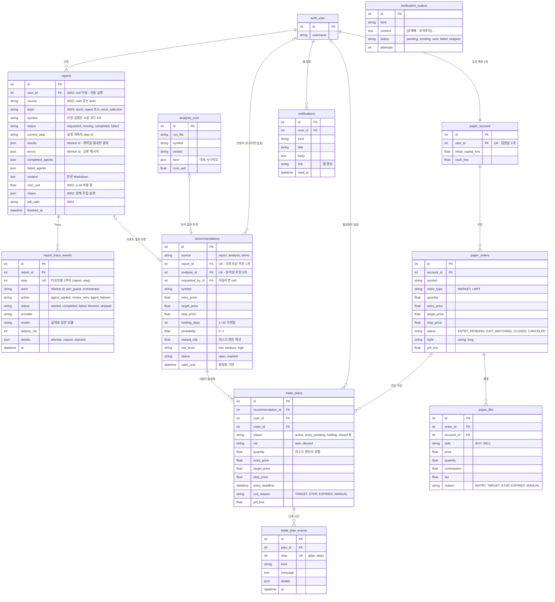
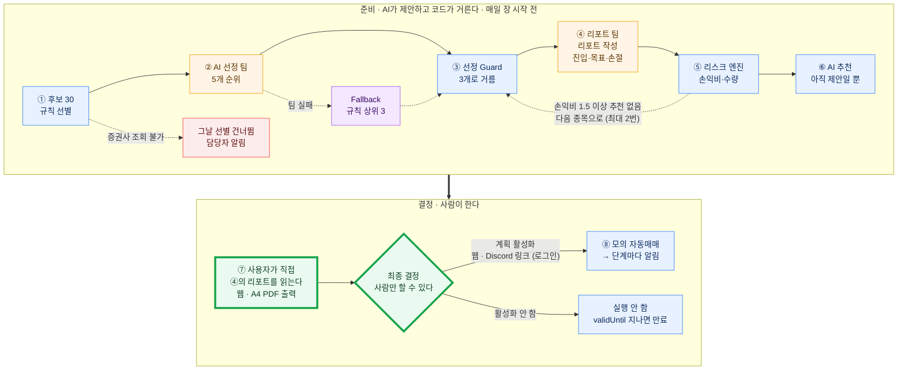
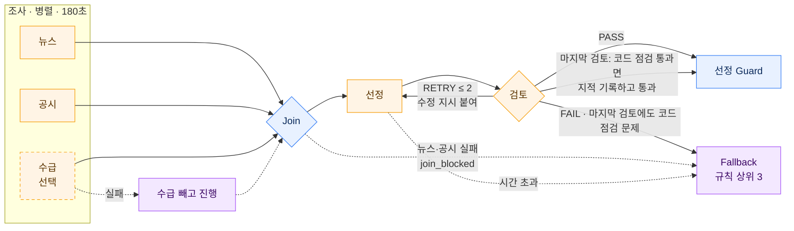
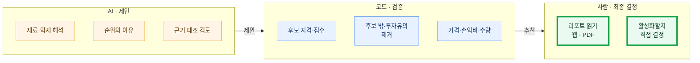
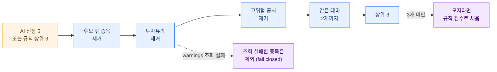
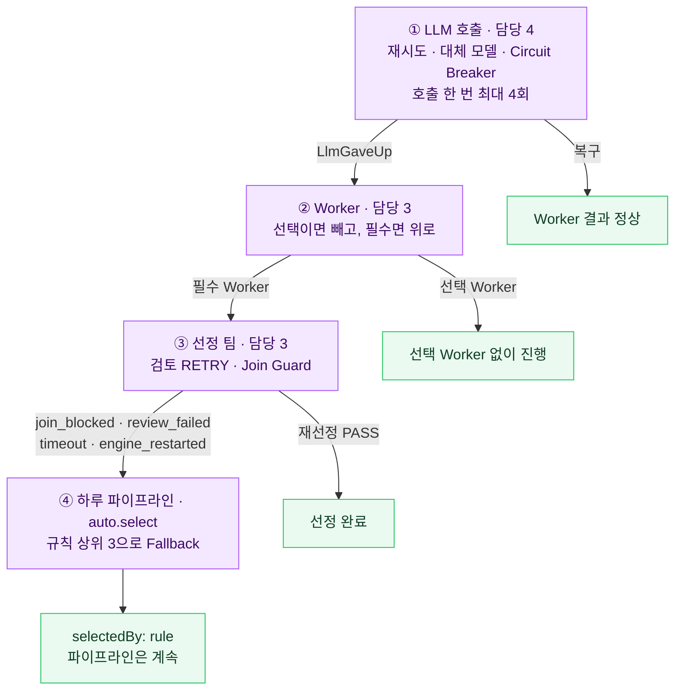
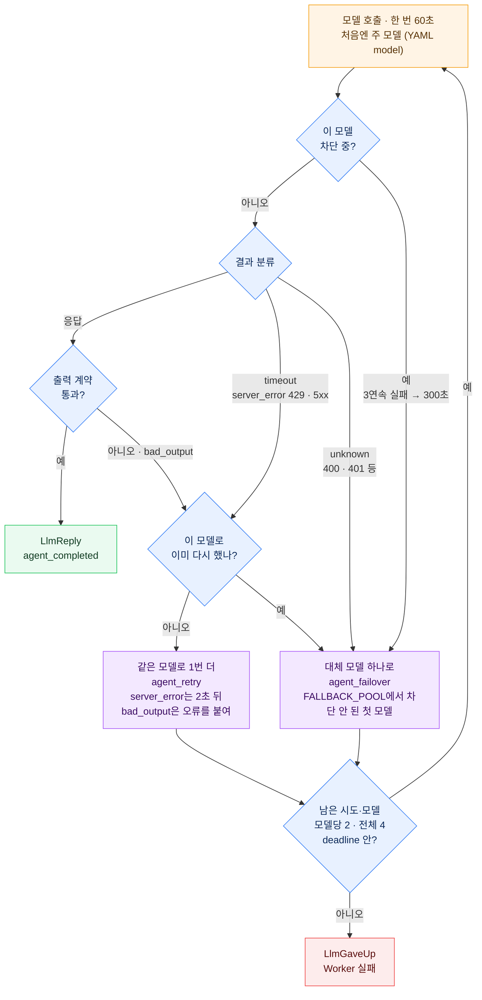
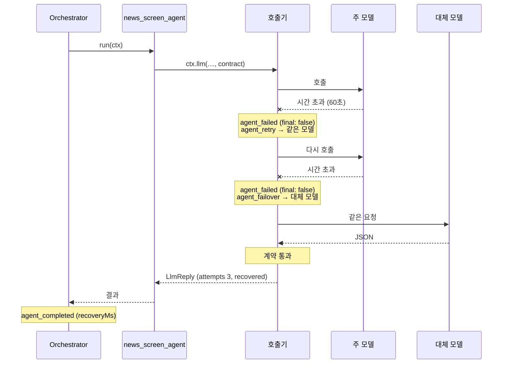
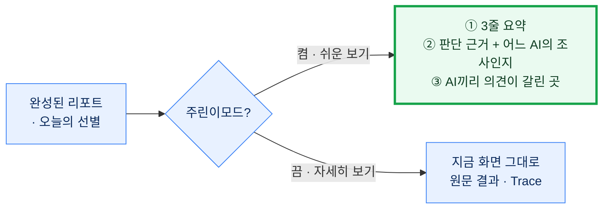
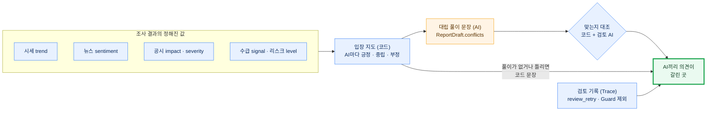

# 매매 종목 선정 AI Agent 워크플로우

> 2026-10-07 작성 · **2026-10-07 구현 (Claude, 사용자 요청 — `docs/DECISIONS.md` 19장)** · 원래 범위: Worker·계약 담당 2, Orchestrator·Guard 담당 3, 호출 복구(AutoHealing) 담당 4.
> 구현 위치(`backend/reports/` 기준, 2026-10-11 기능 폴더로 정리 — `docs/DECISIONS.md` 29장): `orchestration/orchestrator.py`·`runner.py`와 `guardrails/guards.py`(1·2·4·5장),
> `agents/report_team/`·`agents/selection_team/`(Worker 11개), `autoreport/selection.py`(선정 Guard), `autoreport/auto.py`(하루 파이프라인, `AUTO_REPORT=on`).
> 6장(주린이모드 의견 대립)은 제안 그대로 남았다 (미구현).
> 🟧 AI(제안) · 🟦 코드(검증) · 🟩 사람(최종 결정) · 🟪 복구 동작 · 🟥 실패

## 0. DB 스키마 (ERD)

워크플로우가 읽고 쓰는 표만 그렸다. 표 이름은 실제 `db_table`, 열은 주요 열만이다(전체는 각 앱의 `models.py`).
열 설명의 **"0002"**는 2026-10-07 들어온 담당 4의 마이그레이션 0002(T4-1)로 생긴 것이고, **"0003"**은 선정 팀을 붙이며 더한 것이다(처음 설계의 "제안"). 나머지는 그 전부터 있던 것이다.



**선정 팀이 하루에 남기는 것**

| 단계 | 어디에 | 무엇 |
|---|---|---|
| 선정 실행 | `reports` 1행 (`team=stock_selection`, `source=auto`) + `report_trace_events` | 진행 상태, Worker 결과·오류, 복구 사건 (`agent_failover` 등) |
| 선정 결과 | `runs/screening/<날짜>-<시장>.json` (**파일, DB 아님**) | `candidates`·`picks`·`reportIds`·`recommendationIds` + `selection`·`selectedBy`·`fallbackReason`·`aiPicks`·`filtered` (`docs/API.md` ScreeningResult) |
| 종목 리포트 | `reports` 3행 (`team=stock_report`, `source=auto`) + Trace | 리포트 본문·`results.report_agent.targets` |
| AI 추천 | `recommendations` (`source=report`, 리포트당 1개) | 진입·목표·손절, 손익비, `valid_until` |
| 계획 활성화 | `trade_plans` + `trade_plan_events` | **사람이 활성화해야 행이 생긴다** — 활성화하지 않으면 추천은 `expired` |
| 모의 매매·알림 | `paper_orders`·`paper_fills`, `notifications`·`notification_outbox` | 주문·체결, 웹 알림·Discord 보낼 글 |

Circuit Breaker 상태는 엔진 프로세스 메모리에만 있다 (DB에 없고 Trace의 `circuit_open`으로만 보인다).
워크플로우와 상관없는 표: `accounts_profile`·`investor_profiles`(주린이모드), `analysis_run_files`·`jobs`, `equity_daily`·`reservations`,
`daily_move_notes`·`investment_theses`·`thesis_checks`(장기투자), `notification_settings`.

## 1. 전체 흐름



> **최종 결정은 사람이 한다.** AI 추천은 스스로 실행되지 않는다. 사용자가 ④에서 만든 리포트(근거·위험·"이 의견이 틀리는 경우")를 웹에서 읽거나
> A4 PDF로 받아 보고(`GET /api/reports/{id}/pdf`), 직접 **계획 활성화**를 눌러야 모의 자동매매가 시작된다. 활성화하지 않은 추천은 `validUntil`이 지나면 만료된다.

AI 선정 팀이 실패하면 규칙 점수 상위 3개가 대신 선정 Guard로 들어간다 (AI를 다시 부르지 않는다).
그날 리포트 3개가 모두 끝났는데 손익비(비용 반영)가 스윙 기준 1.5 이상인 추천이 하나도 없으면, 이미 리포트한 종목·선정 Guard가 뺀 종목을 빼고
같은 선정 Guard로 다음 3개를 골라 리포트를 다시 낸다 (최대 2번, 선정 팀은 다시 부르지 않는다 — `docs/DECISIONS.md` 22장). 표지는 마지막 회차가 끝난 뒤 보낸다.

## 2. 선정 팀 안



각 AI 칸 안의 모델 호출은 5장의 호출 복구를 먼저 거친다. 그래도 실패한 Worker만 이 그림의 실패 경로로 온다.

| Worker | 보는 것 | 내는 것 | 실패하면 |
|---|---|---|---|
| `news_screen_agent` | 후보별 뉴스 | 재료·악재·테마 | 필수 → Fallback |
| `filing_screen_agent` | 후보별 30일 공시 | 위험 신호 (none·low·high) | 필수 → Fallback |
| `flow_agent` (선택) | 코드가 합한 외국인·기관 순매수 | 매집·이탈 해석 | 빼고 진행 |
| `selector_agent` | 후보 표 + 조사 결과(가격 가림) | 순위 5개 + 근거 (**가격 없음**) | Fallback |
| `selection_review_agent` | 선정안 + 조사 결과(가격 가림) | PASS · RETRY · FAIL (마지막 검토는 코드 점검 통과면 PASS + acceptedWithNotes) | Fallback |

후보 30개를 Worker 하나가 한 번에 본다 → 하루 4~6회 호출. 뉴스·공시 **조회**가 실패하면(키 없음 등) Worker는 "자료 없음"으로 AI에 넘기고 계속한다.

검토 반복 (2026-10-12, `docs/DECISIONS.md` 30장): 선정·검토에 주는 조사 결과는 가격을 "(가격)"으로 가린 사본이고, 선정안 evidence의 가격·목표가 항목은 코드가 지운다.
다시 하는 검토는 직전 지적과 코드가 계산한 "이번에 바뀐 부분"을 받아 지적이 고쳐졌는지부터 본다. 마지막(셋째) 검토는 코드가 판정한다 —
후보 표 밖 종목·공시 위험 high·reason·summary의 권유 표현·가격·목표가가 없으면 LLM이 RETRY여도 남은 지적을 기록하고 통과(`acceptedWithNotes`)한다.

## 3. AI는 제안, 코드는 검증, 사람이 결정



## 4. 선정 Guard



점수·RSI 같은 숫자는 늘 코드 값으로 덮어쓴다. 안전 확인을 못 한 종목은 통과시키지 않고 뺀다.
선정 Guard는 선정 실행이 끝난 뒤 하루 파이프라인(`auto.tick`)에서 돈다 — Fallback(선정 실패·엔진 재시작)에도 같은 길을 타게. 그래서 뺀 종목은 Trace(`selection_filtered`)가 아니라 선별 결과의 `filtered`에 남는다.

## 5. 오류 복구

### 5-1. 4겹 복구: 안쪽에서 못 막으면 바깥으로



### 5-2. LLM 호출 복구 (AutoHealing — `backend/reports/autohealing/healing.py`)



- 2026-10-07 담당 4 결정(`docs/tasks/00-공통.md` 7절): 주 모델 → **대체 모델 하나**. 대체 모델은 YAML `fallbacks`가 아니라
  `healing.FALLBACK_POOL` 순서에서 주 모델이 아니고 차단되지 않은 첫 모델이다. 대체 모델도 같은 규칙으로 한 번 더 할 수 있다.
- 2026-10-08 바뀜: 주 모델 timeout은 같은 모델을 다시 기다리지 않고 바로 대체 모델, 대체 모델 timeout은 같은 모델로 한 번 더 (넘어갈 대체 모델이 없을 때만 주 모델로 한 번 더).
- 호출 한 번은 **최대 4회** 시도한다: 첫 시도 + 재시도 3회, 모델마다 2회 (주 모델 2회 + 대체 모델 2회 — `MAX_ATTEMPTS = 4`, `MAX_ATTEMPTS_PER_MODEL = 2`).
- 무한 재시도는 없다: 시도 수(최대 4회)와 `deadline` 둘 다로 막는다. 실패마다 `agent_failed(final: false)`를 남겨 복구율을 센다.
- 호출 한 번이 60초(`CALL_TIMEOUT_SEC`)라 주 모델 시간 초과 → 대체 모델 시간 초과 → 대체 모델 재시도까지 가려면 단계 제한이 180초는 되어야 한다 (2장·부록 YAML).

### 5-3. 복구 예시: 뉴스 Worker의 주 모델이 늦을 때



화면에는 "뉴스를 읽는 AI가 늦어 다른 AI가 이어받았어요"처럼 나온다 (주린이모드 신뢰 패널, `recovery` 값).

### 5-4. 무엇이 실패하면

모델 쪽 실패(아래 표의 위 다섯 줄)는 모두 호출 한 번의 **최대 4회** 시도 안에서 복구한다 (주 모델 2회 + 대체 모델 2회). 넘으면 Worker 실패다.

| 실패 | 복구 | 그래도 안 되면 |
|---|---|---|
| 모델 시간 초과 (한 번 60초) | 같은 모델 1번 더 → 대체 모델 | Worker 실패 |
| 모델 429·5xx | 2초 뒤 같은 모델 → 대체 모델 | Worker 실패 |
| 계약 위반 응답 | 오류를 붙여 같은 모델에 재요청 → 대체 모델 | Worker 실패 |
| 모델 400·401 등 (unknown) | 재시도 없이 대체 모델 | Worker 실패 |
| 같은 모델 3연속 실패 | 5분 차단, 대체 모델 | Worker 실패 |
| 뉴스·공시 조회 실패 | "자료 없음"으로 AI에 전달 | – |
| 수급 Worker 실패 | 빼고 진행 | – |
| 뉴스·공시 Worker 실패 | – | `join_blocked` → Fallback |
| 검토 RETRY | 수정 지시로 재선정 (최대 2라운드, 다시 하는 검토는 이전 지적과 바뀐 부분부터) · 마지막 검토에서 코드 점검을 통과하면 남은 지적을 기록하고 통과 | FAIL·코드 점검 문제가 남으면 `review_failed` → Fallback |
| 단계 시간 초과 | – | `timeout` → Fallback |
| 엔진 재시작 | `runner.recover()`가 도중 실행을 정리 | `engine_restarted` → Fallback |
| 투자유의 조회 실패 | 그 종목 제외 | 모자라면 규칙 점수로 채움 |
| 증권사 조회 불가 | – | 그날 선별 건너뜀, 담당자 알림 |

Fallback이면 선별 결과(`ScreeningResult`)에 `selectedBy: "rule"`과 `fallbackReason`(위 사유 코드)이 남고, 화면은 "오늘은 규칙으로 골랐어요"를 보여 준다.

## 6. 주린이모드 한정: 3줄 요약 · 판단 근거 · AI 의견 대립 (제안)

> 2026-10-07 사용자 제안 · 미구현. **주린이모드를 켠 사람의 쉬운 보기에만** 보인다. 주린이모드를 끄거나 "이 화면만 자세히 보기"를 누르면 지금 화면(원문 결과·Trace) 그대로다.



### 6-1. 지금 있는 것과 새로 필요한 것

| 칸 | 지금 쉬운 보기 (`components/reports/easy/`) | 이 제안 |
|---|---|---|
| ① 3줄 요약 | **있음** — `ReportDraft.plainSummary` (숫자·권유형 금지) | 오늘의 선별에도: 왜 이 3종목인지 3줄 (`SelectionDraft.plainSummary` 추가) |
| ② 판단 근거 | **있음** — `reasons`·`risks`·"이 의견이 틀리는 경우" (`ReasonsRisks.tsx`) | 근거마다 출처 꼬리표 **[뉴스 AI]·[공시 AI]** (조사 결과의 `evidence` 키로 코드가 붙인다) |
| ③ 의견 대립 | **없음** — 신뢰 패널은 "고쳐 썼다" 한 줄뿐 (`TrustPanel.tsx`) | 새 카드 **"AI끼리 의견이 갈린 곳"** |

### 6-2. 의견 대립은 어떻게 만드나



- **누가 어느 쪽인지는 코드가 정한다.** 조사 결과의 정해진 값(enum)만 보고 입장 지도를 만든다 — AI가 지어낸 대립은 보여 주지 않는다.
- **AI는 대립을 쉬운 말로 풀고, 작성 AI가 어느 쪽을 더 무겁게 봤는지만 쓴다.** 어느 쪽이 맞는지는 말하지 않는다 (판단은 사람 — 1장).
- 긍정과 부정이 같이 있을 때만 대립이다. 대립이 없으면 "이번에는 AI들 의견이 크게 갈리지 않았어요"와 함께 "이 의견이 틀리는 경우"로 이어 준다 (안심시키지 않는다).

| AI | 긍정 | 중립 | 부정 |
|---|---|---|---|
| 시세 `market_agent` | `trend: up` | `sideways` | `down` |
| 뉴스 `news_agent` · `news_screen_agent` | `sentiment: positive` | `neutral` | `negative` |
| 재무·공시 `fundamental_agent` | 최근 공시 `impact` positive가 더 많음 | 같거나 없음 | negative가 더 많음 |
| 공시 위험 `filing_screen_agent` | – | `severity: none · low` | `high` |
| 수급 `flow_agent` | `accumulating` | `mixed` | `distributing` |
| 리스크 `risk_agent` | – | `level: low · medium` | `high` |

### 6-3. 출력 계약 (제안 — 담당 2)

`ReportDraft`에 선택 필드 `conflicts`(최대 2개)를 더한다. 선정 팀은 `SelectionDraft`에 `plainSummary`(1~3개)와 같은 `conflicts`를 더한다.

```json
"conflicts": [
  {
    "topic": "뉴스와 실적",
    "positive": "news_agent",
    "negative": "fundamental_agent",
    "plain": "뉴스는 새 계약 소식으로 좋게 봤지만, 공시에는 이익이 줄었다는 내용이 있어요",
    "weighed": "작성 AI는 실적 쪽을 더 무겁게 보고 '지켜보기'로 정했어요"
  }
]
```

- `plain`·`weighed`는 `plainSummary`와 같은 규칙: **숫자(0-9) 금지, 권유형 금지**, 항목당 100자. 어기면 `ContractError` → 재요청(5-2).
- `positive`·`negative`는 입장 지도에서 실제로 긍정·부정인 AI여야 한다. 아니면 코드가 그 항목을 버리고 코드 문장으로 바꾼다
  (예: "차트 AI는 오르는 흐름으로, 뉴스 AI는 나쁜 소식이 많다고 봤어요").
- 검토 AI는 `conflicts`도 조사 결과와 대조한다. 근거에 없는 대립이면 RETRY.
- 손익비 기준(스윙 1.5)은 여기서도 프롬프트에 넣지 않는다.

### 6-4. 화면 (쉬운 보기)

```
┌─ AI 의견: 지켜보기 ─────────────────────────────┐
│ 쉬운 요약                                        │
│  · 새 공급 계약 소식이 나왔어요                   │
│  · 하지만 지난 분기 이익은 줄었어요               │
│  · 그래서 AI 의견은 지켜보기예요                  │
├─ 판단 근거 ─────────────────────────────────────┤
│  ＋ 새 공급 계약 소식                 [뉴스 AI]   │
│  － 지난 분기 이익 감소               [공시 AI]   │
│  ! 이 의견이 틀리는 경우: …                       │
├─ AI끼리 의견이 갈린 곳 ─────────────────────────┤
│  뉴스 AI  좋게 봄  ◀───▶  공시 AI  나쁘게 봄     │
│  "뉴스는 새 계약 소식으로 좋게 봤지만, …"          │
│  → 작성 AI는 실적 쪽을 더 무겁게 봤어요           │
│  검토 AI가 고쳐 쓰게 한 곳 1곳            ▸ 펼치기 │
│  어느 쪽이 맞는지는 AI가 정하지 않아요 — 직접 판단해요 │
└─────────────────────────────────────────────────┘
```

- 오늘의 선별(리포트 탭)도 같은 세 칸이다. 대립 칸에는 **"AI는 골랐지만 안전장치가 뺀 종목"**(선정 Guard 제외 사유 — 4장)과 검토 AI가 순위를 고치게 한 곳이 더 나온다.
- 검토 기록은 Trace의 `review_retry`(`issues`)와 `selection_filtered`(제안)에서 읽는다. 원문 문장은 펼친 곳에만 둔다.

### 6-5. 바꿀 곳

| 파일 | 내용 | 담당 |
|---|---|---|
| `backend/reports/guardrails/contracts.py`, `agents/` 프롬프트 | `ReportDraft.conflicts`, `SelectionDraft.plainSummary`·`conflicts`, 검토 AI 대조 항목 | 2 |
| `frontend/src/lib/reports.ts` | `stancesOf(results)`(입장 지도), `conflictsOf(state, trace)`(AI 풀이 확인 → 없으면 코드 문장), 근거 출처 꼬리표 | 5 또는 Claude |
| `frontend/src/components/reports/easy/` | `ConflictCard.tsx` 새로, `EasyReport.tsx`에 끼움 (쉬운 보기에서만), `ReasonsRisks.tsx`에 출처 꼬리표 | 5 또는 Claude |
| `docs/API.md`, `docs/tasks/00-공통.md` 10절 | 계약 필드 추가 | 2 |
| `frontend/src/mocks/sampleReports.ts` | 대립 있는 예시 · 없는 예시 (가짜 API로 화면 확인) | 5 또는 Claude |

<details>
<summary>YAML Registry · 구현에서 바꾼 곳 (2026-10-07)</summary>

```yaml
# backend/reports/orchestration/worker_definitions.yaml — fallbacks는 화면에 보이는 대체 모델이다. 호출기는 healing.FALLBACK_POOL에서 고르므로(5-2)
# 그 모델 하나를 적는다 (tests/orchestration/test_registry.py가 확인)
  news_screen_agent:
    title: 후보 뉴스 점검 Agent
    goal: 후보 종목마다 최근 뉴스에서 재료와 악재를 찾아 출처와 함께 정리하고 테마 이름을 붙인다
    provider: devpass
    model: gemini-3.8-flash
    fallbacks: [gpt-5.6-luna]
    output_contract: CandidateNewsResult
  # filing_screen_agent · flow_agent: 같은 모델 · selector_agent: gpt-5.6-luna → [gemini-3.8-flash]
  # selection_review_agent: claude-opus-5-5 → [gpt-5.6-luna] (배정은 docs/tasks/00-공통.md 4절)
```

```yaml
# backend/reports/orchestration/team_definitions.yaml
  stock_selection:
    title: 매매 종목 선정
    failure_policy: required_optional
    steps:
      - id: candidate_research
        title: 후보 조사
        mode: parallel
        workers: [news_screen_agent, filing_screen_agent, flow_agent]
        required: [news_screen_agent, filing_screen_agent]
        optional: [flow_agent]
        timeout: 180
      - id: select
        title: 종목 선정
        mode: sequential
        workers: [selector_agent]
        depends_on: [candidate_research]
        join: true
        timeout: 180
      - id: select_review
        title: 선정 검토
        mode: sequential
        workers: [selection_review_agent]
        depends_on: [select]
        timeout: 180
        retry:
          target: selector_agent
          max_rounds: 2
    handoffs: []
```

- `registry.py` — 팀 하나(`stock_report`)만 캐시한다 → 팀 이름을 인자로.
- `state.py` — `set_step`·`_check_agent`가 리포트의 팀 기준으로 확인.
- `models.py` — `Report`는 종목 단위 → `team` 열 추가 (0002 다음 마이그레이션으로).
- `contracts.py` — `CandidateNewsResult`·`FilingCheckResult`·`FlowResult`·`SelectionDraft` 추가, 검토는 `ReviewResult` 재사용.
- `healing.py` — 리포트 팀과 같은 호출기를 그대로 쓴다 (새로 만들 것 없음).
- `auto.py` `select()` — 선정 팀이 `completed`면 그 결과로 `picks`를 바꾸고, `failed`면 지금 로직(규칙 상위 3) + `selectedBy`·`fallbackReason`.
- ~~`00-공통.md` 9절 — 새 Trace 사건 `selection_filtered`~~ → 선별 결과 파일의 `filtered`로 했다 (4장 끝). 대신 9절에 실패 사유 코드 `agent_failed`·`no_llm`을 더했다.
- `WorkerContext.team_inputs` — 선정 팀 Worker가 후보 표를 받는 자리 (`selection.team_inputs`가 선별 파일에서 만든다).

</details>
