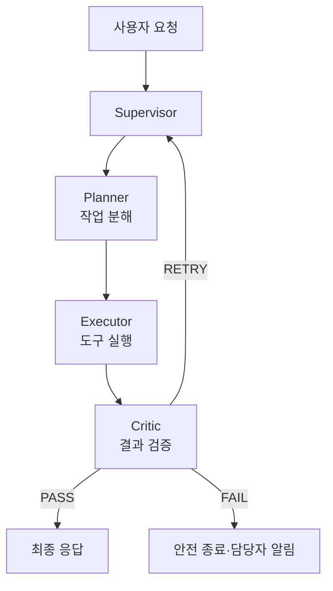

# 프로젝트 진행 가이드(1기)

&lt;aside&gt;  
📌

이 페이지는 **멀티 에이전트 협업 및 서비스 운영** 교과목의 단위프로젝트를 수행하는 훈련생용 가이드입니다.

&lt;/aside&gt;

# 1. 프로젝트 개요

| 구분      | 내용                                                                                                   |
| ------- | ---------------------------------------------------------------------------------------------------- |
| 프로젝트 주제 | **에러 자가 치유(AutoHealing) 워크플로우**                                                                      |
| 핵심 목표   | 여러 에이전트의 역할과 협업 구조를 설계하고, 장애를 감지·판단·복구하는 자동화 흐름을 구현합니다. 협업 실행 흐름을 서비스로 배포한 뒤 장애 시험을 통해 복구 결과를 검증합니다. |
| 필수 산출물  | 멀티 에이전트 아키텍처 설계서, 배포 및 장애 복구 보고서, 파이프라인 구현 결과 보고서                                                    |

### 프로젝트 발표 진행

- 발표 : 10월 13일(화) 6교시(15시 부터) 시작
- 발표 방법
  - 발표자료 작성 내용 기반 발표 진행
    - 결과물 시연 영상은 사전 제작 가능
  - 각 팀당 발표 시간 20분
  - 발표 순서
    - 추후 결정
  - 타임테이블
    - 15시 ~ 15시 25분 oo팀 발표
    - 15시 25분 ~ 15시 50분 oo팀 발표
    - 16시 ~ 16시 25분 oo팀 발표
    - 16시 25분 ~ 16시 50분 oo팀 발표
    - 17시 ~ 17시 25분 교과목 평가
    - 17시 25분 ~ 시상 및 프로젝트 마무리
- 발표는 zoom 화면 공유를 통해 진행
  - zoom 링크 발표 당일 오전 전달
- 발표 영상은 녹화되어 포트폴리오 활용용으로 유투브 업로드 될 예정입니다.
- 단위 프로젝트 심사는 아래 각 항목으로 평가하며 강사/매니저 평가가 진행됩니다.
  - 평가항목
    - 프로젝트 기획 및 목표 달성도(25점)
    - 서비스 완성도 및 활용 가능성(35점)
    - 프로젝트 수행 과정 및 개선 노력(20점)
    - 발표 구성 및 전달력(20점)
  - 평가 총점으로 각 팀의 순위발표가 진행됩니다.
  - 점수는 비공개이며 각 팀의 심사평은 취합하여 일괄 전달할 예정입니다.
  - 1,2위 팀에게는 시상이 진행됩니다.

## 핵심 수행내용

- 에이전트 협업 시나리오와 역할 구조 설계
- 장애 유형별 복구 로직 및 자동화 파이프라인 구현
- 협업 기반 실행 흐름 통합 구현
- 서비스 배포 및 결과 검증

# 2. 프로젝트 이해하기

## AutoHealing이란?

서비스 또는 에이전트에 장애가 발생했을 때 사람의 수동 조치만 기다리지 않고, 시스템이 장애를 감지해 재시도·재연결·대체 경로 선택·대체 모델 호출 등의 방법으로 정상 상태를 회복하는 구조입니다.

## 프로젝트 수행 시나리오 예시

사용자가 서비스 장애 원인 분석을 요청하면 Supervisor가 작업을 Planner에게 전달합니다. Planner는 로그 확인과 원인 분석을 하위 작업으로 나누고 Executor가 관련 도구를 실행합니다. Critic은 결과에 근거가 있는지 검증합니다. 실행 중 외부 API 장애가 발생하면 시스템은 정해진 횟수만큼 재시도하고, 계속 실패하면 대체 API 또는 캐시 결과로 전환합니다. 모든 단계의 상태와 복구 결과는 Memory Keeper와 운영 로그에 기록됩니다.

&lt;aside&gt;  
⚠️

위 시나리오와 에이전트 명칭은 작성 예시입니다. 팀은 교과목 목표를 충족하는 범위에서 주제·역할·도구를 정할 수 있습니다. 문서에는 실제 구현한 구조와 시험 결과만 작성하세요.

&lt;/aside&gt;

# 3. 권장 진행 순서

## 1단계｜문제와 협업 시나리오 정의

- 멀티 에이전트가 해결할 문제와 주요 사용자를 정의합니다.
- 사용자 요청부터 최종 응답까지 전체 흐름을 한 문장으로 작성합니다.
- 한 에이전트가 모두 처리하기보다 역할을 나눠야 하는 이유를 정리합니다.
- 정상 시나리오뿐 아니라 실패·지연·결과 불일치 시나리오도 작성합니다.

## 2단계｜에이전트 역할과 책임 분리

- Planner·Executor·Critic·Memory Keeper·Supervisor 등 필요한 역할을 선정합니다.
- 각 에이전트가 해야 할 일과 하지 말아야 할 일을 함께 정의합니다.
- 역할 중복과 책임 공백이 없는지 확인합니다.
- 최종 성공·실패·재시도 판단 주체를 명확히 정합니다.

## 3단계｜Handoff와 공유 상태 설계

- 에이전트 사이에 전달할 task ID, 목적, 입력, 제약조건, 기대 결과를 정의합니다.
- 상태·메모리·중간 결과가 다음 에이전트에 누락 없이 전달되도록 설계합니다.
- 실패 원인과 재시도 횟수가 다음 실행에 포함되도록 합니다.
- 민감정보와 시크릿을 메시지에 직접 포함하지 않습니다.

## 4단계｜최소 협업 흐름 구현

- Supervisor → Planner → Executor → Critic → 응답의 핵심 흐름부터 구현합니다.
- 각 에이전트를 개별 시험한 후 Handoff를 연결합니다.
- Critic의 PASS·RETRY·FAIL 결과에 따라 다음 경로가 달라지는지 확인합니다.
- 최대 반복 횟수와 종료 조건을 정해 무한 실행을 방지합니다.

## 5단계｜장애 감지와 자동 복구 구현

- 네트워크·DB·API·LLM·프롬프트 공격 등 장애 유형을 구분합니다.
- 장애별 감지 조건, 확인할 지표, 복구 방법, 최종 실패 조건을 정의합니다.
- 재시도·재연결·대체 모델·대체 API·캐시 폴백 중 적절한 전략을 구현합니다.
- 복구가 실패하면 사용자가 이해할 수 있는 안내와 담당자 알림을 제공합니다.

## 6단계｜배포와 자동화 파이프라인 구성

- 에이전트별 서비스를 컨테이너로 구성하고 배포 환경에 연결합니다.
- 코드 커밋 → 빌드 → 테스트 → 배포 흐름을 자동화합니다.
- 테스트 실패 시 배포가 중단되도록 정책을 설정합니다.
- 성공·실패·지연 결과가 담당자에게 전달되도록 알림을 구성합니다.

## 7단계｜장애 주입 시험과 결과 정리

- 정상 요청, 에이전트 실패, API 타임아웃, DB 연결 오류 등의 시험을 수행합니다.
- 시험별 입력·기대 결과·실제 결과·복구 시간·수동 개입 여부를 기록합니다.
- 자동 복구율과 평균 복구시간을 계산합니다.
- 실패 사례와 개선 이력을 숨기지 않고 함께 정리합니다.

---

# 4. 주요 산출물 작성 가이드 및 예시

&lt;aside&gt;  
✏️

아래 서비스명·구성·도구·수치·시험 결과는 **작성 방법을 보여주기 위한 예시**입니다. 팀의 실제 구현과 측정 결과로 교체하세요.

&lt;/aside&gt;

# 산출물 1｜멀티 에이전트 아키텍처 설계서

## 포함할 내용

- 프로젝트 목적과 대표 사용자 시나리오
- 선택한 협업 구조와 선정 이유
- 에이전트별 역할·책임·입력·출력
- Handoff 조건과 전달 데이터
- 공유 상태·메모리·중간 결과 관리 방식
- 정상·재시도·실패·종료 흐름
- 역할 중복 및 책임 공백 점검 결과

## 작성 예시

### 1. 아키텍처 선택

- 구조: Supervisor 기반 중앙 조정형
- 선정 이유: 작업 분배와 최종 응답 책임을 한 곳에서 관리하고, Critic 검증을 통과한 결과만 전달하며, 장애 에이전트를 격리해 대체 경로를 선택하기 쉬움
- 고려사항: Supervisor 장애가 전체 흐름에 영향을 줄 수 있으므로 상태 확인과 재시작 정책 적용

### 2. 에이전트 역할 예시

| 에이전트          | 주요 역할                        | 제한사항              | 주요 출력           |
| ------------- | ---------------------------- | ----------------- | --------------- |
| Supervisor    | 작업 할당, Handoff, 재시도, 종료 판단   | 세부 도구를 직접 실행하지 않음 | 다음 담당, 실행 상태    |
| Planner       | 요청을 하위 작업으로 분해하고 순서·완료 조건 정의 | 직접 도구 실행 금지       | 실행 계획           |
| Executor      | 지정된 도구를 실행하고 원본 결과 반환        | 임의로 성공 판정 금지      | 도구 결과·메타데이터     |
| Critic        | 완전성·일관성·정책 위반 검증             | 결과를 임의로 수정하지 않음   | PASS·RETRY·FAIL |
| Memory Keeper | 작업 상태·중간 결과·실패 이력 관리         | 민감정보 장기 저장 금지     | 상태 참조값          |

### 3. 협업 흐름 예시

### 4. Handoff 데이터 예시

| 필드                      | 예시                            | 용도          |
| ----------------------- | ----------------------------- | ----------- |
| task\_id                | task-102                      | 작업 추적 식별자   |
| from\_agent / to\_agent | planner / executor            | 전달 주체와 대상   |
| objective               | 배포 로그에서 5xx 원인 확인             | 수행 목적       |
| inputs                  | service=api, time\_range=10m  | 실행 입력       |
| constraints             | 원본 로그 변경 금지                   | 금지 또는 제한 조건 |
| expected\_output        | error\_type, evidence, action | 기대 결과 형식    |
| attempt                 | 1                             | 현재 시도 횟수    |
| memory\_refs            | mem-71                        | 이전 상태 참조    |

### 5. Handoff 점검 원칙

- 모든 전달에 task ID와 시도 횟수를 포함합니다.
- 중간 결과에 작성자와 검증 상태를 함께 기록합니다.
- RETRY 시 이전 실패 원인과 수정 지시를 다음 요청에 포함합니다.
- 원본 데이터 대신 참조값을 전달할 때 접근 경로를 명시합니다.
- API 키·비밀번호·개인정보는 메시지나 로그에 남기지 않습니다.

---

# 산출물 2｜배포 및 장애 복구 보고서

## 포함할 내용

- 서비스·컨테이너·통신·시크릿·상태 확인 구성
- 네트워크·DB·API·LLM·보안 장애의 감지 조건과 지표
- 장애별 재시도·재연결·대체 모델·캐시 폴백 등 복구 전략
- 장애 주입 시험의 입력·기대 결과·실제 결과·증빙
- 자동 복구율과 평균 복구시간
- 수동 개입이 필요한 조건과 담당자 알림 방식

## 작성 예시

### 1. 배포 구성

| 구성요소               | 배포 예시                 | 운영 목적        |
| ------------------ | --------------------- | ------------ |
| planner-service    | Deployment 2 replicas | 계획 생성 가용성 확보 |
| executor-service   | Deployment 3 replicas | 도구 실행 부하 분산  |
| critic-service     | Deployment 2 replicas | 검증 처리 지속     |
| memory-service     | StatefulSet 1 replica | 상태 데이터 유지    |
| supervisor-service | Deployment 2 replicas | 전체 작업 조정     |

- 내부 통신: Kubernetes Service
- 외부 진입: Ingress
- 시크릿: Kubernetes Secret 또는 외부 Secret Manager
- 상태 확인: livenessProbe, readinessProbe

### 2. 장애 유형별 대응 예시

| 장애 유형   | 감지 조건 예시                 | 확인 지표                                       | 복구 전략                            |
| ------- | ------------------------ | ------------------------------------------- | -------------------------------- |
| 네트워크    | 응답 5초 초과 또는 연결 실패        | timeout\_count, connection\_error\_rate     | 최대 3회 재시도 후 캐시·대체 API            |
| 데이터베이스  | 연결 풀 90% 초과 또는 쿼리 2초 초과  | pool\_usage, slow\_query\_count             | 유휴 연결 정리, 재연결, 읽기 전용 폴백          |
| 외부 API  | 5xx 연속 3회 또는 429         | status\_5xx\_rate, rate\_limit\_count       | Circuit Breaker, 대체 엔드포인트, 지연 실행 |
| LLM     | 출력 형식 불일치·토큰 한도·근거 없는 응답 | schema\_error\_rate, validation\_fail\_rate | 출력 재요청, 컨텍스트 요약, 대체 모델           |
| 프롬프트 공격 | 지시 무시·시크릿 공개·권한 상승 요구    | injection\_detect\_count                    | 요청 차단, 안전 응답, 보안 로그·알림           |

### 3. 장애 시험 사례 예시

| 항목          | 작성 예시                                  |
| ----------- | -------------------------------------- |
| Scenario ID | DR-API-01                              |
| 주입 장애       | 외부 API가 500 오류를 연속 반환                  |
| 기대 동작       | 재시도 2회 후 Circuit Breaker를 열고 대체 API 호출 |
| 실제 동작       | 팀의 실제 결과 입력                            |
| 복구 시간       | 실제 측정값 입력                              |
| 수동 개입       | 있음 / 없음                                |
| 판정          | PASS / FAIL                            |
| 증빙          | 로그·화면 캡처·모니터링 링크                       |

### 4. 결과 지표 작성 예시

- 자동 복구율 = 수동 개입 없이 정상화된 장애 시나리오 수 ÷ 전체 장애 시나리오 수 × 100
- 평균 복구시간 = 자동 복구 성공 시나리오의 복구시간 합계 ÷ 자동 복구 성공 건수
- 장애 유형별 성공·실패 건수와 실패 원인을 함께 제시합니다.

> 수치 예시는 제공하지 않습니다. 팀이 실제로 수행한 시험 결과만 입력하세요.

---

# 산출물 3｜파이프라인 구현 결과 보고서

## 포함할 내용

- 코드 커밋 → 빌드 → 단위 테스트 → 통합 테스트 → 배포의 전체 흐름
- 단계별 입력·출력·성공 조건·실패 처리
- 테스트 데이터와 커버리지 기준
- 테스트 실패 시 배포 차단 정책
- 성공·실패·지연 알림 및 담당자 에스컬레이션
- 실제 실행 결과와 로그 링크

## 작성 예시

### 1. 파이프라인 흐름

### 2. 단계별 정의 예시

| 단계     | 입력                    | 성공 조건           | 실패 처리           |
| ------ | --------------------- | --------------- | --------------- |
| 빌드     | 소스코드·의존성              | 이미지 생성 완료       | 파이프라인 중단·담당자 알림 |
| 단위 테스트 | 모듈·테스트 데이터            | 팀이 정한 기준 충족     | 배포 차단           |
| 통합 테스트 | 에이전트 Handoff·장애 복구 흐름 | 핵심 시나리오 통과      | 실패 로그 저장·배포 차단  |
| 배포     | 검증된 이미지               | Pod 정상·상태 확인 통과 | 이전 버전 유지 또는 롤백  |
| 알림     | 단계별 결과                | 지정 채널 전송 완료     | 대체 연락 채널 사용     |

### 3. 실행 결과 기입 예시

| 항목          | 팀 작성 내용     |
| ----------- | ----------- |
| Pipeline ID | 실제 실행 ID    |
| Commit      | 실제 커밋 해시    |
| 시작·종료 시각    | 실제 값        |
| 단위 테스트      | 통과 수 / 전체 수 |
| 통합 테스트      | 통과 수 / 전체 수 |
| 배포 결과       | 성공 / 실패     |
| 총 실행시간      | 실제 측정값      |
| 알림 전송       | 성공 / 실패     |
| 로그 URL      | 실제 링크       |

# 5. 구현 결과 및 시연 준비

## 실행 정보

- 배포 URL:
- 저장소 URL:
- 모니터링·로그 URL:
- 파이프라인 실행 URL:
- 실행 환경:
- 테스트 계정 또는 인증 방법:

## 시연 순서 예시

1. 정상 요청을 입력해 에이전트별 역할 분담과 Handoff를 보여줍니다.
2. Critic이 결과를 검증하고 PASS 또는 RETRY를 결정하는 흐름을 보여줍니다.
3. 외부 API 타임아웃 또는 특정 에이전트 실패를 발생시킵니다.
4. 장애 감지, 재시도, 대체 경로 선택 과정을 운영 로그에서 확인합니다.
5. 복구 후 최종 결과가 사용자에게 전달되는지 확인합니다.
6. 파이프라인 실행 결과와 실패 시 배포 차단·알림 동작을 보여줍니다.
7. 자동 복구율, 복구시간, 실패 사례와 향후 개선사항을 설명합니다.

# 6. 제출 전 체크리스트

## 멀티 에이전트 아키텍처 설계서

- \[ \] 에이전트별 역할과 책임 범위가 명확하다.
- \[ \] 역할의 중복과 책임 공백을 점검했다.
- \[ \] Handoff 조건과 전달 데이터가 실제 구현과 일치한다.
- \[ \] 상태·메모리·중간 결과의 전달 방식을 설명할 수 있다.
- \[ \] 재시도·실패·종료 조건이 정의되어 있다.

## 배포 및 장애 복구 보고서

- \[ \] 배포 구성과 실제 환경이 일치한다.
- \[ \] 장애별 감지 조건·지표·복구 전략이 연결되어 있다.
- \[ \] 장애 시험의 입력·기대·실제·증빙을 모두 기록했다.
- \[ \] 자동 복구율과 평균 복구시간의 계산 기준이 명확하다.
- \[ \] 실패 사례와 수동 개입 조건을 포함했다.

## 파이프라인 구현 결과 보고서

- \[ \] 커밋부터 배포까지 전체 흐름을 표현했다.
- \[ \] 단계별 성공 조건과 실패 처리를 작성했다.
- \[ \] 테스트 실패 시 배포 차단이 실제로 동작한다.
- \[ \] 실행 ID·커밋·시험 결과·로그 링크를 기록했다.
- \[ \] 성공·실패·지연 알림과 에스컬레이션을 확인했다.

## 공통

- \[ \] 요구사항·설계서·구현·시험 결과가 서로 일치한다.
- \[ \] API 키·비밀번호·개인정보가 문서와 저장소에 노출되지 않았다.
- \[ \] 배포 환경에서 핵심 기능과 장애 복구 흐름을 시연할 수 있다.
- \[ \] 파일명과 버전을 일관되게 관리했다.

# 7. 팀별 작성 영역

- 팀명:
- 팀원 및 역할:
- 프로젝트 기간:
- 저장소·협업 링크:
- 배포 URL:
- 사용한 에이전트·도구·외부 API:
- 모니터링·파이프라인 링크:
- 추가 산출물: