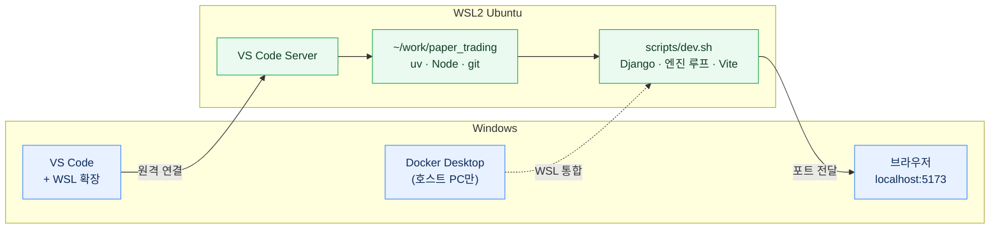

# Windows에서 개발하기: WSL2 세팅과 VS Code 연결

Windows 팀원이 이 저장소를 받아 돌리기 **전에** 하는 준비다. 이 프로젝트는 **WSL이 아닌 Windows(PowerShell·cmd·Git Bash)에서는 돌지 않는다**
(엔진이 Unix 전용 파일 잠금 `fcntl`을 쓰고, `scripts/dev.sh`가 bash·`lsof`·`pgrep`을 쓴다). 그래서 Windows 안의 Linux(WSL2 Ubuntu)에서 코드를 돌리고,
편집은 Windows의 VS Code가 WSL에 붙어서 한다. 이 문서가 끝나면 [docs/guides/SETUP_PROMPT.md](SETUP_PROMPT.md)로 설치·실행을 이어 간다.



## 1. WSL2와 Ubuntu 설치 (Windows PowerShell, 관리자)

```powershell
wsl --install            # WSL2 + 기본 Ubuntu(최신 LTS). 끝나면 재부팅
wsl --update
wsl -l -v                # Ubuntu의 VERSION이 2인지 확인 (1이면: wsl --set-version Ubuntu 2)
```

재부팅 뒤 시작 메뉴의 **Ubuntu**를 열어 Linux 사용자 이름·비밀번호를 만든다 (Windows 계정과 따로다. `sudo`할 때 쓴다).

메모리가 모자라면(테스트·빌드가 느리거나 죽으면) Windows의 `%UserProfile%\.wslconfig`에 적고 `wsl --shutdown` 뒤 다시 연다:

```ini
[wsl2]
memory=8GB
```

## 2. Ubuntu 안에서 도구 설치

```bash
sudo apt update && sudo apt upgrade -y
sudo apt install -y git curl ca-certificates build-essential unzip lsof   # lsof는 dev.sh가 포트 확인에 쓴다

# uv (파이썬 3.12는 uv sync 때 uv가 알아서 받는다)
curl -LsSf https://astral.sh/uv/install.sh | sh
source "$HOME/.local/bin/env"

# Node.js 22 (Vite 8은 Node 20.19 이상 또는 22.12 이상) — nvm으로 사용자 폴더에만 설치
curl -o- https://raw.githubusercontent.com/nvm-sh/nvm/v0.40.3/install.sh | bash
source ~/.bashrc
nvm install 22

uv --version && node -v && npm -v      # 확인
```

선택 — 필요할 때만:

| 무엇 | 언제 | 설치 |
|---|---|---|
| Google Chrome | 리포트 **A4 PDF**를 이 PC에서 만들어 볼 때 (없으면 PDF 대신 같은 내용의 HTML이 나온다) | `wget https://dl.google.com/linux/direct/google-chrome-stable_current_amd64.deb && sudo apt install -y ./google-chrome-stable_current_amd64.deb` (Ubuntu의 `chromium`은 snap이라 WSL에서 잘 안 된다) |
| Docker | 이 PC가 팀 공유 개발 DB(PostgreSQL)를 띄우는 **호스트 PC**일 때만 | Windows에 Docker Desktop 설치 → Settings → Resources → **WSL integration**에서 Ubuntu 켜기. WSL에서 `docker version`으로 확인 |
| AI 코딩 에이전트 | `docs/guides/SETUP_PROMPT.md`를 에이전트에게 맡길 때 | Claude Code·Codex 등을 **WSL 터미널 안에** 설치한다 (Windows 쪽에 설치한 것은 WSL 파일을 제대로 못 돌린다) |

## 3. git 설정과 클론

```bash
git config --global user.name "이름"
git config --global user.email "GitHub 이메일"
git config --global core.autocrlf input      # 줄 끝을 LF로 (CRLF가 섞이면 dev.sh가 '\r' 오류로 멈춘다)

# GitHub 인증: SSH 키를 만들어 GitHub → Settings → SSH and GPG keys에 공개 키를 붙여 넣는다
ssh-keygen -t ed25519 -C "GitHub 이메일"
cat ~/.ssh/id_ed25519.pub
ssh -T git@github.com                        # "Hi <아이디>!"가 나오면 된다

mkdir -p ~/work && cd ~/work
git clone git@github.com:SHS5029/paper_trading.git
cd paper_trading
```

- **반드시 WSL 홈(`~/...`) 아래에 클론한다.** `/mnt/c/...`(Windows 드라이브)에 두면 설치·테스트가 몇 배 느리고, Vite가 파일 변경을 못 알아채며, 권한·줄 끝 문제가 생긴다.
- Windows 탐색기에서 이 폴더를 열려면 주소창에 `\\wsl$\Ubuntu\home\<Linux 사용자>\work\paper_trading`.

## 4. VS Code 연결

1. **Windows에** VS Code를 설치한다 (WSL 안에 설치하지 않는다).
2. 확장 **WSL**(`ms-vscode-remote.remote-wsl`)을 설치한다.
3. Ubuntu 터미널에서 저장소 폴더로 가서 연다. 처음 한 번은 VS Code Server가 WSL에 설치된다.

   ```bash
   cd ~/work/paper_trading && code .
   ```

   또는 VS Code에서 `Ctrl+Shift+P` → **WSL: Connect to WSL** → **File → Open Folder** → `~/work/paper_trading`.
4. 왼쪽 아래 상태 표시줄이 **`WSL: Ubuntu`**인지 확인한다. 이제 VS Code의 터미널(`` Ctrl+` ``)은 WSL bash다.
5. 확장은 **WSL 쪽에** 설치한다 (확장 화면의 "Install in WSL: Ubuntu"):

   | 확장 | 쓰는 곳 |
   |---|---|
   | Python · Pylance | 엔진·백엔드 코드 |
   | Ruff (`charliermarsh.ruff`) | 파이썬 린트 (저장소 규칙 `pyproject.toml`) |
   | ESLint · Tailwind CSS IntelliSense | 프론트엔드 |
   | Markdown Preview Mermaid Support (`bierner.markdown-mermaid`) | `README.md`·`docs/`의 다이어그램 미리 보기 |

6. 파이썬 인터프리터: `uv sync`를 한 뒤 `Ctrl+Shift+P` → **Python: Select Interpreter** → 저장소의 **`.venv/bin/python`**.

## 5. 설치·실행 이어 가기

호스트 PC 담당자에게 받은 **`.env.team`**을 저장소 루트에 둔다 (Windows의 다운로드 폴더에서 복사하는 예):

```bash
cp /mnt/c/Users/<Windows 사용자>/Downloads/.env.team ~/work/paper_trading/
```

그다음은 [docs/guides/SETUP_PROMPT.md](SETUP_PROMPT.md) 그대로다 — WSL 터미널에서 AI 코딩 에이전트를 열고 "`docs/guides/SETUP_PROMPT.md`를 읽고 그대로 진행해 줘", 또는 직접:

```bash
cp .env.team .env          # 이미 .env가 있으면 덮어쓰지 않는다
uv sync
cd frontend && npm ci && cd ..
scripts/dev.sh             # Django + 엔진 루프 + Vite. 끝나면 주소를 보여 준다
```

Windows 브라우저에서 **`http://localhost:5173`**으로 연다 (WSL의 포트가 Windows의 localhost로 저절로 전달된다. VS Code의 "포트" 탭에도 보인다).
포트가 사용 중이면 `dev.sh`가 다음 빈 포트를 쓰니 `scripts/dev.sh status`로 주소를 확인한다.

## 6. 휴대폰·다른 PC에서 접속 (필요할 때만)

WSL2는 기본이 NAT라 `dev.sh`가 `0.0.0.0`에 띄워도 **같은 네트워크의 다른 기기에서는 보이지 않는다.** 이 PC가 공유 DB 호스트(`POSTGRES_BIND=0.0.0.0`, 포트 5434)일 때도 같다.

- **Windows 11 22H2 이상** — 미러 네트워킹. `%UserProfile%\.wslconfig`에 더하고 `wsl --shutdown`:

  ```ini
  [wsl2]
  networkingMode=mirrored
  ```

  그리고 PowerShell(관리자)에서 들어오는 포트를 연다 (예: 5173, 공유 DB 호스트면 5434도):

  ```powershell
  New-NetFirewallHyperVRule -Name WSL-5173 -DisplayName "WSL 5173" -Direction Inbound -VMCreatorId '{40E0AC32-46A5-438A-A0B2-2B479E8F2E90}' -Protocol TCP -LocalPorts 5173
  ```

- **Windows 10** — 포트 프록시 (WSL IP는 `wsl hostname -I`로 확인, WSL을 다시 시작하면 바뀐다):

  ```powershell
  netsh interface portproxy add v4tov4 listenport=5173 listenaddress=0.0.0.0 connectport=5173 connectaddress=<WSL IP>
  New-NetFirewallRule -DisplayName "WSL 5173" -Direction Inbound -Protocol TCP -LocalPort 5173 -Action Allow
  ```

접속 주소는 `http://<Windows PC의 IP>:5173` (`ipconfig`의 IPv4). **개발할 때만** 열고, 끝나면 규칙을 지운다.

## 7. 자주 막히는 것

| 증상 | 원인 · 해결 |
|---|---|
| `scripts/dev.sh: ... $'\r': command not found` | Windows에서 클론해 줄 끝이 CRLF가 됐다 → WSL 홈에 다시 클론하거나 `git config core.autocrlf input && git rm -rq --cached . && git reset --hard` |
| 설치·테스트가 아주 느림, 화면이 저장해도 안 바뀜 | `/mnt/c` 아래에 있다 → `~/work`로 다시 클론 |
| VS Code가 Windows 파이썬·Node를 씀 | 상태 표시줄이 `WSL: Ubuntu`가 아니다 → 4절대로 WSL에 붙어서 연다 |
| 포트 충돌이 계속 남 | `lsof`가 없으면 `dev.sh`가 사용 중인 포트를 못 알아챈다 → `sudo apt install -y lsof` |
| 노트북을 깨운 뒤 토큰·장 시간 판단이 이상함 | 절전 뒤 WSL 시계가 어긋난다 → `date`로 확인하고 `sudo hwclock -s`, 안 되면 PowerShell에서 `wsl --shutdown` 뒤 다시 연다 |
| `docker: command not found` | 호스트 PC가 아니면 필요 없다 (`.env`의 `POSTGRES_HOST`를 `127.0.0.1`로 두지 않는다 — 비우면 SQLite) |
| PDF 대신 HTML이 내려옴 | WSL에 Chrome이 없다 → 2절 선택 표 |
| 메모리 부족으로 vitest·빌드가 죽음 | 1절 `.wslconfig`의 `memory`를 올린다 |

공유 개발 DB 접속, 계정, 화면 주소는 [docs/plans/TEAM_DEV_PLAN.md](../plans/TEAM_DEV_PLAN.md) 12장. 규칙과 명령은 [AGENTS.md](../../AGENTS.md).
