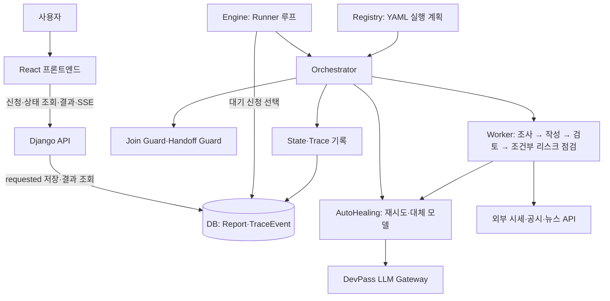
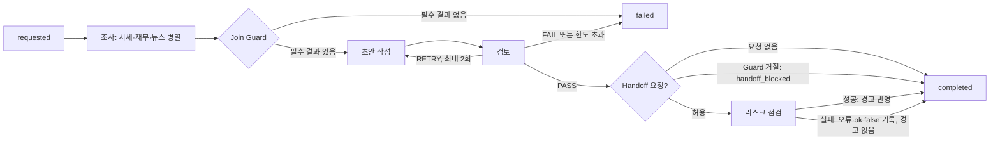

# 멀티 에이전트 아키텍처 설계서 — 모매매 AI 리포트 (산출물 1)

| 항목 | 내용 |
|---|---|
| 팀명 | 모매매 |
| 산출물 | 멀티 에이전트 아키텍처 설계서 |
| 프로젝트 주제 | AI 주식 분석·모의투자 AutoHealing 워크플로우 |
| 작성일·문서 버전 | 2026-10-08 · v1.0 |
| 팀원 및 담당 | 담당 1 심환석: 팀장·통합·배포·자동 리포트 / 담당 2 한다영: Worker·출력 계약 / 담당 3 신유빈: Orchestrator·Guard·Runner / 담당 4 김인혜: AutoHealing·장애 주입·복구 지표 / 담당 5 차성주: 프론트엔드·리포트 화면 |

이 문서는 구조와 동작의 설계서이며, 실제 장애 시험의 성공률·평균 복구 시간·화면 확인 결과는 별도 시험 기록에 남긴다.

## 목적과 사용자 시나리오

대표 사용자 ‘지효’는 주식 리포트의 용어가 어렵지만, 실제 돈을 넣기 전에 종목을 살펴보고 정한 가격으로 사고파는 과정을 연습하고 싶다. 종목 하나를 신청하면 조사 결과를 근거로 쓴 초안을 검토한 뒤 모의 투자 계획의 출처로 사용한다. 자동 종목 선정 경로에서는 규칙이 추린 후보를 별도 AI 팀이 검토한다. AI는 의견과 가격을 제안하며, 주문 수량·한도·체결은 결정론적 코드가 판단한다.

1. 정상: 종목 신청 → 조사 3개 병렬 → 초안 작성 → 검토 PASS → 리포트 완료 → 사용자가 확인 후 모의 실행.
2. 복구: 뉴스 모델 호출 실패 → 오류 종류에 맞게 재시도하거나 대체 모델로 전환 → 성공한 조사 결과로 리포트 완료. 선택 뉴스 Worker 전체가 실패해도 필수 시세·재무 결과가 있으면 계속한다.
3. 실패: 필수 조사가 실패하거나 단계 제한을 넘으면 후속 Worker를 건너뛰고 사유 코드를 남긴다. 검토 FAIL 또는 재작성 한도 초과도 실패로 끝난다.

| 사용자 단계 | 뒤에서 일하는 구성 | 장애가 났을 때 보이는 상태 |
|---|---|---|
| ① 만들기 | Orchestrator → 시세·재무·뉴스 조사 Worker 병렬 → Join Guard → 작성 Worker | 모델 fallback 기록 또는 필수 자료 누락에 따른 실패 사유 |
| ② 검토 | 검토 Worker(PASS·RETRY·FAIL) → 필요 시 작성 재실행 → 선택적 리스크 Handoff, 입력 Guard | 재작성 진행, 검토 실패, 위험 경고 |
| ③ 실행 | 추천 수집 → 리스크 엔진 → 모의 체결기 → 알림. AI가 주문을 내지 않음 | 실행 불가·미체결·체결·청산 알림 |
| 모든 단계 | 사전 정의된 YAML 계획을 Registry가 로딩·검증하고, `state.py`와 Trace가 진행 결과를 기록 | 현재 단계와 순서 있는 사건 기록 |
| 서비스 전체 | Docker, CI/CD, DB, SSE, Discord 알림 | 엔진 재시작 사유, 연결·발송 상태 |

## 협업 구조와 선정 이유

본 프로젝트는 **사전 정의된 Workflow를 중앙 Orchestrator가 관리하는 중앙 조정형 멀티 에이전트 구조**를 채택했다. 실행 순서·Worker 의존성·필수 및 선택 여부·검토 재작성 한도 등은 YAML에 미리 정의하고, `registry.py`가 실행 계획을 로딩·검증한다. Orchestrator는 검증된 계획에 따라 독립적인 조사 Worker를 병렬 실행하고, Join Guard로 필수 결과와 출력 계약을 확인한 뒤 작성·검토 Worker를 순차 실행한다. 검토 결과에 따라 재작성·실패 종료·조건부 Handoff를 제어하며, `state.py`와 Trace가 중간 결과와 실행 사건을 기록한다.

이 구조는 실행을 중앙에서 조정한다는 점에서 **Supervisor의 역할과 유사하지만**, LLM이 매 단계 다음 Agent를 동적으로 선택하는 방식은 아니다. 요청마다 새 실행 계획을 만드는 별도의 LLM 기반 Planner Agent도 구현하지 않았다. Worker와 Orchestrator는 엔진 프로세스 안에서 공통 `WorkerContext`·출력 계약으로 연결하고, 배포는 에이전트마다 컨테이너를 나누지 않고 웹·엔진·DB 등 서비스 역할로 나눈다. 작은 팀에서 배포·통신 복잡도를 줄이면서도 실행 계획, 계약 검증, 중앙 기록으로 책임 경계를 명확히 하기 위한 선택이다.

API는 신청을 DB의 `requested` 상태로 저장하고 진행·결과를 조회하게 한다. Runner가 신청을 골라 Orchestrator에 넘기며, Orchestrator가 Registry의 계획을 따라 Worker를 실행한다. Worker의 외부 자료 조회와 LLM 호출은 구분하고, 검증된 결과와 사건은 State/Trace를 통해 DB에 남긴다. 프론트엔드는 저장된 상태와 사건을 보여주며 직접 Worker를 실행하지 않는다.

그림의 두 AutoHealing 화살표는 별도 호출 두 번을 뜻하지 않는다. Orchestrator가 AutoHealing 호출기를 `WorkerContext.llm`에 넣어 주고, Worker가 그 호출기를 사용할 때 DevPass LLM Gateway 요청·재시도·대체 모델 전환이 수행된다.

두 팀의 실행 계획은 다음과 같다. `stock_report`는 사용자 종목 리포트를, `stock_selection`은 자동 경로의 후보 종목 선정을 맡는다. 둘 다 `required_optional` 정책을 사용하고, 필수 조사 결과가 있어야 다음 단계로 간다.

| 팀 | 병렬 조사 | 순차 작성·검토 | 검토 재작성 | Handoff |
|---|---|---|---|---|
| `stock_report` | 시세·재무 필수, 뉴스 선택 | `report_agent` → `review_agent` | 작성 Worker 최대 2회 재실행 | 검토 통과 후 필요 시 `risk_agent`, 최대 1 Hop |
| `stock_selection` | 후보 뉴스·공시 필수, 수급 선택 | `selector_agent` → `selection_review_agent` | 선정 Worker 최대 2회 재실행 | 없음 |

### 핵심 구성요소의 책임 경계

| 구성요소 | 담당 책임 | 담당하지 않는 일 |
|---|---|---|
| Orchestrator | 실행 순서·병렬 처리·Join·검토 분기·Handoff·종료 판단 | 개별 종목 분석 결과 직접 생성 |
| Registry | 사전 정의된 YAML 실행 계획 로딩·검증 | 요청별 신규 계획 동적 생성 |
| 조사·작성 Worker | 지정된 자료 조사 및 초안·선정안 생성 | 전체 Workflow의 최종 성공·실패 결정 |
| Review Worker | 근거 검토, PASS·RETRY·FAIL 및 수정 지시 생성 | 검토 대상 초안 직접 수정 |
| AutoHealing | LLM 호출 오류에 따른 재시도·대체 모델 전환·차단 정책 | 전체 Workflow의 최종 종료 상태 결정 |
| State / Trace | 중간 결과·오류·비용·진행 사건 기록 | 실행 순서 및 다음 Worker 결정 |

## 역할과 실행 순서

이 그림은 종목 리포트 팀의 흐름이다. Handoff가 거절되거나 `risk_agent`가 실패해도 검토 PASS 결과는 유지되고 최종 상태는 `completed`다. 허용된 Handoff에서 Worker가 실패하면 `agent_failed`와 `handoff_completed(ok: false)`가 남으며, 성공 결과가 없으므로 위험 경고 블록은 붙지 않는다. 현재 화면의 실행 사건·Worker 상태에서는 실패를 확인할 수 있지만, 완료된 리포트 본문에 리스크 검토 미실시 경고를 별도로 넣지는 않는다. 따라서 리포트 생성은 완료하되, 리스크 검토가 수행되지 않았음을 사용자에게 더 분명히 표시하는 것은 향후 개선 과제다.

자동 선정 경로는 규칙 코드가 후보 표를 만든 뒤 `news_screen_agent`·`filing_screen_agent`·`flow_agent`를 병렬 실행하고, 필수 결과를 확인한 다음 `selector_agent`가 1~5개 선정안을 작성한다. `selection_review_agent`가 근거와 후보 범위를 검토하며 RETRY면 선정안을 재작성한다. 선정 결과는 자동 리포트 경로의 추가 규칙 검증을 거친다. AI 선정과 모의 주문은 별개다.

### 에이전트별 책임·입출력

모든 Worker는 종목·작업 ID, 시도 번호, 이전 결과 참조, 제한 시간 등이 든 `WorkerContext`를 입력으로 받으며, 아래의 출력 계약을 따르는 딕셔너리를 반환한다. 표의 모델은 YAML에 선언한 주 모델이며 호출 실패 시 대체 모델 선택은 AutoHealing 절의 규칙을 따른다.

| 팀 / Worker | 고유 책임과 주요 입력 | 출력 계약 | 주 모델 |
|---|---|---|---|
| 리포트 `market_agent` | 장마감 가격·완성 일봉으로 시세·추세·지표 정리 | `MarketResult` | `gemini-3.8-flash` |
| 리포트 `fundamental_agent` | OpenDART 재무·공시 정리, 자료 부재 표시 | `FundamentalResult` | `gemini-3.8-flash` |
| 리포트 `news_agent` | 최근 뉴스·증권사 헤드라인으로 분위기 정리(선택) | `NewsResult` | `gemini-3.8-flash` |
| 리포트 `report_agent` | 성공한 조사 결과와 재작성 지시로 Markdown 초안 작성 | `ReportDraft` | `gpt-5.6-luna` |
| 리포트 `review_agent` | 초안과 조사 근거 대조, PASS·RETRY·FAIL 및 리스크 요청 판단 | `ReviewResult` | `claude-opus-5-5` |
| 리포트 `risk_agent` | 검토 Handoff와 저장된 근거로 위험 경고 작성, 본문 수정 금지 | `RiskResult` | `deepseek-v4.1-flash` |
| 선정 `news_screen_agent` | 후보 종목의 최근 뉴스·재료·악재 확인 | `CandidateNewsResult` | `gemini-3.8-flash` |
| 선정 `filing_screen_agent` | 후보의 최근 공시에서 위험 신호 확인 | `FilingCheckResult` | `gemini-3.8-flash` |
| 선정 `flow_agent` | 집계된 외국인·기관 수급 해석(선택) | `FlowResult` | `gemini-3.8-flash` |
| 선정 `selector_agent` | 후보 표와 조사 결과로 1~5개 종목 순위·근거 작성, 가격 제안 금지 | `SelectionDraft` | `gpt-5.6-luna` |
| 선정 `selection_review_agent` | 선정안의 근거·후보 범위 검사, PASS·RETRY·FAIL 판단 | `ReviewResult` | `claude-opus-5-5` |

#### 담당 2: 종목 리포트 Worker 상세

아래 표는 종목 리포트 팀의 6개 Worker에 대한 역할·책임·입출력·자료·실패 처리다. 모든 Worker의 입력은 `WorkerContext`이며, 출력 딕셔너리는 표시한 계약으로 검증된다. LLM 호출 오류는 공통 AutoHealing 호출기가 최대 4회 시도·대체 모델 전환을 처리한다. 표의 실패 처리는 그 뒤에도 결과를 얻지 못했거나 외부 자료가 없을 때의 팀 정책을 뜻한다.

| Worker / 책임 | 주요 입력 | 사용 자료와 코드의 검증 | 출력 계약 / 주 모델 | 실패·자료 부재 시 처리 |
|---|---|---|---|---|
| `market_agent` — 시세·차트 조사 | 종목 코드·시장, 직전 정규장 종가와 완성 일봉 | `trading.market.closes`·`completed_candles`로 RSI·변동성·지지·저항·손절가 등을 코드가 계산하고 LLM의 숫자를 덮어쓴다. | `MarketResult` / `gemini-3.8-flash` | 일봉·종가가 없으면 `WorkerError`. 필수 조사라 최종 실패 시 다음 Join을 막는다(단계 시간 초과는 `timeout`). |
| `fundamental_agent` — 재무·공시 조사 | 종목 코드·시장, DART 재무와 최근 30일 공시 | OpenDART·장기투자 재무 자료로 PER·PBR 등 지표를 코드가 계산하고, 실제 조회된 공시만 남긴다. 공시 제목은 `clean_text`를 통과한다. | `FundamentalResult` / `gemini-3.8-flash` | DART 키 없음·조회 실패·지연은 자료 없음과 `metrics: null`로 계속한다. LLM까지 최종 실패하면 필수 조사라 Join을 막는다. |
| `news_agent` — 뉴스·심리 조사 | 종목 코드·시장, 최근 뉴스 제목과 증권사 헤드라인 | 최근 7일 Google 뉴스 RSS·최근 30일 증권사 헤드라인을 정리한다. 제목·매체는 `clean_text`로 거르고, 받은 제목만 결과에 남긴다. | `NewsResult` / `gemini-3.8-flash` | 조회 실패·자료 없음은 사유를 표시하고 중립 심리·점수 `null`로 계속한다. LLM 최종 실패도 선택 조사라 뉴스 결과를 빼고 진행한다. |
| `report_agent` — 리포트 초안 작성 | 성공한 조사 결과 전체; RETRY 때 이전 초안과 검토 수정 지시 | 조사 결과의 `evidence`만 인용하고, 손절가는 `market_agent.stop`으로 덮어쓴다. AI가 의견·진입가·목표가·본문을 제안한다. | `ReportDraft` / `gpt-5.6-luna` | 시세 조사 결과가 없으면 작성하지 않는다. 출력 계약·LLM 최종 실패는 필수 작성 실패로 종료한다. 검토 RETRY면 수정 지시를 받아 최대 2회 다시 쓴다. |
| `review_agent` — 초안 근거 검토 | 최신 `ReportDraft`, 시세·재무·뉴스 조사 결과 전체 | 주장·인용·가격 순서와 종가 대비 진입가 5% 범위 등을 대조한다. 투자유의 신호는 조건부 Handoff로 넘기며 초안을 직접 수정하지 않는다. | `ReviewResult` / `claude-opus-5-5` | 고칠 수 있으면 `RETRY`와 지시를 내고, `FAIL` 또는 재작성 한도 초과는 `review_failed`. Worker 자체가 최종 실패하면 `agent_failed`. |
| `risk_agent` — 조건부 위험 경고 | 검토의 Handoff, 앞선 조사·초안·검토 결과 | 증권사 투자유의 지정과 변동성·공시·뉴스를 본다. 지정이 있으면 위험 단계의 하한을 코드가 보장하며 원래 본문은 수정하지 않는다. | `RiskResult` / `deepseek-v4.1-flash` | Handoff 거절·Worker 실패는 Trace에 남기고 경고 결과 없이 검토 PASS 리포트를 완료한다. 지정 조회 불가 시 확인하지 못했음을 경고한다. |

`registry.py`가 YAML의 Worker·단계·의존성·정책을 검증한다. `orchestrator.run_report`는 단계 순으로 `state.set_step`을 호출하고, 각 Worker에 `WorkerContext`를 만든다. 조사는 병렬, 작성과 검토는 순차다. Worker는 State를 직접 저장하지 않는다. Orchestrator가 `_guarded` 같은 내부 키를 제거하고 출력 계약을 다시 검증한 뒤 `state.add_result`로 저장한다.

시세 Worker는 가격·차트, 재무 Worker는 재무·공시, 뉴스 Worker는 뉴스·심리를 담당한다. 작성 Worker 하나가 초안을 바꾸고 검토 Worker 하나가 근거를 대조한다. 리스크 Worker는 Handoff가 허용될 때 경고만 더한다. 역할이 겹쳐 한 결과를 두 Worker가 수정하는 경로는 없다.

## 공유 State, Join과 부분 실패

State의 유일한 쓰기 경로는 `state.start`, `set_step`, `record`, `add_result`, `add_error`, `add_cost`, `finish`다. DB의 리포트 레코드에 현재 단계·Worker별 중간 결과·오류·비용을 모으고, Trace는 리포트별 순서 번호로 사건을 저장한다. Worker 사이에서는 공유 메모리를 직접 수정하지 않고 `WorkerContext.inputs`에 성공한 앞 단계 결과를 복사해 전달한다. 재작성 때에는 최신 초안과 수정 지시를 사용하며, Handoff의 `memory_refs`는 State 결과 키를 가리킨다. `workflow_completed` 또는 `workflow_failed`를 먼저 남기고 `finish`를 호출한다.

Join Guard는 의존 단계에서 성공한 결과만 계약 재검증 후 선택한다. 작성에는 성공한 조사 결과를, 검토에는 최신 초안과 성공한 조사 결과 전체를 준다. `required_optional`에서는 필수 실패만 중단하고, `fail_fast`에서는 어떤 Worker 실패도 중단하며, `best_effort`에서는 가능한 결과로 진행한다. 초안 또는 검토 결과가 없으면 완료로 표시하지 않는다. 직접적인 필수 Worker 시간 초과는 `timeout`, 나머지 필수 결과 누락·계약 오류는 `join_blocked`다.

검토 RETRY는 `review_retry` 사건과 수정 지시를 남기고 작성 Worker를 재실행한다. YAML의 실제 한도는 2회, Registry 허용 상한은 3회다. `agent_started.details.attempt`는 Worker 실행 횟수이고, `agent_failed`·`agent_retry.details.attempt`는 그 실행 안의 LLM 호출 순번이다. `agent_completed.details.attempts`는 해당 Worker 실행의 전체 LLM 호출 수다.

LLM 호출은 단계의 남은 시간 안에서만 기다린다. 오류 종류에 따른 재시도와 대체 모델 전환은 아래 AutoHealing 절의 규칙을 따른다. 실패 호출 비용까지 `state.add_cost`로 합산해 `Report.cost_usd`와 전체 종료 Trace에 남긴다.

## AutoHealing: 호출 실패와 복구

Orchestrator는 Worker 실행마다 `healing.make_caller`로 호출기를 만들어 `WorkerContext.llm`에 넣는다. 호출기는 DevPass LLM Gateway에 `complete_json_once`로 한 번씩 요청하고, 응답의 JSON 형식과 출력 계약을 검사한다. 한 번의 `ctx.llm(...)` 호출에서 모델당 최대 2회, 전체 최대 4회 시도한다. 각 요청은 최대 60초이고 단계 제한 시간 180초를 넘지 않는다. 모든 시도가 실패하면 `LlmGaveUp`을 Orchestrator에 돌려준다.

| 오류 | 판정과 다음 동작 |
|---|---|
| `timeout` | 주 모델의 시간 초과는 곧바로 대체 모델로 전환한다. 대체 모델의 시간 초과는 같은 모델을 한 번 더 시도할 수 있다. 대체 모델을 고를 수 없으면 주 모델을 한 번 더 시도할 수 있다. |
| `server_error` | HTTP 429·5xx 또는 연결 실패로 판정하고 2초를 기다린 뒤 같은 모델을 한 번 더 호출한다. |
| `bad_output` | 빈 응답, 잘못된 JSON 또는 출력 계약 위반이다. 오류 내용을 프롬프트에 붙여 같은 모델에 다시 요청한다. |
| `unknown` | 그 밖의 오류는 같은 모델을 재시도하지 않고 대체 모델로 전환한다. |

대체 모델은 YAML의 `fallbacks`를 순회하지 않는다. `FALLBACK_POOL`(`gpt-5.6-luna` → `gemini-3.8-flash` → `deepseek-v4.1-flash`)에서 주 모델과 이미 사용한 모델을 제외하고, 차단되지 않은 첫 모델 하나를 고른다. YAML의 `fallbacks`는 실행 계획 화면에 표시할 모델을 나타낸다.

모델이 연속 3회 실패하면 Circuit Breaker가 그 모델을 300초 동안 차단한다. 차단된 모델은 호출하지 않고 `agent_failover(reason: "circuit_open")`를 남긴다. 정상 응답을 받으면 해당 모델의 연속 실패 횟수를 초기화한다. 일반 리포트는 엔진 프로세스의 차단 상태를 공유하지만, 장애 주입을 켠 리포트의 주입 실패는 리포트별 차단 상태에서 세어 다른 리포트의 모델 사용을 막지 않는다.

리포트 신청 시 `chaos` 설정을 주면 대상 Worker, 실패 종류(`timeout`·`server_error`·`bad_output`), 확률, 적용 범위(주 모델만 또는 모든 모델), seed를 검사해 저장한다. 실제 모델 호출 직전에 실패를 주입하고, 이후에는 실제 장애와 같은 복구 경로를 사용한다. 주입 여부는 `agent_failed.details.injected`에 기록한다. 주입한 시간 초과는 실제 60초를 기다리지 않으므로 주입 사례의 복구 시간은 실제 네트워크 시간 초과와 같은 의미로 해석하지 않는다.

호출기의 실패는 `agent_failed(final: false)`로, 같은 모델 재시도는 `agent_retry`로, 대체 모델 전환은 `agent_failover`로 Trace에 남는다. Worker가 최종 실패하면 Orchestrator가 `agent_failed(final: true)`를 기록하고 필수·선택 정책에 따라 계속하거나 종료한다. `stats.report_recovery`는 한 Worker 실행의 첫 호출 실패를 장애 1건으로 세고, 같은 실행의 완료 여부로 복구·미복구를 판단한다. `GET /api/reports/recovery-stats`는 기간별 장애 유형·Worker별 건수·최근 사건과 호출 장애 자동 복구율을 계산한다. 이 비율은 장애 주입 시나리오별 성공률과 별개의 지표다.

## Handoff와 Guard

검토 결과에 Handoff 요청이 있으면 계획의 `review_agent → risk_agent` 경로, 최대 Hop, 신청자 ID, 메시지의 지시문·비밀 값 모양을 검사한다. 허용되면 `handoff_started`를 남기고 `ctx.handoff`에 `task_id`, `trace_id`, 전달 주체·대상, 목적, State 결과 키 참조, 제약, 기대 계약, 시도 횟수, 사용자 ID, Hop 수를 담아 리스크 Worker를 실행한다. 거절은 `handoff_blocked`로 기록하며 검토를 통과한 초안은 유지한다. 리스크 결과에 경고가 있으면 본문 위에 표시한다. 외부 뉴스·공시 문자열은 `guards.clean_text`로 정리하고 제거 사유를 `_guarded`와 완료 Trace에 남긴다.

| Handoff 데이터 | 의미와 통제 |
|---|---|
| `task_id`, `trace_id` | 같은 리포트의 작업·사건을 연결한다. |
| `from_agent`, `to_agent`, `objective`, `reason` | 검토 Worker에서 리스크 Worker로 넘기는 목적과 요청 사유. 등록된 경로만 허용한다. |
| `inputs.memory_refs` | 앞선 Worker 결과의 State 키 목록. 원문 전체를 새 지시로 신뢰하지 않는다. |
| `constraints`, `expected_output` | 본문 수정·매매 권유 금지 등 제약과 `RiskResult` 계약. |
| `attempt`, `user_id`, `hop_count` | 실행 시도·신청자·전달 횟수를 확인해 재전달과 권한 혼동을 막는다. |

## 실패와 종료

| 대표 시나리오 | 설계상 기대 동작 |
|---|---|
| 선택 `news_agent` 실패 | 실패를 기록하되 필수 시세·재무 결과가 있으면 리포트 작성을 계속한다. |
| 필수 `market_agent` 실패 | 직접적인 시간 초과는 `timeout`; 그 밖의 필수 결과 누락은 다음 단계 Join Guard에서 차단해 `join_blocked`로 종료한다. |
| 검토 `RETRY` | 수정 지시를 남기고 `report_agent`를 다시 실행해 재검토한다. 현재 계획은 재작성 최대 2회이며 한도를 넘으면 `review_failed`다. |
| LLM 모델 장애 | 오류를 분류해 같은 모델을 재시도하거나 대체 모델로 전환한다. 허용 시도·시간을 모두 소진하면 Worker 실패와 팀의 필수·선택 정책에 따라 처리한다. |
| Handoff 거절 또는 리스크 Worker 실패 | 사유 또는 실패 사건을 기록하고, 검토를 통과한 리포트는 경고 결과 없이 완료한다. |

표는 코드에서 정한 **기대 동작**이다. 장애 주입 시 실제 성공 여부·복구 시간·화면 결과는 별도 장애 시험 보고서에서 확인한다.

`workflow_failed.details.reason`은 `join_blocked`, `review_failed`, `timeout`, `agent_failed`, `no_llm`, `engine_restarted`, `expired`, `exception` 중 하나다. 필수 결과가 없거나 계약이 틀리면 Join이 막고 후속 Worker에 `agent_skipped`를 남긴다. 검토 FAIL·반복 한도 초과는 `review_failed`다. Join이 없는 단계의 필수 Worker 실패는 `agent_failed`, 실행 시작 시 LLM 연결 설정이 없으면 `no_llm`이다. 예상하지 못한 오류는 `exception`, 재시작 때 남은 실행은 `engine_restarted`다.

`run_engine`이 매 바퀴 `runner.tick`을 호출한다. Runner는 신청 후 24시간이 지난 `requested`를 AI 호출 없이 `failed(expired)`로 끝내고 행을 남긴다. 남은 신청은 오래된 순서대로 하나씩 실행하며 동시 실행은 1건으로 제한한다. `recover`는 이전 실행이 남긴 `running`을 실패로 정리한다. `shutdown`은 실행 스레드를 최대 10초 기다린다. 종료된 사용자 리포트의 알림은 엔진 루프의 `alerts.sweep_finished`가 보내며, 실패 알림은 마지막 실패 사유 코드를 쉬운 문장으로 바꿔 전달한다. 자동 리포트의 종료 처리는 `auto.after_finish`가 맡는다.

## 역할 중복·책임 공백 점검

| 확인 항목 | 점검 결과와 책임 경계 |
|---|---|
| 조사와 작성 | 조사 Worker는 각자 자료의 근거를 정리하고, 리포트·선정안의 문장과 순위는 작성 Worker만 만든다. 선택 조사 실패는 필수 결과가 있을 때만 허용한다. |
| 작성과 검토 | 검토 Worker는 PASS·RETRY·FAIL 및 수정 지시만 낸다. 초안·선정안을 직접 고치지 않아 작성 책임이 겹치지 않는다. |
| 검토와 위험 경고 | 검토가 Handoff를 요청해도 `risk_agent`는 경고만 추가하고 통과한 본문을 바꾸지 않는다. 선정 팀에는 Handoff 경로가 없다. |
| 실행 계획·기록·복구 | Registry는 계획 검증, Orchestrator는 실행·Join·종료 판단, `state.py`는 DB 쓰기, AutoHealing은 LLM 호출 복구를 맡는다. Worker가 직접 완료 상태를 선언하거나 DB를 수정하지 않는다. |
| AI와 모의 주문 | AI 결과를 곧바로 주문으로 실행하지 않는다. 사용자의 계획 선택과 규칙 기반 리스크 엔진·모의 체결기가 별도 책임을 가진다. |

현재 병합된 실행 계획과 Worker 등록을 기준으로 두 팀의 **11개 Worker** 및 리포트 팀의 **1개 조건부 Handoff**를 확인했다. Registry는 사전 정의된 계획의 로딩·검증, Orchestrator는 Worker 실행·Join·검토 분기·재시도·종료 판단, State/Trace는 중간 결과와 사건 기록, AutoHealing은 개별 LLM 호출 장애 복구를 맡는다. 별도의 동적 Supervisor 또는 LLM 기반 Planner Agent 없이 **사전 정의된 실행 계획과 조건 기반 분기**로 협업 흐름을 제어한다. 이는 설계 범위에 따른 역할 분리이며, 요청별 계획 생성 기능이 없다는 사실을 책임 공백으로 간주하지 않는다. 반면 실제 장애 복구율·평균 복구 시간·AWS 화면 확인은 이 설계만으로 증명할 수 없으므로 별도 장애 시험 및 운영 확인 기록의 검증 대상으로 남긴다.
