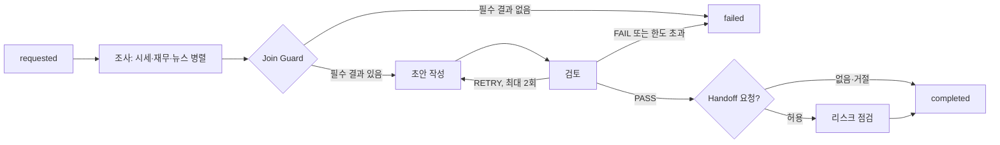

# 종이배 AI 리포트 워크플로우 설계서 ①

작성: 2026-10-08. 구현 기준: `docs/tasks/00-공통.md`, `docs/tasks/03-orchestrator.md`.

## 목적과 사용자 시나리오

처음 주식 리포트를 읽는 사용자가 종목 하나를 신청하면, 조사 결과를 근거로 쓴 초안을 검토한 뒤 모의 투자 계획의 출처로 사용한다. AI는 의견과 가격을 제안하며, 주문 수량·한도·체결은 결정론적 코드가 판단한다.

1. 정상: 종목 신청 → 조사 3개 병렬 → 초안 작성 → 검토 PASS → 리포트 완료 → 사용자가 확인 후 모의 실행.
2. 복구: 뉴스 모델 호출 실패 → 예비 모델로 전환 → 성공한 조사 결과로 리포트 완료. 선택 뉴스 Worker 전체가 실패해도 필수 시세·재무 결과가 있으면 계속한다.
3. 실패: 필수 조사가 실패하거나 단계 제한을 넘으면 후속 Worker를 건너뛰고 사유 코드를 남긴다. 검토 FAIL 또는 재작성 한도 초과도 실패로 끝난다.

| 사용자 단계 | 뒤에서 일하는 구성 | 장애가 났을 때 보이는 상태 |
|---|---|---|
| ① 만들기 | Orchestrator → 시세·재무·뉴스 조사 Worker 병렬 → Join Guard → 작성 Worker | 모델 fallback 기록 또는 필수 자료 누락에 따른 실패 사유 |
| ② 검토 | 검토 Worker(PASS·RETRY·FAIL) → 필요 시 작성 재실행 → 선택적 리스크 Handoff, 입력 Guard | 재작성 진행, 검토 실패, 위험 경고 |
| ③ 실행 | 추천 수집 → 리스크 엔진 → 모의 체결기 → 알림. AI가 주문을 내지 않음 | 실행 불가·미체결·체결·청산 알림 |
| 모든 단계 | Planner: YAML 실행 계획, Memory Keeper: `state.py`와 Trace | 현재 단계와 순서 있는 사건 기록 |
| 서비스 전체 | Docker, CI/CD, DB, SSE, Discord 알림 | 엔진 재시작 사유, 연결·발송 상태 |

## 역할과 실행 순서

`registry.py`가 YAML의 Worker·단계·의존성·정책을 검증한다. `orchestrator.run_report`는 단계 순으로 `state.set_step`을 호출하고, 각 Worker에 `WorkerContext`를 만든다. 조사는 병렬, 작성과 검토는 순차다. Worker는 State를 직접 저장하지 않는다. Orchestrator가 `_guarded` 같은 내부 키를 제거하고 출력 계약을 다시 검증한 뒤 `state.add_result`로 저장한다.

시세 Worker는 가격·차트, 재무 Worker는 재무·공시, 뉴스 Worker는 뉴스·심리를 담당한다. 작성 Worker 하나가 초안을 바꾸고 검토 Worker 하나가 근거를 대조한다. 리스크 Worker는 Handoff가 허용될 때 경고만 더한다. 역할이 겹쳐 한 결과를 두 Worker가 수정하는 경로는 없다.

## 공유 State, Join과 부분 실패

State의 유일한 쓰기 경로는 `state.start`, `set_step`, `record`, `add_result`, `add_error`, `add_cost`, `finish`다. Trace는 리포트별 순서 번호로 저장한다. `workflow_completed` 또는 `workflow_failed`를 먼저 남기고 `finish`를 호출한다.

Join Guard는 의존 단계에서 성공한 결과만 계약 재검증 후 선택한다. 작성에는 성공한 조사 결과를, 검토에는 최신 초안과 성공한 조사 결과 전체를 준다. `required_optional`에서는 필수 실패만 중단하고, `fail_fast`에서는 어떤 Worker 실패도 중단하며, `best_effort`에서는 가능한 결과로 진행한다. 초안 또는 검토 결과가 없으면 완료로 표시하지 않는다. 직접적인 필수 Worker 시간 초과는 `timeout`, 나머지 필수 결과 누락·계약 오류는 `join_blocked`다.

검토 RETRY는 `review_retry` 사건과 수정 지시를 남기고 작성 Worker를 재실행한다. YAML의 실제 한도는 2회, Registry 허용 상한은 3회다. `agent_started.details.attempt`는 Worker 실행 횟수이고, `agent_failed`·`agent_retry.details.attempt`는 그 실행 안의 LLM 호출 순번이다. `agent_completed.details.attempts`는 해당 Worker 실행의 전체 LLM 호출 수다.

LLM 호출은 단계의 남은 시간 안에서만 기다린다. timeout은 같은 모델을 다시 호출하지 않고 YAML의 다음 fallback으로 간다. 서버 오류·출력 오류는 같은 모델을 한 번 재시도할 수 있다. 실패 호출 비용까지 `state.add_cost`로 합산해 `Report.cost_usd`와 전체 종료 Trace에 남긴다.

## Handoff와 Guard

검토 결과에 Handoff 요청이 있으면 계획의 `review_agent → risk_agent` 경로, 최대 Hop, 신청자 ID, 메시지의 지시문·비밀 값 모양을 검사한다. 허용되면 `handoff_started`를 남기고 `ctx.handoff`에 `task_id`, `trace_id`, 전달 주체·대상, 목적, State 결과 키 참조, 제약, 기대 계약, 시도 횟수, 사용자 ID, Hop 수를 담아 리스크 Worker를 실행한다. 거절은 `handoff_blocked`로 기록하며 검토를 통과한 초안은 유지한다. 리스크 결과에 경고가 있으면 본문 위에 표시한다. 외부 뉴스·공시 문자열은 `guards.clean_text`로 정리하고 제거 사유를 `_guarded`와 완료 Trace에 남긴다.

## 실패와 종료

`workflow_failed.details.reason`은 `join_blocked`, `review_failed`, `timeout`, `engine_restarted`, `exception` 중 하나다. 필수 결과가 없거나 계약이 틀리면 Join이 막고 후속 Worker에 `agent_skipped`를 남긴다. 검토 FAIL·반복 한도 초과는 `review_failed`다. 예상하지 못한 오류는 `exception`, 재시작 때 남은 실행은 `engine_restarted`다.

`run_engine`이 매 바퀴 `runner.tick`을 호출한다. Runner는 신청 후 24시간이 지난 `requested`를 AI 호출 없이 `failed(expired)`로 끝내고 행을 남긴다. 남은 신청은 오래된 순서대로 하나씩 실행하며 동시 실행은 1건으로 제한한다. `recover`는 이전 실행이 남긴 `running`을 실패로 정리한다. `shutdown`은 실행 스레드를 최대 10초 기다린다. 실제 DevPass 키를 사용하는 리포트 1건의 비용·본문·화면·알림은 통합 시험에서 검증한다.

## 팀별 보강 자리

- 담당 2: Worker별 자료 출처, 입력 정리 사례, 출력 계약 표와 실제 모델 시험 결과.
- 담당 4: timeout·fallback·Circuit Breaker 세부 복구 흐름과 장애 시험 지표.
- 담당 1: 자동 리포트 종료 처리와 실제 운영 환경에서 Runner 활성화 절차.
